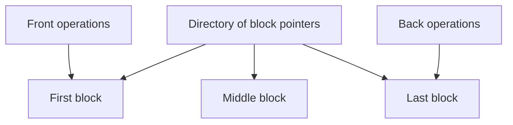

Adding an element to the front of a vector shifts its existing elements.
If your algorithm regularly adds or removes items at either end,
`std::deque` avoids that repeated shifting. Its name means **double-ended
queue**, pronounced "deck". It also supports O(1) access by index.

## Working with both ends

`push_front` and `push_back` add an element at the chosen end.
`pop_front` and `pop_back` remove one. The pop operations do not return the
removed value; read it with `front()` or `back()` before removing it if
you need to keep it.

```cpp
#include <cassert>
#include <deque>

int main() {
    std::deque<int> d = {2, 3};
    d.push_front(1);
    d.push_back(4);
    assert((d == std::deque<int>{1, 2, 3, 4}));

    d.pop_front();
    d.pop_back();
    assert((d == std::deque<int>{2, 3}));
    assert(d.front() == 2 && d.back() == 3);
    assert(d.at(1) == 3);
}
```

Calling `front`, `back`, or either pop on an empty deque is undefined
behavior in C++20, with no guaranteed result or automatic error.
`d[i]` is also unchecked, while `d.at(i)` throws `std::out_of_range` for an
invalid index. Both provide O(1) access.

Single-element insertion and removal at either end have O(1) container
complexity. An insertion may still allocate storage, so this is not a
promise that every call takes the same elapsed time. Inserting or erasing
in the middle can take O(n), where n is the number of elements, because
existing values may need to shift.

## Why its storage is not contiguous

A typical implementation stores elements in separate fixed-size blocks
and uses a growable directory of pointers to find those blocks. This
**segmented storage** explains how it can grow at either end without moving
the existing elements into one larger buffer. Unlike vector, its elements
have no contiguous-storage guarantee. The diagram shows the idea,
not a required layout or a particular block size:



Indexing finds the right block and then the element within it. That takes
constant time, but adds indirection compared with a contiguous vector.
Deque has no `data()` pointer covering every element and no `reserve()`
operation. Do not treat an element pointer as the start of a contiguous
array spanning the deque.

## What remains valid after a change

An **iterator** represents a traversal position. A pointer or reference
identifies an element, with a reference acting as an alias for that element.
These are different ways to retain access, and deque treats them differently:

- Adding at either end preserves pointers and references to existing
  elements, but invalidates all iterators, including the old `end()`.
- Popping at an end invalidates handles to the removed element, while
  iterators, pointers, and references to surviving elements remain valid.
  The old `end()` is invalidated by `pop_back`, and by `pop_front` when it
  removes the last element.
- Middle insertion, or erasure that touches neither end, invalidates all
  iterators, pointers, and references to elements. Do not carry saved
  handles across those operations.

An index is different again. If an element was at index 0, `push_front`
moves its index to 1 even though a reference to the element stays valid.
`pop_front` shifts the surviving indices back. Stable references do not
mean stable positions.

## When a deque fits

Choose a deque when you need efficient changes at both ends together with
indexed access. If you mainly append at the back and scan the sequence,
a vector is often simpler and more cache-friendly; measure representative
operations when either container could work.

The [sliding-window maximum](/dsa/patterns/monotonic-structures/sliding-window-maximum)
uses a deque of indices into the input array. It removes expired candidates
from the front and candidates with smaller or equal values from the back.
Each input index enters
once and leaves at most once, so the total deque work is O(n). It does not
depend on stable indices into the deque itself.

## Related C++ tools

- [std::vector](/cpp/vector) offers contiguous storage and efficient back growth.
- [std::stack / std::queue](/cpp/stack-queue) builds simpler stack and queue interfaces over a container.
