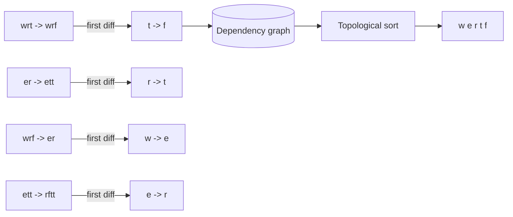

## Problem

Given a list of words from an "alien dictionary" sorted by an unknown
character order, derive a valid ordering of the characters. Return any
valid order, or "" if none exists.

**Constraints**

- `1 <= words.length <= 100`
- `1 <= words[i].length <= 100`
- All characters are lowercase English letters.

**Example**

```text
Input:  words = ["wrt", "wrf", "er", "ett", "rftt"]
Output: "wertf"    // w before e before r before t before f
```

## Brute force

There is no meaningful brute force: the alphabet's order is a constraint
satisfaction problem, and enumerating permutations of up to 26 letters
(26! ≈ 4 * 10^26) to check them against the word list is not an answer.
The entire problem is *reading the constraints out of the data*, and
that reading is the canonical insight.

## The extraction: the first differing pair is the constraint

The insight that unlocks the problem: **the dictionary is sorted**, so
the *only* information about character order comes from the first
differing position of each adjacent word pair. `"wrt"` before `"wrf"`
differs at the last character (`t` vs `f`), and that pair says exactly
`t` comes before `f`, and *nothing else* (everything before the
difference is equal, so it says nothing; everything after is masked,
because the earlier difference already decided the sort).



So: for each adjacent word pair, walk both words together, and at the
first position where they differ, add the edge
`first[i] -> first[i+1]`... rather, `words[k][i] -> words[k+1][i]`,
and stop scanning the pair (later positions are masked). Build this
edge set, and the answer is a **topological order** of that graph,
which is exactly the
[course schedule](/dsa/patterns/graph-specializations/course-schedule)
machinery applied to a *derived* graph.

```cpp
std::string alienOrder(const std::vector<std::string>& words) {
    std::vector<std::vector<int>> adj(26);
    std::vector<int> inDegree(26, 0);
    std::vector<char> present(26, 0);

    for (const std::string& word : words) {
        for (char c : word) {
            present[c - 'a'] = 1;        // every letter that ever appears
        }
    }

    for (int k = 0; k + 1 < static_cast<int>(words.size()); ++k) {
        const std::string& a = words[k];
        const std::string& b = words[k + 1];
        int limit = static_cast<int>(std::min(a.size(), b.size()));
        bool foundDifference = false;
        for (int i = 0; i < limit; ++i) {
            if (a[i] != b[i]) {
                int from = a[i] - 'a';
                int to = b[i] - 'a';
                adj[from].push_back(to);
                ++inDegree[to];
                foundDifference = true;
                break;                    // later positions are masked
            }
        }
        if (!foundDifference && a.size() > b.size()) {
            return "";                    // prefix anomaly: "abc" before "ab"
        }
    }

    // Kahn's topological sort over the derived graph.
    std::queue<int> ready;
    for (int c = 0; c < 26; ++c) {
        if (present[c] && inDegree[c] == 0) {
            ready.push(c);
        }
    }

    std::string order;
    while (!ready.empty()) {
        int c = ready.front();
        ready.pop();
        order += static_cast<char>('a' + c);
        for (int next : adj[c]) {
            if (--inDegree[next] == 0) {
                ready.push(next);
            }
        }
    }

    int letters = 0;
    for (int c = 0; c < 26; ++c) {
        letters += present[c] ? 1 : 0;
    }
    return static_cast<int>(order.size()) == letters
        ? order                          // every letter placed: valid order
        : "";                             // a cycle remains: no valid order
}
```

The failure check is the problem's second insight, and the one people
miss: **a cycle in the derived graph is a contradiction** (a before b
*and* b before a), detected for free by Kahn's incomplete ordering
(the same [cycle detection](/dsa/patterns/graph-specializations) as
course schedule: count the placed letters against the present letters).
And there is a second contradiction the statement permits: the
**prefix anomaly**, a longer word sorted *before* its own prefix
(`"abc"` before `"ab"`), which no order can explain, and which must
be checked explicitly during the pairwise scan because the edge set
does not express it.

A third subtlety worth naming, because it produces silently wrong
answers rather than exceptions: words may contain letters that appear
in *no* constraint pair (single-letter lists, isolated words), and
those letters must still appear in the output (`present` tracks them),
with their position among themselves arbitrary: any valid order
answers, which is why "return *a* valid order" is the honest phrasing
and why the queue's processing order (alphabetical, here) silently
picks one.

## Complexity

| Approach | Time | Space |
| --- | --- | --- |
| Extract pairs + Kahn | O(total characters + 26 + E) | O(26 + E) |

Linear in the input size: each adjacent pair contributes at most one
edge, scanned in the length of the shorter word, and the sort runs over
at most 26 nodes. This is the canonical *derived-graph* problem in
[graph specializations](/dsa/patterns/graph-specializations): the
graph is not given, it is *read out of the data by a stated rule*, and
that reading (plus the two contradictions that can invalidate it) is
the entire difficulty, with the algorithm itself being standard.

## Related C++ tools

- [std::stack / std::queue](/cpp/stack-queue): the LIFO and FIFO adapters.
- [std::string](/cpp/string): substr, find, and the operations that copy.
