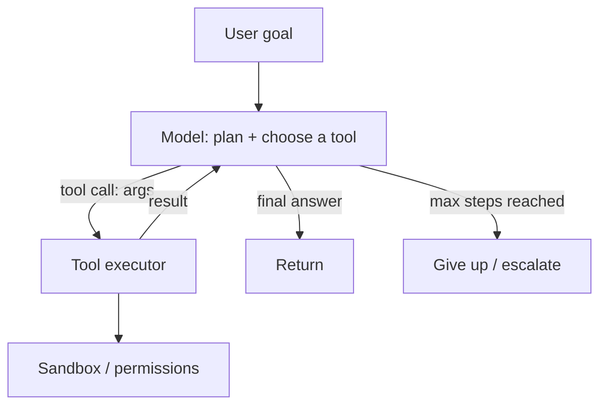

An **agent** is a language model in a *loop*: instead of one
generation, the model is given **tools** (functions it can call:
search, a database query, a calculator, an API, code execution),
decides which to call, sees the results, and decides again — until
it produces a final answer. The pattern ("ReAct" and its relatives:
reason → act → observe → repeat) turns a text generator into
something that can *do things*, and it is where the LLM era's
systems engineering gets genuinely hard: the model is now driving a
loop with *side effects*, *unbounded steps*, and *untrusted inputs*,
and every one of those is a systems problem.

## The loop

The components, and each design decision:

- **The tool definitions** (each tool: a name, a description, a
  *schema* for its arguments — the model reads these to decide, so
  the *descriptions are prompts* ([the prompt
  page](/system-design/ai-ml/prompt-engineering-systems)) and the
  *schemas are contracts* ([the guardrails
  page's](/system-design/ai-ml/llm-guardrails-validation) structured
  output, applied to tool args). A badly-described tool is a tool
  the model misuses).
- **The executor** (runs the tool call: the model outputs *what* to
  do, the *system* does it — the trust boundary, and the place the
  [sandbox](#the-sandbox-and-permissions) lives).
- **The loop control** (how many steps, what terminates: the
  **max-steps cap** is mandatory (an agent that loops forever is a
  runaway cost and a runaway side-effect generator: the
  [rate-limiting](/system-design/fundamentals/rate-limiting)
  discipline for the loop itself), plus a timeout and a cost
  budget (the [token-budget](/system-design/ai-ml/cost-token-budgets)
  page, per task)).

## The sandbox and permissions

The agent's tools are *capabilities*, and the security discipline is
the [least-privilege](/system-design/fundamentals/security-fundamentals)
rule applied to a *probabilistic* caller: the model may be
manipulated (by [prompt
injection](/system-design/ai-ml/llm-guardrails-validation) in the
data it reads) into calling a tool with hostile arguments, so the
*executor* must be the guardrail, not the model's good judgment:

- **Scoped tool access** (each tool: the *minimum* capability —
  a read-only database user, an API key scoped to one tenant, a
  filesystem confined to a sandbox: the tools *cannot* exceed their
  grant, regardless of what the model asks).
- **The sandbox** (code execution and filesystem access run in an
  isolated environment (a container, a VM, a restricted runtime):
  the agent is *untrusted code*, and the [security
  page's](/system-design/fundamentals/security-fundamentals) isolation
  discipline is the containment).
- **Human-in-the-loop for irreversible actions** (the *confirmation
  gate*: an agent may *propose* a payment, a deletion, an email —
  and a human approves: the [check-then-act](/system-design/fundamentals/concurrency-and-parallelism)
  discipline, where the "check" is a person, and the reason
  high-stakes agents are *assistants*, not autonomous — the
  [responsible-AI](/system-design/ai-ml/responsible-ai-safety)
  page's kill-switch/approval framing).
- **Auditability** (every step logged: which tool, what args, what
  result — the [decision log](/system-design/hld/fraud-detection),
  for agents: the [trace](/system-design/fundamentals/observability),
  and the *only* way to debug "why did the agent do that").

## The failure modes (the honest list)

Agents fail in ways single generations do not, and each needs a
system answer:

- **Infinite loops** (the model repeats the same tool call: the
  max-steps cap and a *loop detector* (same call, same args, twice →
  stop) are the containment).
- **Compounding error** (each step's small mistake feeds the next:
  the *long-horizon* reliability problem — a 95%-correct step is a
  ~60%-correct 10-step task — which is why *short* agent loops are
  reliable and *long* ones need checkpoints and verification at each
  step: the [evaluation page's](/system-design/ai-ml/evaluating-llm-systems)
  step-level measurement).
- **Cost runaway** (a loop with an expensive model and many steps:
  the per-task budget is a *hard* cap, not a hope).
- **Injection-driven misuse** (untrusted data instructs the agent:
  the sandbox and the approval gate are the defense, because the
  model *will* be fooled sometimes).
- **Silent wrong actions** (the agent did the wrong thing and
  reported success: the verification step (check the side effect
  happened, not just that the model said so) — the [trust but
  verify](/system-design/ai-ml/llm-guardrails-validation) discipline,
  at the action level).

## The systems summary

An agent is, structurally, a **[workflow engine whose steps are
chosen by a model](/system-design/hld/distributed-job-scheduler)** —
which means the systems disciplines that apply to any workflow
engine apply here: step limits, timeouts, idempotency (a retried
tool call must be safe: the [idempotency
page](/system-design/fundamentals/idempotency-and-exactly-once), for
tool calls), sandboxing, audit logging, and human gates on
irreversible steps. The model adds *flexibility* (the steps are not
pre-written) and *unreliability* (the steps are probabilistic), and
the engineering is putting the workflow-engine guardrails *around* a
probabilistic chooser — which is the whole of agentic systems design
in one sentence.

## Related concepts

- [Guardrails & Output Validation](/system-design/ai-ml/llm-guardrails-validation):
  the structured output and injection defense the tools require.
- [Cost & Token Budgets](/system-design/ai-ml/cost-token-budgets):
  the per-task budget the loop must respect.
- [Security Fundamentals](/system-design/fundamentals/security-fundamentals):
  the sandbox and least-privilege discipline.
- [Design a Distributed Job Scheduler](/system-design/hld/distributed-job-scheduler):
  the workflow-engine machinery an agent rides.
- [Responsible AI & Safety](/system-design/ai-ml/responsible-ai-safety):
  the human gates and kill switch.
