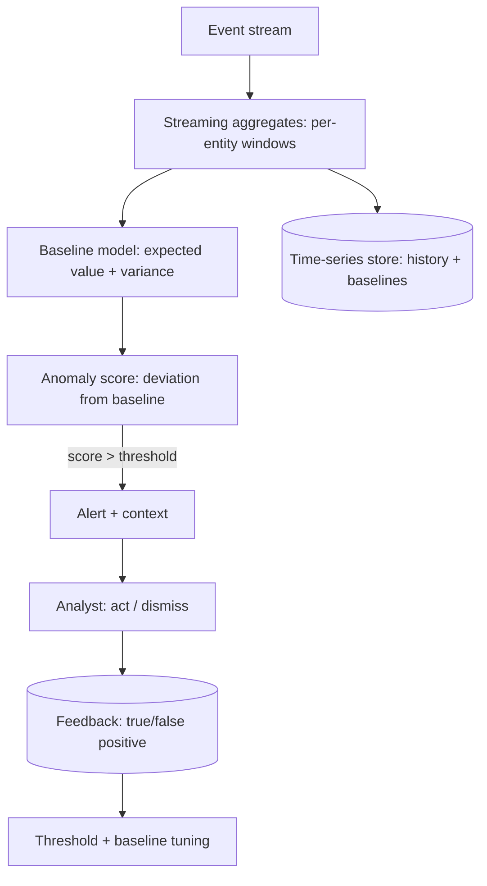

A real-time anomaly detection system watches a stream of events
(metrics, transactions, logins, sensor readings, API calls) and
*flags the unusual* — fast enough to act (block, page, throttle) and
accurately enough to be usable (a system that cries wolf is ignored,
which is worse than none). It is the [fraud-detection](/system-design/hld/fraud-detection)
shape with the *labels absent* (anomalies are rare and often
undefined: the [unsupervised](/system-design/ai-ml/supervised-unsupervised-rl)
problem) and the *false-positive budget* front and center (the
[alert-fatigue](/system-design/fundamentals/reliability-engineering)
failure mode), and its design is the [streaming](/system-design/fundamentals/stream-vs-batch-processing)
machinery plus the *unsupervised* detection layer.

## Requirements

**Functional**

- Detect anomalies in a high-volume event stream, per entity
  (per user, per host, per service, per metric).
- Alert/act (page, block, throttle, flag for review) with enough
  context to act.
- Adapt to the *normal* evolving (seasonality, growth: the
  [drift](/system-design/ai-ml/model-monitoring-drift) problem, but
  for the *baseline*).
- Reduce false positives over time (the [feedback
  loop](/system-design/ai-ml/concept-drift-retraining) from the
  analyst's decisions).

**Non-functional**

- **Latency: seconds to minutes** (fast enough to *act*: the
  [online-inference](/system-design/ai-ml/offline-vs-online-inference)
  requirement, though often looser than fraud — a metric anomaly can
  tolerate seconds).
- **Scale: the firehose** (millions of events/sec: the
  [streaming](/system-design/fundamentals/stream-vs-batch-processing)
  throughput).
- **The false-positive budget** (the *defining* constraint: the
  alert volume must be *actionable* (the
  [error-budget](/system-design/fundamentals/reliability-engineering)
  idea, applied to alerts: the system is *tuned* to a tolerable
  alert rate, and *precision* is the metric that matters, not
  recall)).
- **Adaptivity** (the baseline *moves* (daily patterns, growth,
  seasonal events): a static threshold is useless, and the
  *baseline model* is the system).

## The architecture

- **Streaming aggregates** (the per-entity [windowed
  statistics](/system-design/fundamentals/stream-vs-batch-processing)
  (counts, rates, latency percentiles) the detection needs, computed
  *as the events flow* — the [feature pipeline](/system-design/ai-ml/feature-platform)
  shape).
- **The baseline model** (the *expected* behavior: a seasonal model
  (daily/weekly patterns), a forecast, or a learned distribution —
  the *unsupervised* core, and the reason the system adapts: the
  baseline *moves* and the anomaly is *deviation from it*).
- **The anomaly score** (the deviation (how many σ from expected,
  the forecast error, an isolation-forest score): the detection,
  and the *threshold* that maps score → alert (the precision/recall
  dial).
- **Alerting and the analyst loop** (the alert with *context*
  (what, when, how anomalous, related signals), the analyst's
  *decision* (act/dismiss), and the *feedback* (dismissals tune the
  threshold and the baseline: the [labeling](/system-design/ai-ml/data-labeling-annotation)
  loop, for anomalies)).

## The hard parts

- **Unsupervised detection is *evaluation-hard*** (there is no
  "right answer" to compare against (anomalies are rare and often
  undefined): the metrics are the *analyst's experience*
  (alert volume, dismissal rate, time-to-acknowledge) and the
  *retrospective* ("did we catch the real incidents?"): the
  [evaluation](/system-design/ai-ml/evaluating-llm-systems) page's
  proxy-management, at its most honest).
- **The false-positive *budget* is the design** (the system is
  *tuned* to an alert rate (the team can act on ~N alerts/day):
  the threshold is *derived* from the budget, not chosen freely —
  the [SLO](/system-design/fundamentals/reliability-engineering)
  discipline, and the reason "just lower the threshold" is not an
  answer (it spends the budget)).
- **Baselines that adapt *slowly enough*** (the baseline must track
  *normal* drift (seasonality, growth) but *not* absorb the anomaly
  (a slow-adapting baseline would call a persistent anomaly
  "normal": the [drift-vs-anomaly](/system-design/ai-ml/concept-drift-retraining)
  tension, and the *adaptation rate* is the dial — the same
  [flapping-threshold](/system-design/hld/load-balancer-system)
  reasoning, for baselines).
- **The context and the actionability** (an alert without context is
  useless: the system must surface *what is anomalous, when it
  started, what else is correlated* (the [observability](/system-design/fundamentals/observability)
  discipline, alert-shaped), so the analyst can act *fast*).
- **Seasonality and the cold start** (a *new* entity has no
  baseline (the [cold-start](/system-design/ai-ml/model-serving-architectures)
  problem): the system uses *population* baselines (this entity's
  cohort) until the entity's own history accrues — the
  [recommendation cold-start](/system-design/hld/recommendation-system)
  problem, for baselines).

## Capacity sketch

The arithmetic: ~10^6 events/sec aggregated into per-entity windows
(the [streaming](/system-design/fundamentals/stream-vs-batch-processing)
tier's throughput), the baseline + scoring *per entity per window*
(a *cheap* model (a statistical baseline, a small forest): the
[inference](/system-design/ai-ml/batch-vs-real-time-prediction)
cost, sized by entity count × window rate), the baselines stored in
a [time-series store](/system-design/hld/metrics-monitoring-system)
(the history), and the alerts at a *tuned* rate (the budget: e.g.,
hundreds/day, not thousands) — the whole system optimized for
*precision* (actionable alerts), because the alert volume is the
product's usability limit.

## Related concepts

- [Design a Fraud Detection System](/system-design/hld/fraud-detection):
  the supervised, labeled sibling.
- [Stream vs. Batch Processing](/system-design/fundamentals/stream-vs-batch-processing):
  the windowing machinery.
- [Model Monitoring & Data Drift](/system-design/ai-ml/model-monitoring-drift):
  the drift-vs-anomaly distinction.
- [Observability](/system-design/fundamentals/observability) and
  [Metrics & Monitoring](/system-design/hld/metrics-monitoring-system):
  the alerting infrastructure.
- [Reliability Engineering](/system-design/fundamentals/reliability-engineering):
  the false-positive budget and alert-fatigue discipline.
