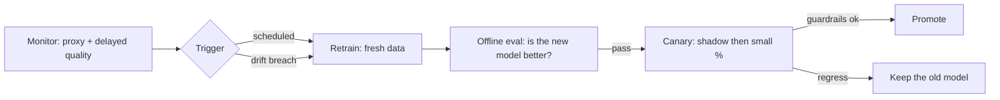

[Data drift](/system-design/ai-ml/model-monitoring-drift) is the
inputs moving; **concept drift is the *answer* moving** — the same
input now maps to a different outcome, because the world's
*relationship* changed, not just its distribution. The spam
patterns evolve (spammers adapt to the filter), the fraud tactics
shift (the [adversarial](/system-design/hld/fraud-detection) case:
the attacker is *optimizing against the model*), user tastes move,
a macroeconomic shock rewrites what "likely to repay" means. Data
drift can be tolerated by a robust model; concept drift *is* the
model becoming wrong, and the design question is **how fast the
system notices and replaces it.**

## The two change rates, and why they matter

- **Gradual concept drift** (slow taste shifts, seasonal patterns:
  the model degrades over months): handled by **scheduled
  retraining** (weekly/monthly, a [batch](/system-design/fundamentals/stream-vs-batch-processing)
  job over the fresh [training pipeline](/system-design/ai-ml/training-data-pipelines)),
  and the schedule is calibrated to the decay rate (retrain faster
  than the model goes stale).
- **Sudden concept drift** (a shock: a policy change, a new fraud
  campaign, a global event): the model is wrong *now*, and a
  weekly schedule is too slow — the system needs **drift detection
  as a trigger** (the [monitoring](/system-design/ai-ml/model-monitoring-drift)
  breach fires retraining, not the calendar), and the honest
  admission that *detection latency + training latency + deploy
  latency* is the total time the system serves a wrong model. The
  [fraud](/system-design/hld/fraud-detection) design's fast
  retraining is exactly this: the adversary guarantees sudden
  drift, so the loop must be *continuous*.

The systems design question, stated once: **what is the total
detect-to-deploy time, and does the product's drift rate fit inside
it?** A monthly retrain is fine for churn; catastrophic for
adversarial fraud. The loop's speed is a *product* requirement
(the same [batch-vs-realtime](/system-design/ai-ml/batch-vs-real-time-prediction)
decision, applied to learning), not an engineering preference.

## The retraining loop, designed

The components, and the trap in each:

- **The trigger** (schedule, drift breach, or a **data-volume
  trigger**: "retrain when N new labels accumulated" — the
  [fraud](/system-design/hld/fraud-detection) case, where labels
  *are* the input): the honest design supports several, because
  the drift mode is not always known in advance.
- **The retrain** (the [training pipeline](/system-design/ai-ml/training-data-pipelines)
  on fresh data: the *same* pipeline, versioned, reproducible:
  the [lineage](/system-design/ai-ml/data-versioning-lineage)
  discipline, so "which data trained the model serving right now"
  is answerable).
- **The offline gate** (the new model must *beat* the current one
  on held-out data: the
  [offline evaluation](/system-design/ai-ml/offline-vs-online-evaluation)
  loop, and the trap that the *held-out set* must be *recent*
  (evaluating on old data measures the old world) and *leak-free*:
  a retrained model that "wins offline" on stale data can lose
  online).
- **The deploy** (the new model through the
  [canary/shadow](/system-design/ai-ml/offline-vs-online-evaluation)
  funnel: the *automatic* promotion when guardrails hold, the
  *automatic rollback* when they break — the
  [reliability](/system-design/fundamentals/reliability-engineering)
  discipline, because a retrained model is a *deployment* and
  deserves the same safety as any code change, more so because its
  failures are invisible to health checks).

## The automation dial

How much of the loop is automatic is the design's spine, and the
honest spectrum:

- **Manual** (a human reviews the retrain, runs the eval, clicks
  deploy): safe, slow, and correct for *high-stakes, slow-drift*
  models (a credit model: a human should look), and it does not
  scale past a handful of models.
- **Triggered-but-gated** (the pipeline runs automatically, a human
  approves the *promote*: the middle, and the common production
  shape).
- **Fully automatic** (retrain → eval → canary → promote, no human:
  the [fraud](/system-design/hld/fraud-detection) case, and the
  only viable shape when drift is adversarial and fast), with the
  guardrails (the automatic rollback) *doing* the human's job — which
  is why full automation is only as good as its guardrail metrics,
  and why "we automated it" without a rollback story is how a bad
  retrain ships at 3 AM.

## The feedback-loop trap, restated

The deepest hazard of retraining, worth its own paragraph: **the
retrain learns from the outcomes of the model it is replacing**,
so it inherits and amplifies the old model's biases (the
[feedback loop](/system-design/hld/recommendation-system): the new
model is trained on what the old one chose to show). The mitigations
are the [exploration](/system-design/ai-ml/supervised-unsupervised-rl)
discipline (log propensities, explore deliberately, so the training
data is not fully determined by the previous policy) and the
*holdout* discipline (keep a slice of traffic on a fixed policy, so
there is always unbiased data to learn from) — the same
[A/B](/system-design/ai-ml/ab-testing-experimentation) holdout that
makes experiments honest, doing double duty as the retraining
loop's anchor.

## Related concepts

- [Model Monitoring & Data Drift](/system-design/ai-ml/model-monitoring-drift):
  the detection that triggers retraining.
- [Training Data Pipelines](/system-design/ai-ml/training-data-pipelines):
  the retrain's input machinery.
- [Offline vs Online Evaluation](/system-design/ai-ml/offline-vs-online-evaluation)
  and [A/B Testing](/system-design/ai-ml/ab-testing-experimentation):
  the gates the new model passes.
- [Design a Fraud Detection System](/system-design/hld/fraud-detection):
  the adversarial, fast-drift, fully-automated case.
- [Design a Recommendation System](/system-design/hld/recommendation-system):
  the feedback-loop-trap case.
