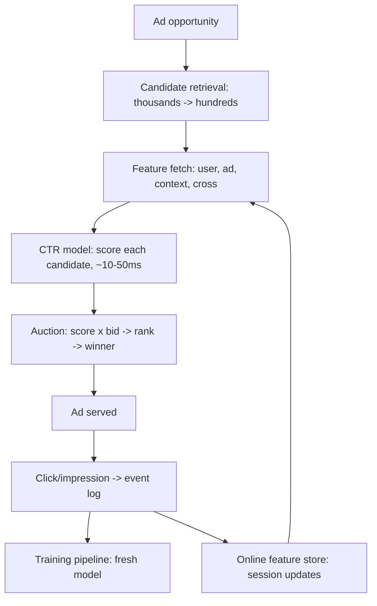

An ad-ranking (or any CTR — click-through-rate — prediction) system
is the classic *real-time prediction* HLD, and it is a demanding one
because the constraints are tight and *all at once*: predict a
probability for *millions* of candidate ads, for *every* ad
opportunity (billions a day), in the *milliseconds* before the page
renders, and the prediction *is money* (it drives the auction and
the bill). It is the [recommendation system's](/system-design/hld/recommendation-system)
sibling with harder latency and a *calibration* requirement (the
predicted probability is a *price input*, not just a ranking), and
it exercises the whole AI/ML serving track at once.

## Requirements

**Functional**

- For an ad opportunity (user, page, context), score candidate ads
  with a *predicted click probability* (and often a conversion
  probability).
- Rank/bid using the scores (the auction: score × bid → the winner).
- Learn from the outcomes (clicks, conversions) to improve.

**Non-functional**

- **Latency: ~10-50ms for the whole scoring** (the auction is in the
  page-render path: the [bidding budget](/system-design/fundamentals/latency-vs-throughput),
  and the hardest constraint — the model and *all* its features must
  fit in it).
- **Throughput: millions of predictions/sec** (each opportunity ×
  each candidate ad: the [scale](/system-design/fundamentals/capacity-planning-and-estimation),
  and the reason the scoring is *simple and fast*, not large and
  accurate).
- **Calibration** (the predicted probability must *mean* what it
  says: a 0.05 must click ~5% of the time, because it is a *price*
  — the [evaluation](/system-design/ai-ml/evaluation-metrics)
  requirement, and the reason CTR models are
  [calibrated](/system-design/ai-ml/evaluation-metrics), not just
  ranked).
- **Freshness** (a user's *current* session behavior matters: the
  [online features](/system-design/ai-ml/feature-stores) must be
  fresh, which is the [feature-store's](/system-design/ai-ml/feature-platform)
  hardest tier).

## The architecture

- **Candidate retrieval** (the [recommendation's two-stage
  shape](/system-design/hld/recommendation-system): from millions
  of ads, a *cheap* filter (targeting, budget, relevance) narrows
  to the hundreds worth scoring — the *only* way the latency budget
  works).
- **Feature fetching** (the [feature store's](/system-design/ai-ml/feature-stores)
  *online* tier: user features (history, demographics), ad features,
  context features, and *cross* features (this user's engagement
  with this ad's category) — fetched in *milliseconds*, which is why
  the features are *precomputed* (the [batch-vs-realtime](/system-design/ai-ml/batch-vs-real-time-prediction)
  split: the expensive aggregates offline, the *fresh* session
  signals streaming).
- **The model** (a *small, fast* model (logistic regression,
  GBDT, a small net): the latency budget forbids a large model, and
  the field's wisdom is that *features beat model size* for CTR —
  the [inference-optimization](/system-design/ai-ml/inference-optimization)
  trade, decided *early* by the latency).
- **The auction** (the [pricing](/system-design/hld/stock-exchange)
  layer: score × bid, second-price or otherwise, the *business*
  logic the prediction feeds).
- **The learning loop** (the [outcomes](/system-design/hld/ad-click-aggregator)
  (clicks, conversions) → the [training pipeline](/system-design/ai-ml/training-data-pipelines)
  → a fresh model: the [retraining](/system-design/ai-ml/concept-drift-retraining)
  loop, and the [feedback-loop](/system-design/hld/recommendation-system)
  hazards (only served ads have outcomes)).

## The hard parts

- **The latency budget vs. the feature richness** (the *central
  tension*: more features = better predictions = more latency; the
  budget is ~tens of ms, so the design is a *relentless* exercise in
  *which features fit* — the reason CTR features are *precomputed
  aggregates*, not on-the-fly joins: the [feature
  store](/system-design/ai-ml/feature-platform), mandatory).
- **Calibration** (the model must produce *prices*, so it is
  *calibrated* (the [metric](/system-design/ai-ml/evaluation-metrics):
  reliability diagrams, isotonic/Platt correction), and *monitored*
  for calibration drift — a miscalibrated CTR model is a *money
  bug* (the auction prices wrong), not just a ranking bug).
- **The feedback loop and the exploration problem** (only the ads
  the system *served* have outcomes: the training data is
  *biased* by the previous policy — the
  [exploration](/system-design/ai-ml/supervised-unsupervised-rl)
  discipline (log propensities, explore deliberately) is *required*,
  not optional, and the [A/B platform](/system-design/ai-ml/ab-testing-experimentation)
  is the same infrastructure).
- **Freshness of session features** (the user *just* clicked
  something: the [streaming feature
  tier](/system-design/ai-ml/feature-platform) (the [stream-vs-batch](/system-design/fundamentals/stream-vs-batch-processing)
  compute), and the [online store's](/system-design/ai-ml/feature-stores)
  update latency — a stale session feature is a *worse* prediction,
  and the freshness *contract* is per-feature).
- **Scale of the training data** (billions of impressions × features:
  the [data platform](/system-design/fundamentals/olap-vs-oltp) is
  part of the system, and the [training/serving
  skew](/system-design/ai-ml/feature-engineering-basics) (the
  batch features vs. the online features) is the recurring
  correctness bug).

## Capacity sketch

The arithmetic: ~10B opportunities/day × ~100 scored candidates =
~10^12 predictions/day (~10M/sec at peak: a *huge* scoring fleet,
sized by the [small-model](/system-design/ai-ml/inference-optimization)
throughput per core, the [batching](/system-design/ai-ml/batching-and-latency)
(batch the candidates *within* one opportunity, and opportunities
across requests), and the [feature-store](/system-design/ai-ml/feature-stores)
read throughput (the *other* bottleneck: the feature fetches may
dominate the scoring); the training is a [batch](/system-design/fundamentals/stream-vs-batch-processing)
job over the impression log (the [ad-click
aggregator's](/system-design/hld/ad-click-aggregator) data), and the
model refreshes on the [drift](/system-design/ai-ml/model-monitoring-drift)
schedule (often daily, sometimes continuous).

## Related concepts

- [Design a Recommendation System](/system-design/hld/recommendation-system):
  the two-stage sibling.
- [Design an Ad Click Aggregator](/system-design/hld/ad-click-aggregator):
  the outcome-counting tier.
- [Feature Stores](/system-design/ai-ml/feature-stores) and
  [Feature Platform](/system-design/ai-ml/feature-platform): the
  feature tier.
- [Evaluation Metrics for ML](/system-design/ai-ml/evaluation-metrics):
  calibration and AUC.
- [Batch vs Real-Time Prediction](/system-design/ai-ml/batch-vs-real-time-prediction):
  the freshness split.
