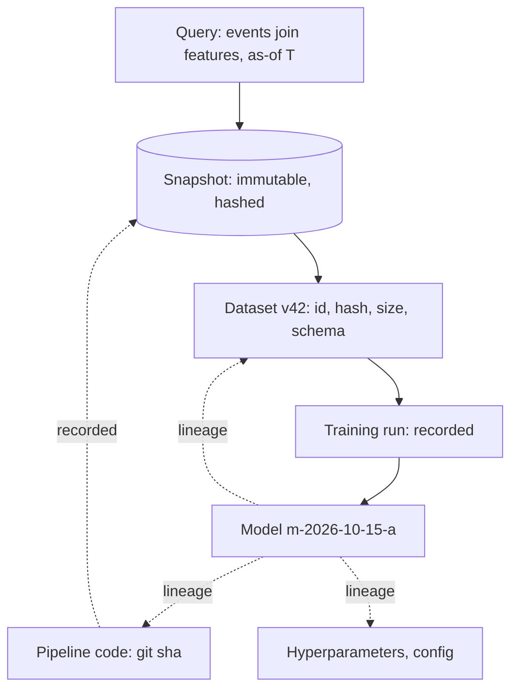

Training a model is the most expensive kind of bug factory: the
artifact *absorbs* its inputs, and if you cannot answer "**which
data, which code, which choices produced this model?**" months
later, then the model is unfixable (you cannot reproduce it),
unauditable (you cannot explain it), and undebuggable (you cannot
compare it to what came before). Data versioning and lineage are the
discipline that makes ML artifacts *reproducible and explainable*
— [event sourcing](/system-design/fundamentals/event-sourcing-and-cqrs)'s
"the log is the truth" instinct, applied to the artifacts of
learning, and the prerequisite for every other maturity in the
[ML lifecycle](/system-design/ai-ml/ml-system-design-basics).

## The problem: data is not code

Code is versioned by habit (git), and code is *immutable* in the
sense that version 1.2 is forever 1.2. **Data is none of that**: a
training set is usually "the result of a query *over data that
changes***" ("all events last 90 days": a different dataset every
day, the same *name*), the [labeling](/system-design/ai-ml/data-labeling-annotation)
changes (guidelines evolve: eras), the *joins* change (the pipeline's
code mutates), and the [feature
definitions](/system-design/ai-ml/feature-engineering-basics)
change (a window resized, an aggregation fixed: *different
features, same names*). The classic failure: two models, trained
"on the same data", meaning two different things, and a
production regression whose cause is undiscoverable because
neither dataset exists anymore.

## The solution: datasets as immutable, versioned artifacts

The core move, the same one [object storage](/system-design/hld/object-storage-system)
and [event logs](/system-design/fundamentals/event-sourcing-and-cqrs)
already taught: **a dataset version is an immutable snapshot with
an identity.**

- **Snapshot, not query**: the training job consumes a *materialized*
  dataset (an [immutable object](/system-design/fundamentals/object-storage):
  parquet files, a
  [content hash](/system-design/hld/distributed-file-storage) as
  the identity), not a live query. The version is the hash, the
  hash is forever, and "re-train on what m-2026-09-01 used" is
  literally resolvable.
- **Everything in the lineage**: dataset hash, pipeline git sha,
  feature definitions, hyperparameters, the random seed — the
  [experiment tracking](https://en.wikipedia.org/wiki/MLOps)
  discipline (the model registry's "reproduce this run" button is
  *the lineage record, materialized*), and the honest bar:
  **re-running the recorded recipe reproduces the recorded model**
  (bit-for-bit is hard; metric-for-metric is the practical
  standard, and the seed discipline
  [deterministic runs](https://en.wikipedia.org/wiki/Deterministic_algorithm)]
  is what makes it achievable).
- **The lineage graph**: the model → dataset → source-events →
  [label eras](/system-design/ai-ml/data-labeling-annotation) →
  feature-code chain, queryable *forward* ("what models depend on
  this dataset?": the blast radius of a data fix) and *backward*
  ("what made this model?": the audit). The graph is
  [the reconciliation](/system-design/hld/payment-system) of ML:
  the *answer* to every "why did the model change" incident, and
  the machinery that makes "roll back to the previous *data* era"
  a possible operation.

## The mechanisms, priced

- **Immutable snapshots**: storage is cheap ([object
  storage](/system-design/fundamentals/object-storage)), the
  datasets are [warehouse](/system-design/fundamentals/olap-vs-oltp)-sized
  (hundreds of GB per version: *retention policy* is a real
  decision: keep the versions of record (deployed models' datasets)
  forever, the experiment churn for N months).
- **Content hashing**: the same mechanism as
  [content-addressed storage](/system-design/hld/distributed-file-storage)
  (the hash *is* the identity, dedup for free: two training sets
  that differ by one row are two hashes, and two that are identical
  are one, automatically).
- **The registry** (the metadata plane): dataset versions, model
  versions, run records, lineage edges — a
  [metadata/data-plane split](/system-design/hld/object-storage-system)
  (the registry is small and strongly consistent; the artifacts are
  big and immutable), and the same split every artifact system on
  this site makes.

## Lineage in the lifecycle

Where lineage pays, concretely:

- **The debugging case** (production model degraded: was it the
  data? the labels? a feature change? — the lineage answers *which
  input changed*, which is 90% of the investigation), and the
  [drift](/system-design/ai-ml/ml-system-design-basics) monitoring
  connects here (the model's *input distribution* is part of its
  lineage record: compare production traffic to the training
  snapshot's distribution).
- **The audit case** (regulatory, or the
  [fairness](/system-design/fundamentals/multi-tenancy-and-data-residency)
  review: "what did the model learn from, and was that data
  legitimately obtained, in this era?" — answerable only with
  lineage).
- **The collaboration case** (data scientists sharing datasets:
  the version pin is the contract, the same discipline
  [API versioning](/system-design/fundamentals/api-design) gives
  code, applied to data).

## Related concepts

- [Training Data Pipelines](/system-design/ai-ml/training-data-pipelines):
  the pipeline whose outputs are the versioned artifacts.
- [Event Sourcing & CQRS](/system-design/fundamentals/event-sourcing-and-cqrs):
  the log-as-truth architecture this discipline instantiates.
- [Object Storage](/system-design/fundamentals/object-storage):
  the immutable-artifact tier underneath.
- [Serialization & Schema Evolution](/system-design/fundamentals/serialization-and-schema-evolution):
  the schema-versioning discipline for the feature definitions.
