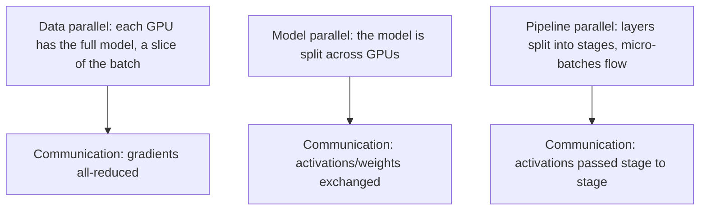

Training a modern model (a large LLM: billions of parameters, a
trillion tokens) does not fit one machine's memory, and would take
years on one machine's compute — so training *distributes*: across
many GPUs, many nodes, for weeks. The three ways to split the work
— **data parallelism** (split the *batch*), **model parallelism**
(split the *model*), and **pipeline parallelism** (split the
*layers*) — each has a distinct communication pattern, and the
whole discipline is about **keeping the expensive accelerators busy
despite the communication between them** (the
[GPU-management](/system-design/ai-ml/gpu-accelerator-management)
problem, at training scale).

## The three parallelisms

- **Data parallelism** (the *default* and simplest: replicate the
  model on every GPU, give each a different slice of the batch,
  and *all-reduce* (average) the gradients after each step so the
  replicas stay in sync). The communication is *gradients*
  (model-sized: gigabytes per step), and the bottleneck is the
  interconnect (the all-reduce across GPUs): the reason training
  clusters use fast interconnects ([NVLink,
  InfiniBand](https://en.wikipedia.org/wiki/InfiniBand)) — *the
  network is the training's bottleneck*, and the whole field's
  engineering (gradient compression, overlapped communication) is
  about hiding it.
- **Model parallelism** (the model *itself* split across GPUs
  (a layer's weights on several GPUs, computed in parallel: *tensor
  parallelism*): needed when the model does not fit one GPU's
  memory, and *communication-heavy* (the activations must be
  exchanged *within* a layer's forward pass: per-layer
  communication, not per-step — the tighter coupling, and the
  reason it is used *within* a node (fast NVLink) more than across
  nodes).
- **Pipeline parallelism** (the *layers* split into stages, each on
  a GPU, and *micro-batches* flow through the pipeline: stage 1
  processes micro-batch A while stage 2 processes B — the
  [assembly-line](https://en.wikipedia.org/wiki/Pipeline_(computing))
  idea, hiding the stage-to-stage latency, at the cost of a
  *pipeline bubble* (the fill/drain time where stages idle: the
  efficiency loss the micro-batch sizing trades against).

## The combinations (and the modern stack)

Real large-model training *combines* all three (the "3D
parallelism": data × tensor × pipeline), and the field's frameworks
(Megatron, DeepSpeed, FSDP: PyTorch's Fully Sharded Data Parallel)
encode the combinations. The key modern refinement, worth naming:
**ZeRO / FSDP** (shard the *optimizer state, gradients, and
parameters* across GPUs (not just the batch): data parallelism
where the model's *memory* is distributed, so a model that does not
fit one GPU *can* be data-parallel — the technique that made
large-model training *practical* on standard clusters, by trading
communication for memory).

## The systems concerns

- **The interconnect is the design** (the parallelism *choice* is a
  choice of *communication pattern*: data (gradients, per step),
  tensor (activations, per layer), pipeline (activations, per
  stage) — and the *right* choice is the one matching the
  *hardware topology* (NVLink within a node: cheap; InfiniBand
  across: expensive), which is why the parallelism is
  *topology-aware*, not a config flag).
- **Checkpointing** (a weeks-long job *will* fail: periodic
  checkpoints (the model state to [object
  storage](/system-design/fundamentals/object-storage)) let it
  *resume* rather than restart — the
  [job-scheduler's](/system-design/hld/distributed-job-scheduler)
  checkpoint discipline, and the reason a failed node costs minutes,
  not weeks).
- **Fault tolerance** (a node dies mid-run: the job must *detect*
  (heartbeats), *reconfigure* (the parallelism changes when a GPU
  is lost), and *resume from checkpoint* — the
  [distributed-systems](/system-design/fundamentals/availability-and-reliability)
  discipline, at training scale, and the reason large runs are
  *orchestrated* (the [training platform](/system-design/ai-ml/ml-training-platform)).
- **Scheduling** (the job needs *all* its GPUs at once (gang
  scheduling) and *co-located* (topology): the
  [GPU-management](/system-design/ai-ml/gpu-accelerator-management)
  scheduler's hardest case).

## Related concepts

- [GPU & Accelerator Management](/system-design/ai-ml/gpu-accelerator-management):
  the resources and scheduling.
- [Design an ML Training Platform](/system-design/ai-ml/ml-training-platform):
  the orchestration layer.
- [Hyperparameter Tuning at Scale](/system-design/ai-ml/hyperparameter-tuning):
  many training runs, in parallel.
- [Cost Optimization for ML](/system-design/ai-ml/cost-optimization-ml):
  the utilization economics of training.
- [Design a Distributed Job Scheduler](/system-design/hld/distributed-job-scheduler):
  the job machinery.
