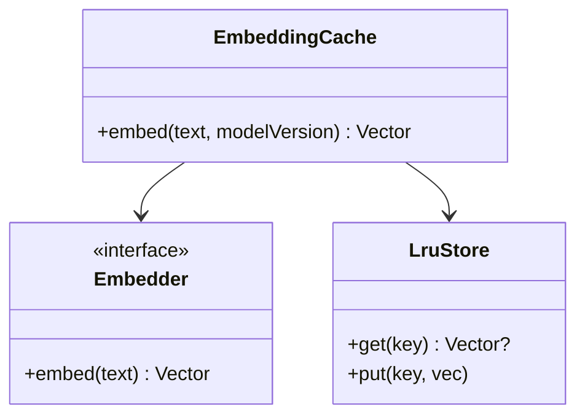

An embedding cache stores computed [embeddings](/system-design/ai-ml/embeddings-vector-representations)
keyed by content, so that re-embedding the *same* text (a repeated
document, a common query, a re-processed chunk) is a lookup rather
than a model call. It is the [caching](/system-design/fundamentals/caching)
pattern with two ML-specific twists: the key is *content* (a hash of
the text, not an id), and the *value* is tied to the *embedding
model* (a new model invalidates the *whole cache*, which is the
[model-era migration](/system-design/ai-ml/feature-model-backfills)
problem in a cache). It is a clean LLD: the cache machinery plus the
model-version key discipline.

## The requirements (as code)

- `embed(text) -> vector` (compute-or-fetch).
- Keyed by *content* (the same text, different ids, hits the same
  entry).
- Keyed by *model version* (a new model's embeddings are *different
  vectors*: the cache is per-model, or the key includes the model).
- Bounded (an LRU: the cache is a cache).
- Concurrency-safe (many embedding workers).

## The class model



The key insight: **the cache key is `(content_hash, model_version)`**
— the content hash makes the same text hit, and the model version
makes a *new model* a *cache miss* (correctly: the old vectors are
*invalid* for the new model, so they must not be served).

## The C++ sketch

```cpp
class EmbeddingCache {
public:
    EmbeddingCache(Embedder& embedder, size_t capacity)
        : embedder_(embedder), capacity_(capacity) {}

    std::vector<float> embed(const std::string& text,
                             const std::string& modelVersion) {
        std::string key = keyFor(text, modelVersion);
        {
            std::lock_guard<std::mutex> guard(mtx_);
            auto it = store_.find(key);
            if (it != store_.end()) {
                touch(key);                   // LRU: move to front
                return it->second;            // the cache hit
            }
        }
        // Miss: compute OUTSIDE the lock (the embedder is slow).
        std::vector<float> vec = embedder_.embed(text);
        {
            std::lock_guard<std::mutex> guard(mtx_);
            if (store_.size() >= capacity_) {
                evictLru();                   // bounded: the LRU eviction
            }
            store_[key] = vec;
            touch(key);
        }
        return vec;
    }

private:
    // The key: content hash + model version (both matter).
    static std::string keyFor(const std::string& text,
                              const std::string& modelVersion) {
        return modelVersion + ":" + sha256(text);   // model-scoped content key
    }

    Embedder& embedder_;
    size_t capacity_;
    std::mutex mtx_;
    std::unordered_map<std::string, std::vector<float>> store_;
    std::list<std::string> lru_;         // most-recent at front
};

class Embedder {
public:
    virtual ~Embedder() = default;
    virtual std::vector<float> embed(const std::string& text) = 0;
};
```

The design decisions:

- **The key is `(model_version, content_hash)`** (the *whole*
  correctness: the content hash makes repeats hit, and the model
  version makes a *model change* a *cold cache* — the
  [invalidation](/system-design/fundamentals/caching) that the
  embedding era *requires*, because a new model's vectors are a
  *different space* and serving old vectors would be *wrong*
  (semantic search would return nonsense: the vectors are
  incomparable across models).
- **Compute outside the lock** (the embedder is slow (a model
  call): holding the cache lock during it serializes *every*
  embedding — the [lock-the-bookkeeping-never-the-work](/system-design/fundamentals/concurrency-and-parallelism)
  rule, the [rate-limiter](/system-design/lld/rate-limiter-lld)
  discipline).
- **The stampede hazard** (two threads miss the *same* key and both
  compute: the [cache-stampede](/system-design/fundamentals/caching),
  here a *duplicated model call* — the fix is *single-flight* (the
  first computes, the rest wait): the [LLM-cache](/system-design/ai-ml/llm-caching)
  discipline, and worth a mention).
- **The LRU is the bound** (the cache is finite: the
  [LRU](/system-design/lld/lru-lfu-cache) machinery, and the
  [leaderboard](/system-design/hld/leaderboard) `touch`/`evictLru`
  shape — the hot embeddings (common queries, frequent documents)
  stay, the long tail evicts).

## The model-era twist

The reason this is an *AI/ML* LLD rather than a generic cache: **the
value's validity depends on the model.** A content-keyed cache
without the model version is *wrong* the moment the model changes
(it serves vectors from a *different embedding space*), and the
*invalidation* is not TTL-based (the content did not change: the
*model* did) but *version-based* (a new model version = a new cache
namespace). This is the [vector-database
era-migration](/system-design/ai-ml/vector-databases) problem at
cache scale: the "invalidate everything on model change" is
*correct* (the old vectors are useless), and the design's job is to
make it *cheap* (a version prefix in the key: the old entries age
out, the new ones fill — the [dual-era](/system-design/ai-ml/vector-databases)
transition, in a cache).

## Related concepts

- [Embeddings & Vector Representations](/system-design/ai-ml/embeddings-vector-representations):
  what is cached.
- [Caching](/system-design/fundamentals/caching): the pattern, its
  eviction and stampede disciplines.
- [Design an LRU/LFU Cache](/system-design/lld/lru-lfu-cache): the
  eviction machinery.
- [Caching for LLMs](/system-design/ai-ml/llm-caching): the
  LLM-shaped sibling (prompt/semantic caches).
- [Feature/Model Backfills](/system-design/ai-ml/feature-model-backfills):
  the model-era migration.
