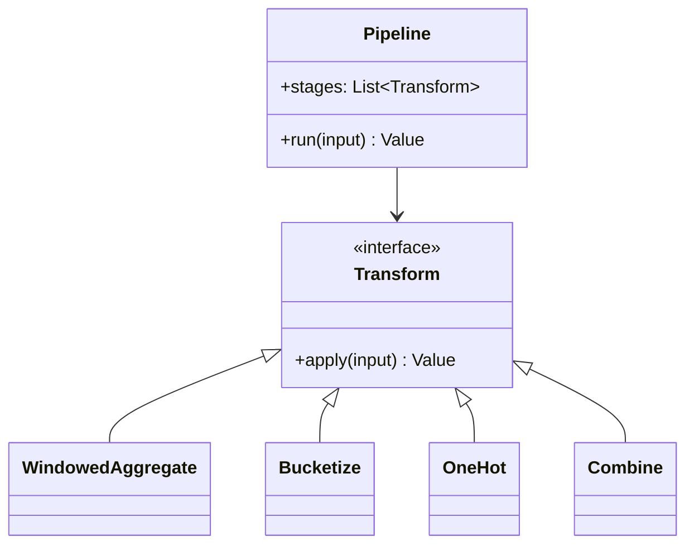

A feature transform pipeline is the *code layer* underneath the
[feature store](/system-design/ai-ml/feature-stores): the
*composable transforms* (window an aggregate, bucketize a value,
one-hot an encoding, combine features) that turn raw sources into
feature values — expressed as *code* so that the *same* transform
runs in *both* the online and offline paths (the consistency
guarantee, the [feature-store](/system-design/ai-ml/feature-stores)
core). It is the [text-editor's](/system-design/lld/text-editor-undo-redo)
*command pattern* and the [file system's](/system-design/lld/in-memory-file-system)
*composite pattern* applied to features: small composable units,
assembled into a pipeline, executed identically wherever they run.

## The requirements (as code)

- Define a transform (a function over inputs → an output).
- Compose transforms (the pipeline: transform A → B → C).
- Execute the pipeline (the same code, online and offline).
- Version the definitions (the [lineage](/system-design/ai-ml/data-versioning-lineage):
  which transform version produced this value).

## The class model



The **`Transform` interface** is the design's whole point: a
*composable unit* (input → output) that can be *chained* (the
composite) and *executed anywhere* (the same `apply` runs online
and offline). The pipeline is a *list of transforms*, and its
consistency comes from the transforms being *the same objects* in
both paths.

## The C++ sketch

```cpp
struct FeatureInput {
    std::string entityId;
    std::chrono::system_clock::time_point asOf;
    const Source* source;                 // the raw events/warehouse
};

// The composable unit: input -> output (the same everywhere).
class Transform {
public:
    virtual ~Transform() = default;
    virtual double apply(const FeatureInput& input) const = 0;
    virtual std::string describe() const = 0;   // for lineage/versioning
};

// A windowed aggregate: "sum of events in the last N hours, as of asOf".
class WindowedAggregate : public Transform {
public:
    WindowedAggregate(std::string eventType, std::chrono::seconds window)
        : eventType_(std::move(eventType)), window_(window) {}

    double apply(const FeatureInput& input) const override {
        // The point-in-time discipline: the window ENDS at asOf, not now.
        auto from = input.asOf - window_;
        double sum = 0.0;
        for (const auto& e : input.source->events(input.entityId, eventType_)) {
            if (e.at > from && e.at <= input.asOf) {   // the as-of window
                sum += e.value;
            }
        }
        return sum;
    }

    std::string describe() const override {
        return "sum(" + eventType_ + ", " + std::to_string(window_.count()) + "s)";
    }

private:
    std::string eventType_;
    std::chrono::seconds window_;
};

// Bucketize: a continuous value -> a bucket index (the discretization).
class Bucketize : public Transform {
public:
    Bucketize(std::shared_ptr<Transform> inner, std::vector<double> edges)
        : inner_(std::move(inner)), edges_(std::move(edges)) {}

    double apply(const FeatureInput& input) const override {
        double value = inner_->apply(input);
        return static_cast<double>(
            std::lower_bound(edges_.begin(), edges_.end(), value) - edges_.begin());
    }

    std::string describe() const override { return "bucket(" + inner_->describe() + ")"; }

private:
    std::shared_ptr<Transform> inner_;    // the COMPOSITION
    std::vector<double> edges_;
};

// The pipeline: a list of transforms, run in order (the composite).
class Pipeline {
public:
    void add(std::shared_ptr<Transform> transform) {
        stages_.push_back(std::move(transform));
    }

    double run(const FeatureInput& input) const {
        // The composition: each stage's output feeds the next. In this
        // simple form, the pipeline is a single chain; a DAG version
        // allows branching (multiple features from shared intermediates).
        double value = 0.0;
        for (const auto& stage : stages_) {
            value = stage->apply(input);   // the same code, online and offline
        }
        return value;
    }

    std::string version() const {          // for the lineage record
        std::string v;
        for (const auto& stage : stages_) {
            v += stage->describe() + "|";
        }
        return v;
    }

private:
    std::vector<std::shared_ptr<Transform>> stages_;
};
```

The design decisions:

- **`apply` takes the `asOf` time** (the *point-in-time* discipline
  is in the *interface*: a window ends at `asOf`, not "now", so the
  *same* transform produces the *training* value (as of a past time)
  and the *serving* value (as of now) — the
  [feature-store](/system-design/ai-ml/feature-stores) consistency,
  enforced at the transform layer).
- **The composite/command composition** (`Bucketize` *wraps* an
  inner transform: the [composite
  pattern](/system-design/lld/in-memory-file-system), so transforms
  *nest* and *chain* — the [text-editor's](/system-design/lld/text-editor-undo-redo)
  command pattern, where each unit is self-contained and composable).
- **`describe()` for versioning** (each transform can *describe
  itself*: the pipeline's `version()` is the *concatenation* — the
  [lineage](/system-design/ai-ml/data-versioning-lineage) that says
  *which transforms produced this value*, so a transform change is a
  *new version* and a [backfill](/system-design/ai-ml/feature-model-backfills)
  boundary).
- **The DAG generalization** (the simple form is a *chain*; real
  pipelines are *DAGs* (multiple features from shared
  intermediates: compute the expensive aggregate once, feed many
  features) — the [dependency
  graph](/system-design/lld/task-scheduler-lld) the pipeline
  *is*, and the reason a real pipeline is a
  [DAG scheduler](/dsa/patterns/graph-specializations/problems/course-schedule),
  not a list).

## The consistency lesson

The page's point, stated once: **the transform is the *unit of
consistency*.** Because a transform is a *self-contained function*
(its inputs are explicit, its computation is pure over them), the
*same transform* can run in the batch (over history) and the stream
(over the live feed) and produce *the same value* — which is the
[training/serving skew](/system-design/ai-ml/feature-engineering-basics)
*eliminated by construction*. The design that *works* is the one
where the transform is *code* (versioned, composable, executable
anywhere), and the design that *fails* is where the online feature
and the offline feature are *two implementations* (the skew, always).
This LLD is the [feature-store's](/system-design/ai-ml/feature-stores)
consistency guarantee, *at the level of the transform* — the smallest
unit that must be *one thing*.

## Related concepts

- [Feature Engineering Basics](/system-design/ai-ml/feature-engineering-basics):
  what transforms produce.
- [Feature Stores](/system-design/ai-ml/feature-stores): the
  consistency the transforms deliver.
- [Design a Feature Store (Code-Level)](/system-design/ai-ml/feature-store-lld):
  the store these transforms feed.
- [Design a Task Scheduler (Code-Level)](/system-design/lld/task-scheduler-lld):
  the DAG execution.
- [Data Versioning & Lineage](/system-design/ai-ml/data-versioning-lineage):
  the transform versioning.
