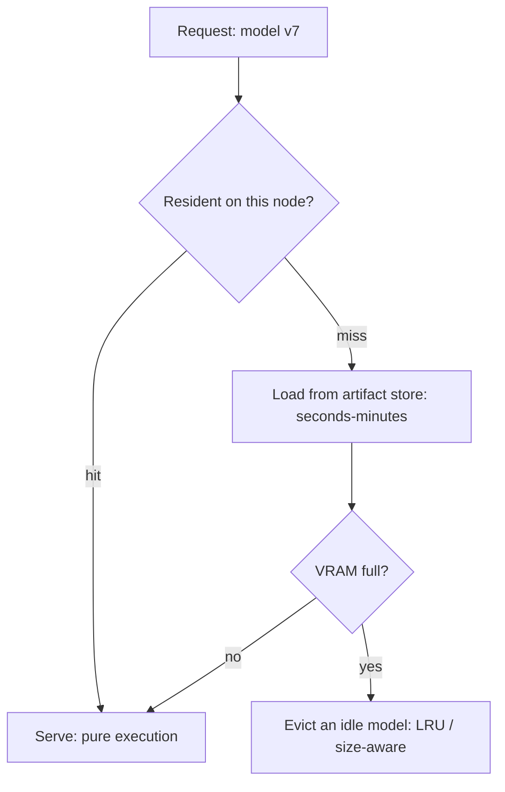

"Model caching" is the unglamorous infrastructure that makes
everything else on the serving pages work: **keeping the model
resident** — in RAM, in [VRAM](/system-design/ai-ml/gpu-accelerator-management),
on the right node — so that serving is pure execution and no
request pays the [cold start](/system-design/ai-ml/serverless-inference).
It is, structurally, a [cache](/system-design/fundamentals/caching)
whose entries are *models* and whose miss cost is *seconds-to-minutes*
(the load), which is why it is the single most-reused pattern in the
serving tier: [multi-model routing](/system-design/ai-ml/multi-model-serving-routing)
is a model cache, [warm pools](/system-design/ai-ml/serverless-inference)
are a model cache, and the "keep the hot model warm" instinct is
cache design wearing an ML hat.

## The cache, with models as entries

Every cache concept transfers, with the load cost as the twist:

- **The artifact store** (the "backing store": the
  [object storage](/system-design/fundamentals/object-storage) +
  the **model registry** (the metadata: versions, sizes, which
  [compiled runtime](/system-design/ai-ml/model-runtimes-compilation),
  the [lineage](/system-design/ai-ml/data-versioning-lineage)):
  the durable source of every loadable model).
- **The residency policy** (which models are warm on which nodes:
  *hot everywhere* (the high-traffic models, resident on every
  replica), *warm somewhere* (the mid-tail, resident on a subset
  with [consistent-hash](/system-design/fundamentals/consistent-hashing)
  routing), *cold* (load on demand) — the
  [multi-model routing's](/system-design/ai-ml/multi-model-serving-routing)
  hot/cold split, as a policy).
- **The eviction** (the [LRU/LFU](/system-design/fundamentals/caching)
  discipline, with a model-specific twist: entries have wildly
  different *sizes* (a 10 GB LLM vs. a 50 MB ranker), so the policy
  is **size-aware** (evict by bytes, not count: the
  [PoP cache's](/system-design/hld/cdn-service) size-class idea) and
  *cost-aware* (evict the cheap-to-reload, keep the expensive:
  a model that takes 5 minutes to load is worth holding).
- **The warm-up** (a loaded model is not *ready* until the first
  inference runs (the runtime init, the GPU warm-up: the
  [cold start's](/system-design/ai-ml/serverless-inference) last
  stage), so the pool loads *and warms* before marking the entry
  available — the "warm pool" name, and the reason a naive
  "load on miss" still pays a stall).

## The warm pool, precisely

The warm pool is the residency policy made concrete: **a set of
pre-loaded, pre-warmed model instances ready to serve immediately.**
Its parameters, each a
[capacity-planning](/system-design/fundamentals/capacity-planning-and-estimation)
decision:

- **Size** (how many warm: the traffic floor, the burst headroom, and
  the cost — the [warm-floor
  trade](/system-design/ai-ml/serverless-inference), sized by the
  [autoscaling](/system-design/ai-ml/autoscaling-inference) signal).
- **Composition** (which models are warm: the traffic distribution's
  head — the top-K models cover the bulk, and the tail is cold).
- **Replenishment** (how fast a cold model becomes warm under a
  spike: the load+download+init latency, which is the
  *responsiveness* of the pool — the reason the
  [node-local artifact cache](/system-design/fundamentals/caching)
  and the [snapshot/restore](/system-design/ai-ml/serverless-inference)
  techniques matter).

## The stampede, model-shaped

The [cache-stampede](/system-design/fundamentals/caching) problem
appears here with an unusually expensive miss: a popular model
*evicted* (or a fleet restart) and a burst of requests all miss
simultaneously, all triggering *loads* of the same multi-GB
artifact — N concurrent downloads, N concurrent loads, the node's
memory thrashing, and an outage made of *the fix attempting itself*.
The mitigations are the [caching page's](/system-design/fundamentals/caching),
verbatim: **single-flight** (one loader per model, the rest wait),
**jittered** eviction (do not evict the fleet in lockstep), and
**pin the critical models** (the hottest never evicted: the
[leaderboard's](/system-design/hld/leaderboard) pinned top-N,
at model scale).

## The observability

The cache-specific metrics, which are the *operational* heart of the
serving tier: **hit rate** (what fraction of requests hit a warm
model: the number that determines the p99 — a low hit rate is a
latency outage waiting to happen), **load latency** (the miss cost),
**eviction rate** (thrashing: the pool is too small), and **warm
count per model** (the residency policy's actual state vs. intended).
These four numbers are the serving tier's
[golden signals](/system-design/fundamentals/observability), and
they belong on the first dashboard, because every serving incident
is some version of "the model was not warm."

## Related concepts

- [Model Serving Architectures](/system-design/ai-ml/model-serving-architectures):
  the tier this caches for.
- [Multi-Model Serving & Routing](/system-design/ai-ml/multi-model-serving-routing):
  the hot/cold split this implements.
- [Serverless Inference & Cold Starts](/system-design/ai-ml/serverless-inference):
  the miss cost, in depth.
- [Caching](/system-design/fundamentals/caching): the pattern, its
  eviction and stampede disciplines.
- [Object Storage](/system-design/fundamentals/object-storage): the
  artifact store the loads come from.
