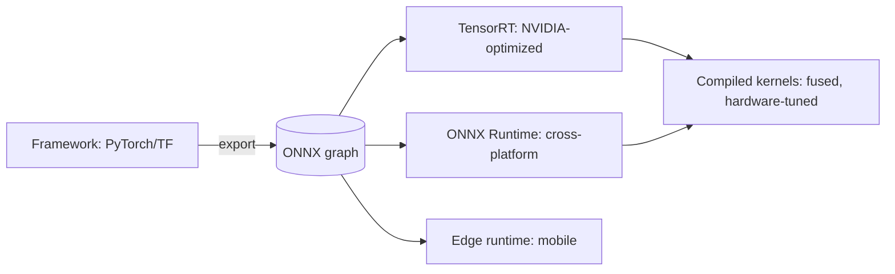

A trained model is a **computation graph** (the layers, the
operations, the tensors flowing between them), and the *runtime* is
what turns that graph into instructions the hardware executes. The
naive path (a Python interpreter executing ops one at a time) is
slow — the interpreter overhead per op dominates, and the ops are
not fused or hardware-tuned — and the *runtime* family exists to fix
that: **compile the graph into fused, hardware-specific kernels**,
ahead of time, so serving is pure execution. This is the
[compilation](/system-design/fundamentals/serialization-and-schema-evolution)
discipline applied to models: the graph is the program, the runtime
is the compiler, and the *serving* is the compiled binary.

## The portability problem, and ONNX

The graph is produced by a *framework* (PyTorch, TensorFlow,
scikit-learn), and the serving tier should not need the whole
framework (heavy, version-fragile, training-oriented). **ONNX**
(Open Neural Network Exchange) is the *interchange format*: export
the trained model to a framework-neutral graph, and any
ONNX-compatible runtime can execute it. The value: **decoupling**
(the model artifact is portable, the serving tier is not tied to
the training framework), which is the
[serialization](/system-design/fundamentals/serialization-and-schema-evolution)
argument — a stable contract between the trainer and the server.

## The compilation techniques (what "optimizing the graph" means)

The transformations the runtimes apply, each a real speedup:

- **Operator fusion** (the biggest win): adjacent ops become *one*
  kernel (conv + bias + activation, executed in one pass over
  memory) — the interpreter's per-op overhead and the intermediate
  tensor's round-trip to memory both vanish. Fusion is why a
  compiled model can be *several times* faster than the eager one
  with identical math.
- **Constant folding and dead-code elimination** (compile-time
  evaluation of the parts that do not depend on the input: the
  graph-theory optimizations, applied to a tensor program).
- **Kernel auto-tuning** (TensorRT's core: for each op and each
  hardware, pick the *fastest* kernel implementation from a library,
  benchmarked on the target — the [systems](/system-design/fundamentals/latency-vs-throughput)
  reality that "matmul" has dozens of implementations and the
  fastest depends on the shapes).
- **Precision and layout selection** (choosing the
  [quantized](/system-design/ai-ml/inference-optimization)
  kernels and the memory layouts the hardware prefers: a *runtime*
  decision that pairs with the model-level quantization).
- **Ahead-of-time (AOT) compilation** (compile the *whole* graph to
  a binary, no interpreter: the strongest form (TorchScript, XLA,
  TVM), and the trend — the *serving* path has no Python, no
  framework, just kernels).

## The runtime landscape, by purpose

- **TensorRT** (NVIDIA: the fastest on NVIDIA GPUs, hardware-tuned,
  per-GPU compiled — the artifact is *device-specific*, which is a
  real deployment constraint: the compiled engine does not move
  between GPU models).
- **ONNX Runtime** (cross-platform, CPU + GPU + edge: the portable
  default, and the *inference-only* runtime that keeps serving
  light).
- **Framework-native runtimes** (TorchServe's torchscript, TF
  Serving's SavedModel: convenient, heavier, tied to the framework).
- **Edge/mobile runtimes** (TFLite, Core ML, NNAPI: tiny, device-
  specific, the [edge page's](/system-design/ai-ml/edge-on-device-inference)
  subject).

## The deployment consequences

The runtime choice has *systems* consequences, and they are the
interview content:

- **The compiled artifact is a *deploy unit*** (TensorRT's
  device-specific engine: a model is compiled *for* a GPU class,
  which means the [fleet](/system-design/ai-ml/autoscaling-inference)
  must be *homogeneous* per compiled artifact, or the artifact
  matrix multiplies: the [multi-model
  routing](/system-design/ai-ml/multi-model-serving-routing)
  problem, at the runtime layer).
- **Compilation is *build time*** (the graph-to-kernels pass takes
  minutes to hours: it belongs in the *CI/CD* pipeline
  ([MLOps](/system-design/ai-ml/ml-system-design-basics)), not the
  serving path — the [artifact registry](/system-design/ai-ml/model-caching-warm-pools)
  holds compiled engines, not just weights).
- **The warm-up cost** (a compiled engine's first inference
  initializes GPU state: the [cold-start](/system-design/ai-ml/serverless-inference)
  problem, made *worse* by compilation — the runtime's init is a
  real line item in the warmth budget).

## Related concepts

- [Inference Optimization](/system-design/ai-ml/inference-optimization):
  the model-level optimizations that compose with compilation.
- [GPU & Accelerator Management](/system-design/ai-ml/gpu-accelerator-management):
  the hardware the kernels target.
- [Serverless Inference](/system-design/ai-ml/serverless-inference)
  and [Model Caching](/system-design/ai-ml/model-caching-warm-pools):
  the warm-up consequences.
- [Serialization & Schema Evolution](/system-design/fundamentals/serialization-and-schema-evolution):
  the interchange-format discipline ONNX instantiates.
- [MLOps](/system-design/ai-ml/ml-system-design-basics): where the
  compile step lives in the pipeline.
