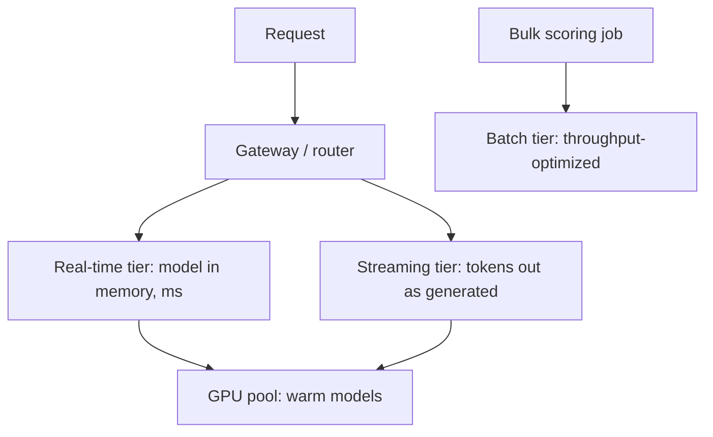

The [lifecycle](/system-design/ai-ml/ml-system-design-basics) ends
with a model artifact (a few hundred MB to a few GB of weights), and
**serving** is turning that artifact into an endpoint that answers
requests. It looks like any
[stateless service](/system-design/fundamentals/scalability) —
requests in, responses out, scaled horizontally — with three
ML-specific twists that shape the whole design: the **artifact is
big** (loading it is slow, so it must be *warm*), the **compute is
special** (often a [GPU](/system-design/ai-ml/gpu-accelerator-management),
a scarce resource), and the **request is expensive** (a forward pass
is orders of magnitude more work than a typical API call, which
changes the [batching](/system-design/ai-ml/batching-and-latency)
and [autoscaling](/system-design/ai-ml/autoscaling-inference)
calculus entirely).

## The serving shapes

- **Real-time (online)**: one request, one forward pass, in a
  latency budget (the [fraud](/system-design/hld/fraud-detection)
  and [recommendation](/system-design/hld/recommendation-system)
  shape): the model *resident* in the server's memory (or the GPU's),
  the [features](/system-design/ai-ml/feature-stores) fetched
  per-request, the response synchronous. The engineering: model
  loading and versioning, warm pools, and the
  [degradation contract](/system-design/ai-ml/offline-vs-online-inference).
- **Batch (offline)**: the model applied to a whole dataset on a
  schedule (the [churn-score](/system-design/ai-ml/batch-vs-real-time-prediction)
  shape): a [batch job](/system-design/fundamentals/stream-vs-batch-processing),
  not a service, optimized for throughput over latency (large
  batches, GPUs saturated, spot instances), and its "serving" is
  the [warehouse](/system-design/fundamentals/olap-vs-oltp) write.
- **Streaming (the LLM-era shape)**: the response is *generated*
  token by token, and the product needs the *first* token fast, not
  the whole answer (the perceived-latency trick: a chatbot that
  starts answering in 300ms feels fast even if it finishes in 5s).
  The serving tier holds a long-lived connection
  ([the chat design's](/system-design/hld/chat-application)
  WebSocket machinery) and emits incrementally, which is a
  *different* contract than request-response.

## The serving tier's contracts

Each decision the tier makes, and its shape:

- **Model versioning at serve time** (a request must be scored by
  the *intended* model version: the [multi-model
  routing](/system-design/ai-ml/multi-model-serving-routing)
  problem, and the reason the [A/B platform](/system-design/ai-ml/ab-testing-experimentation)
  and the serving tier are coupled — the routing *is* the
  experiment assignment).
- **Warmness** (the model must be in memory before the request
  arrives: the [warm-pool](/system-design/ai-ml/model-caching-warm-pools)
  discipline, and the [cold-start](/system-design/ai-ml/serverless-inference)
  problem when it is not).
- **The degradation contract** (scoring fails or times out: the
  [fail-open/fail-closed](/system-design/lld/rate-limiter-lld)
  decision, per product: fraud fails open (allow + challenge),
  search fails to a fallback ranker, a feed serves the cache).
- **Observability** (the model's *own* metrics: prediction
  distribution, latency p99, and the
  [drift](/system-design/ai-ml/model-monitoring-drift) signals —
  the serving tier is where the [exposure log](/system-design/ai-ml/model-monitoring-drift)
  is written).

## The infrastructure underneath

The serving tier is a [stateless
service](/system-design/fundamentals/load-balancing) with the model
as its (large) state, which means: **the model is baked into the
container image** (or mounted: the [object
storage](/system-design/fundamentals/object-storage) + warm-pool
choice), the fleet is [autoscaled](/system-design/ai-ml/autoscaling-inference)
on the *right* signal (queue depth, not CPU: the forward pass is
often not CPU-bound), and the routing is the
[gateway's](/system-design/fundamentals/api-gateway-and-service-mesh)
machinery with a *model-version* dimension added. Everything else —
health checks, rolling deploys, canaries — is the standard
[reliability](/system-design/fundamentals/reliability-engineering)
discipline, with the twist that the *artifact* is the deploy unit
(a model rollout is an artifact rollout, and its failures are
[silent](/system-design/ai-ml/model-monitoring-drift)).

## The framework landscape, named

The serving frameworks (TorchServe, Triton, vLLM, TGI, Ray Serve,
BentoML, the cloud-managed endpoints) are, structurally, the same
tier with different emphases: **Triton/TorchServe** (general
multi-framework serving: batching, versioning, GPU), **vLLM/TGI**
(LLM-specific: the [KV-cache and continuous
batching](/system-design/ai-ml/batching-and-latency) optimizations
that the autoregressive generation demands), and **Ray
Serve/BentoML** (the Python-native composition layer). The
interview-grade point is not the product names but the *shapes*
above — and the recognition that "build a model serving tier" is
"build a latency-budgeted, GPU-backed, model-versioned stateless
service," which is this page.

## Related concepts

- [Batching & Latency](/system-design/ai-ml/batching-and-latency):
  the throughput/latency machinery the tier runs on.
- [GPU & Accelerator Management](/system-design/ai-ml/gpu-accelerator-management):
  the scarce resource underneath.
- [Model Caching & Warm Pools](/system-design/ai-ml/model-caching-warm-pools)
  and [Serverless Inference](/system-design/ai-ml/serverless-inference):
  the warmth problem, both answers.
- [Autoscaling for Inference](/system-design/ai-ml/autoscaling-inference):
  the scaling signal.
- [Offline vs Online Inference](/system-design/ai-ml/offline-vs-online-inference):
  which shape, per product.
