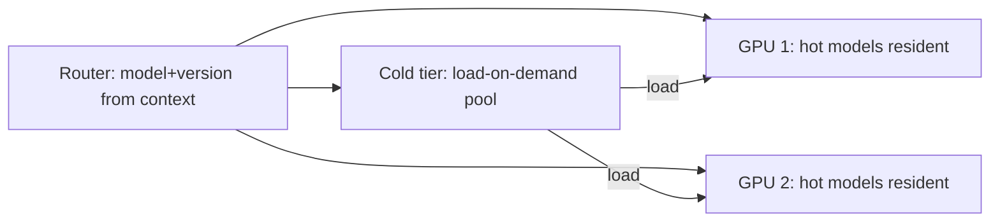

A mature ML platform serves **hundreds to thousands of models**: one
per product, per tenant, per region, per experiment, per model
*version* — and the naive "one dedicated deployment per model" is
unaffordable (idle [GPUs](/system-design/ai-ml/gpu-accelerator-management)
per model, hundreds of fleets). The design problem: **serve many
models from a shared fleet**, routing each request to the model
that should answer it, while keeping the routing itself fast,
versionable, and experiment-aware. This is the
[load balancer](/system-design/fundamentals/load-balancing) and
[API gateway](/system-design/fundamentals/api-gateway-and-service-mesh)
problem with a *model-identity* dimension added — the request does
not just go "somewhere," it goes to a *specific model version*.

## The routing dimensions

What the router decides, per request:

- **Which model** (the product's model: `fraud-model`,
  `feed-ranker`): the [gateway's](/system-design/fundamentals/api-gateway-and-service-mesh)
  path/route mapping, model-shaped.
- **Which *version*** (the [A/B
  experiment](/system-design/ai-ml/ab-testing-experimentation)'s
  assignment: user 42 gets model v7, user 43 gets v8): the routing
  *is* the experiment bucketing, which is why the serving tier and
  the experimentation platform are coupled (the
  [deterministic hash](/system-design/ai-ml/ab-testing-experimentation)
  of the user id decides the model).
- **Which *tenant*** (the [multi-tenant](/system-design/fundamentals/multi-tenancy-and-data-residency)
  case: each customer's own fine-tuned model): the routing keyed by
  the authenticated tenant, with the isolation guarantee.
- **Which *region*** (the [data-residency](/system-design/fundamentals/multi-tenancy-and-data-residency)
  case: the model that may serve this region's data must be the one
  physically there).

The routing *key* (user id, tenant, region, a request attribute) is
the design's first decision, and it must be *available before* the
model runs (the router sees the request's context, not the model's
output) — the same "route on what you know at the door" constraint
as every [gateway](/system-design/fundamentals/api-gateway-and-service-mesh).

## The serving strategies

How many models, loaded how:

- **All resident** (every model loaded on every replica: simple,
  instant routing, and *impossible* at a thousand models — the VRAM
  does not hold them).
- **Hot/cold split** (the standard: the *hot* models (high traffic)
  resident on every replica, the *long tail* (rarely-called models)
  loaded *on demand* from a [warm pool](/system-design/ai-ml/model-caching-warm-pools),
  evicted when idle — the [cache](/system-design/fundamentals/caching)
  hierarchy, at the model layer, with the same
  eviction/load-cost trade). The honest dial: *how many models are
  hot, how fast is a cold load, and how often does the tail get hit*
  — the [capacity planning](/system-design/fundamentals/capacity-planning-and-estimation)
  arithmetic per fleet.
- **Sharded by model** (each model on a *subset* of replicas:
  the [consistent hashing](/system-design/fundamentals/consistent-hashing)
  placement, so a model lives on a few nodes and the router sends
  its traffic there — higher per-model warmth, lower fleet
  utilization, and the hot-model/hot-shard skew to manage).

## The versioning and rollout machinery

The model-identity dimension's real complexity, and where it meets
the [A/B platform](/system-design/ai-ml/ab-testing-experimentation)
and the [retraining loop](/system-design/ai-ml/concept-drift-retraining):

- **Version-pinned routing** (a request's model version is
  *determined* by the assignment, not chosen at load time: the
  [sticky](/system-design/ai-ml/ab-testing-experimentation)
  requirement, so a user's experience is consistent and the
  experiment is valid).
- **Canary and shadow** (route 5% to v8, shadow-score with v9:
  the [deployment](/system-design/fundamentals/reliability-engineering)
  discipline, per model version — and the router is where the
  percentages live).
- **The version matrix** (the *deploy-unit explosion*: N models ×
  M live versions × K [compiled
  runtimes](/system-design/ai-ml/model-runtimes-compilation) =
  a combinatorial fleet requirement, which is *the* reason the
  [warm-pool and eviction machinery](/system-design/ai-ml/model-caching-warm-pools)
  is mandatory, not optional, at scale).
- **The retirement path** (old versions must be *removed* — the
  [strangler](/system-design/hld/large-scale-migration) discipline
  for models: the experiment concludes, the loser's version is
  deleted from the fleet, or the "version matrix" grows forever).

## The platform shape

A model-serving platform (Seldon, KServe, Ray Serve, the cloud ML
platforms) is, structurally: a **model registry** (the artifacts +
metadata: [the caching page's](/system-design/ai-ml/model-caching-warm-pools)
subject) + a **router** (the model-identity-aware gateway above) +
a **warm-pool loader** (load/unload per traffic) + the **GPU
scheduler** ([the accelerator page](/system-design/ai-ml/gpu-accelerator-management))
— which is to say, a [distributed cache](/system-design/hld/distributed-cache)
whose "entries" are models and whose "keys" are model versions. That
reframing is the interview's punchline: **a multi-model serving tier
is a cache of models**, and everything you know about caches
(eviction, warm-up, hit rate, the tail) applies, with the model's
*load cost* (seconds to minutes) as the unusually expensive miss.

## Related concepts

- [Model Serving Architectures](/system-design/ai-ml/model-serving-architectures):
  the single-model tier this generalizes.
- [Model Caching & Warm Pools](/system-design/ai-ml/model-caching-warm-pools):
  the load/evict machinery.
- [A/B Testing & Experimentation](/system-design/ai-ml/ab-testing-experimentation):
  the version-assignment the router enforces.
- [GPU & Accelerator Management](/system-design/ai-ml/gpu-accelerator-management):
  the resource the packing economizes.
- [Distributed Cache](/system-design/hld/distributed-cache): the
  structure this tier is, at model scale.
