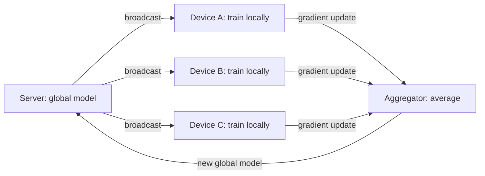

Classic ML centralizes data (collect everything into a training
set), which is exactly what privacy regulation and user
expectation increasingly forbid: the raw data (messages, health
records, keystrokes) is often the *most* sensitive thing the system
holds, and "we need it to train the model" is no longer an
acceptable answer. The two techniques that change this —
**federated learning** (train where the data lives) and
**differential privacy** (train on the data without memorizing
individuals) — are systems architectures, not algorithms, and this
page covers their shapes and their honest costs.

## Federated learning: the model travels, not the data

The inversion: instead of moving data to the model, **move the model
to the data**. Devices (phones, hospitals, banks) train locally on
their own data, and only **model updates** (gradients or weights)
travel to a central server that aggregates them into a global model.

The systems design, and each hard part:

- **The device population is unreliable** (phones are offline,
  battery-limited, on metered connections: participation is
  *sporadic* and *biased* — the devices that report are not a
  random sample, and the aggregation must handle "the cohort
  changes every round," which is [drift](/system-design/ai-ml/concept-drift-retraining)
  built into the architecture).
- **Communication is the bottleneck** (the updates are model-sized,
  the connections are expensive: the field's whole optimization
  surface — compression, quantization of updates, fewer rounds —
  exists because *uploading a gradient is the cost*).
- **The aggregation is a security surface** (a malicious or buggy
  device can poison the global model: the
  [Byzantine-robust](https://en.wikipedia.org/wiki/Byzantine_fault)
  aggregation, the median/trimmed-mean defenses, is a research
  area and a real production concern — the
  [fraud-detection](/system-design/hld/fraud-detection) adversarial
  problem, at the model level).
- **Secure aggregation** (the server should not see any *single*
  device's update, only the sum: cryptographic protocols make the
  aggregation a blind sum, which is the privacy promise's
  technical core).

## Differential privacy: the guarantee, quantified

Where federated learning moves the computation, **differential
privacy (DP)** changes the *output*: a randomized mechanism is
`(ε, δ)`-DP if its output distribution changes only slightly when
any single individual's data is added or removed — i.e., **the
output reveals almost nothing about any one person**, quantified by
the privacy budget `ε` (smaller = more private = more noise).

- **DP-SGD** (the training technique): clip each example's gradient
  (bound any one example's influence), add calibrated noise, and
  the resulting model is DP — the standard for private model
  training, at a *real accuracy cost* (the noise hurts, and the
  cost is the ε dial: privacy is bought, not free).
- **The privacy budget is spent** (every query/training run
  consumes ε: the *composition* accounting — many DP queries
  together leak more than one — is the discipline that makes
  "private" a *tracked budget*, not a property: the
  [error-budget](/system-design/fundamentals/reliability-engineering)
  discipline's privacy twin).
- **Local vs central DP** (local: each device adds noise before
  sending, no trust in the server, worse utility; central: the
  server adds noise, better utility, requires trusting the
  aggregator — the standard trade, and why "trusted execution
  environments" appear in the central-DP designs).

## What each technique actually buys

- **Federated**: raw data never centralizes (regulatory and
  user-trust wins), but the *model* can still memorize
  individuals (the
  [membership-inference](https://en.wikipedia.org/wiki/Membership_inference_attack)
  attacks: a model can leak its training data), so federation
  *alone* is not privacy — it is *data-locality*, and the privacy
  needs DP layered on top.
- **Differential privacy**: a *provable* bound on individual
  leakage, composable and auditable, at an accuracy cost and with
  the budget-accounting overhead — the *guarantee* layer.

The honest production stack is **both** (federated training with
secure aggregation and DP-SGD: the data stays local, the updates
are blinded, and the result is DP), which is exactly the shape of
the large-scale consumer deployments (Google's keyboard, Apple's
usage models) — and the honest caveat that the *accuracy cost of
strong privacy is real* and must be part of the product decision,
not discovered late.

## The adjacent requirements

- **Data minimization at collection** (the cheapest privacy: do not
  collect what you do not need: the
  [security-fundamentals](/system-design/fundamentals/security-fundamentals)
  least-privilege instinct, applied to data), and **retention
  limits** (the [object-storage](/system-design/fundamentals/object-storage)
  lifecycle rules, but for privacy).
- **Right-to-deletion vs. trained models** (GDPR's erasure right
  meets a model that has *absorbed* the data: the hard, unsolved
  problem — retraining from scratch without the data is the only
  honest answer, which is why *retention of training data* and
  *the ability to retrain* are privacy-architecture decisions).
- **PII in features** (the [feature store's](/system-design/ai-ml/feature-stores)
  content: hashed identifiers, aggregated-only features, and the
  [multi-tenancy/residency](/system-design/fundamentals/multi-tenancy-and-data-residency)
  tagging that says which features are regulated).

## Related concepts

- [Bias, Fairness & Explainability](/system-design/ai-ml/bias-fairness-explainability):
  the other trust requirement on models.
- [Responsible AI & Safety](/system-design/ai-ml/responsible-ai-safety):
  the governance wrapping both.
- [Security Fundamentals](/system-design/fundamentals/security-fundamentals):
  the broader protection discipline.
- [Multi-Tenancy & Data Residency](/system-design/fundamentals/multi-tenancy-and-data-residency):
  where data may physically live.
- [Feature Stores](/system-design/ai-ml/feature-stores): where
  privacy constraints land in the serving path.
