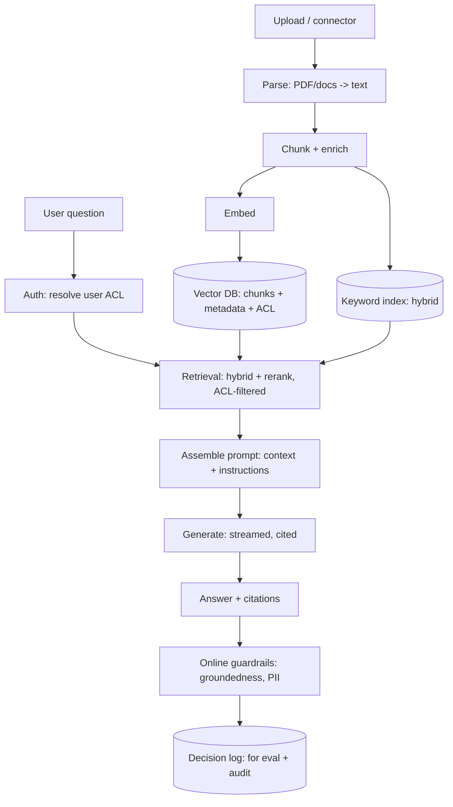

"Chat with your documents" is the flagship LLM-era product, and it
is the [RAG](/system-design/ai-ml/rag) pattern as a *system*: an
ingestion pipeline that turns documents into a searchable index, a
query path that retrieves and generates, and the evaluation and
safety machinery that keep it honest. It is the AI/ML track's
canonical HLD — every LLM-system design conversation is a variation
on it — and the design's quality lives in the joins (retrieval
precision, grounding, permissions), not in the model choice.

## Requirements

**Functional**

- Ingest documents (uploaded files, connected sources: Drive,
  Confluence, a database), from many formats (PDF, docs, HTML).
- Ask a question in natural language; get an answer grounded in
  the documents, with citations.
- Conversational (follow-ups with context).
- Access control: each user sees only documents they may access.

**Non-functional**

- **Answer quality** (the product: correct, grounded, cited — the
  [evaluation](/system-design/ai-ml/evaluating-llm-systems) axes:
  retrieval, groundedness, relevance).
- **Latency** (the first token in ~1-2s: the retrieval is fast, the
  generation dominates — the [TTFT](/system-design/ai-ml/llm-serving)
  budget).
- **Freshness** (a document added is searchable within minutes: the
  ingestion pipeline is *standing*, not a nightly job).
- **Cost** (per-query tokens and the embedding/index storage: the
  [token budget](/system-design/ai-ml/cost-token-budgets)).
- **Permissions** (the answer must never surface a document the
  user may not see: the [security](/system-design/fundamentals/security-fundamentals)
  requirement, and the hardest join in the system).

## The architecture

## The components, and the decisions

**Ingestion (offline, standing)**: parse (the *unglamorous hard
part*: PDFs are hostile — tables, columns, images: the parse quality
caps the whole system), [chunk](/system-design/ai-ml/chunking-indexing-strategies)
(structural + heading-enriched, tuned against retrieval metrics),
[embed](/system-design/ai-ml/embeddings-vector-representations), and
index into *both* the [vector store](/system-design/ai-ml/vector-databases)
and the keyword index (the [hybrid](/system-design/fundamentals/search-and-inverted-index)
default). The pipeline is *incremental* (a document change re-chunks
and re-embeds *that* document: the [re-indexing](/system-design/ai-ml/chunking-indexing-strategies)
discipline) and *permission-tagged* (every chunk carries its source
document's ACL: the [multi-tenancy](/system-design/fundamentals/multi-tenancy-and-data-residency)
metadata, mandatory for the filter below).

**Retrieval (online)**: the [filtered
search](/system-design/ai-ml/similarity-search-ann) — the query
embeds, the vector search runs *with the user's ACL as a filter*
(only their documents: the *security-critical* step, and the reason
the ACL is *in the index*, not a post-filter), the keyword search
merges (hybrid), and a **reranker** keeps the top ~5 chunks (the
precision stage: [RAG's](/system-design/ai-ml/rag) quality lever).

**Generation**: the [prompt assembly](/system-design/ai-ml/prompt-engineering-systems)
(system instructions ("answer only from the context, cite sources")
+ the retrieved chunks + the conversation history, under the
[context budget](/system-design/ai-ml/cost-token-budgets)) and the
[streamed](/system-design/ai-ml/model-serving-architectures)
generation with citations.

**Guardrails and evaluation**: the [output
validation](/system-design/ai-ml/llm-guardrails-validation)
(groundedness check: does the answer cite a retrieved chunk? PII
scan) and the [decision log](/system-design/hld/fraud-detection)
(every Q&A for the [offline eval](/system-design/ai-ml/evaluating-llm-systems)
and the audit).

## The hard parts

- **Permission-filtered retrieval** (the *defining* hard problem:
  the vector search must return only the user's documents, and the
  naive "search then filter" both *starves* (the top-k are all
  inaccessible) and *leaks* (the ranking saw inaccessible content):
  the answer is *filter-aware* retrieval (per-tenant/per-ACL
  partitions or in-index filtering) — the
  [filtered-vector-search](/system-design/ai-ml/similarity-search-ann)
  problem, with security stakes).
- **Parse quality** (the PDF-with-tables problem: the whole pipeline
  is capped by what the parser extracted — a real, underestimated
  engineering sink).
- **Grounding** (the model *will* sometimes ignore the context or
  hallucinate: the prompt constrains, the [guardrail
  verifies](/system-design/ai-ml/llm-guardrails-validation), and the
  [eval](/system-design/ai-ml/evaluating-llm-systems) measures — no
  single mechanism suffices).
- **Staleness** (a document is deleted, the chunk lingers: the
  [re-index/invalidation](/system-design/ai-ml/chunking-indexing-strategies)
  discipline, and the permission change *too* — a user loses
  access, the chunks must stop appearing).
- **Conversation context** (follow-ups need history, but the
  [context window](/system-design/ai-ml/llm-serving) is finite: the
  history summarization/selection decision).

## Capacity sketch

The arithmetic: N documents * ~chunks-per-doc * ~1 KB-per-chunk-vector
is the index (a million docs at ~20 chunks each, ~768-dim
embeddings, [quantized](/system-design/ai-ml/inference-optimization):
~tens of GB — a [vector-database](/system-design/ai-ml/vector-databases)
shard or two); the query path is ~100k Q&A/day (retrieval: ms,
generation: the [LLM tier's](/system-design/ai-ml/llm-serving)
cost — the dominant bill, and the
[caching](/system-design/ai-ml/llm-caching) target); the ingestion
is bursty (a bulk upload: the [queue](/system-design/fundamentals/message-queues-and-pubsub)
absorbs it).

## Related concepts

- [Retrieval-Augmented Generation](/system-design/ai-ml/rag): the
  pattern, in depth.
- [Chunking & Indexing](/system-design/ai-ml/chunking-indexing-strategies)
  and [Vector Databases](/system-design/ai-ml/vector-databases):
  the retrieval tier.
- [Guardrails & Output Validation](/system-design/ai-ml/llm-guardrails-validation)
  and [Evaluating LLM Systems](/system-design/ai-ml/evaluating-llm-systems):
  the safety and measurement.
- [LLM Gateways](/system-design/ai-ml/llm-gateways) and
  [Cost & Token Budgets](/system-design/ai-ml/cost-token-budgets):
  the serving and cost tier.
