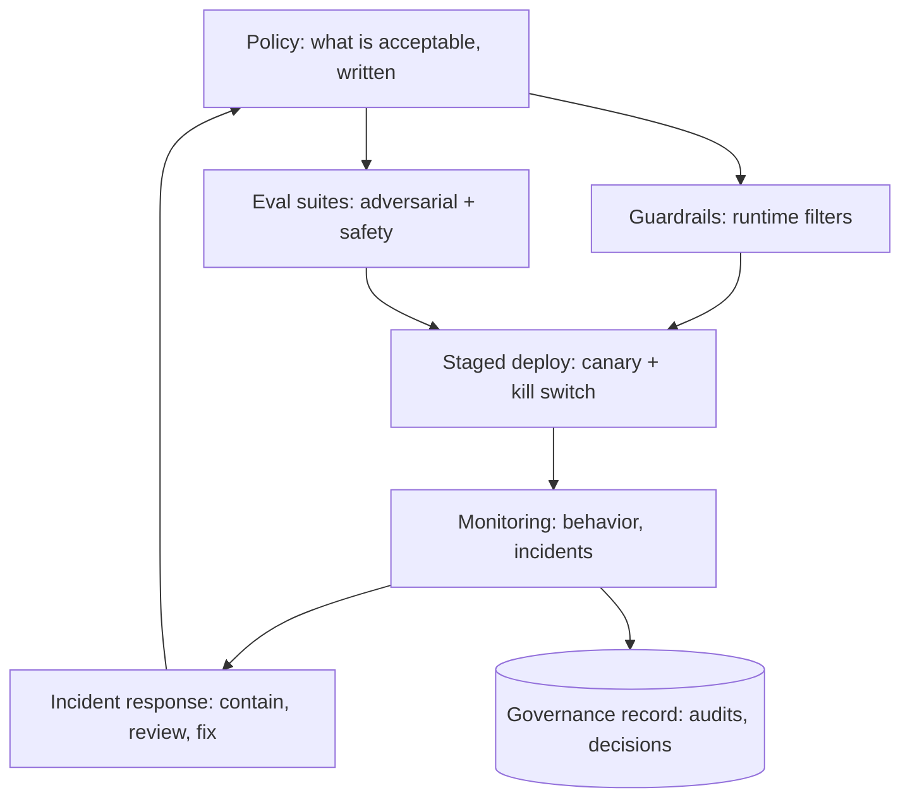

"Responsible AI" is often dismissed as ethics-washing, and the
dismissal is fair *when it is a values statement with no
machinery*. This page is the opposite: the **engineering practices**
that turn responsible-AI from a principle into a running system —
guardrails, evaluations, staged rollout, incident response, and the
governance records that make the whole thing auditable. The
organizing idea: a model is a *deployed system with emergent,
hard-to-predict behavior*, so "responsible" means treating it like
one — with the same operational rigor as any production service,
aimed at failure modes (harmful outputs, biased decisions,
data leakage) that health checks cannot see.

## The practices, as a system

- **Policy, written** (the *definition* of acceptable: what the
  model must never do, what it must do, the fairness metric
  [chosen](/system-design/ai-ml/bias-fairness-explainability):
  vague principles are unenforceable, and the writing is the first
  deliverable — it becomes the test suite's spec).
- **Guardrails** (the *runtime* layer: input filters (prompt
  injection, PII detection), output filters (toxicity, policy
  violations, [hallucination](/system-design/ai-ml/responsible-ai-safety)
  checks), and the *refusal* behavior (when the model should not
  answer): a [rate-limiter](/system-design/lld/rate-limiter-lld)-shaped
  interceptor in front of and behind the model, with its own
  false-positive cost (over-refusal is a product failure, so the
  guardrail has *its* precision/recall trade,
  [evaluated](/system-design/ai-ml/evaluation-metrics) like any
  model).
- **Eval suites** (the *pre-deploy* tests: a curated set of
  adversarial and safety prompts/inputs, run on every candidate
  model, versioned, growing with each incident — the
  [regression-test](/system-design/fundamentals/reliability-engineering)
  discipline for behavior, and the *only* way "we fixed the
  jailbreak" stays fixed).
- **Staged deployment** (the [canary](/system-design/fundamentals/reliability-engineering)
  discipline, model-shaped: small traffic share, safety metrics as
  guardrails, and a **kill switch** (the ability to disable or
  revert the model instantly: the feature-flag machinery, and the
  thing that makes every other practice safe to attempt).
- **Monitoring and incident response** (the
  [drift](/system-design/ai-ml/model-monitoring-drift) plus a
  *behavior* feed: reported harms, refusal rates, distribution of
  outputs; and the incident process: contain (kill switch),
  investigate (the [decision log](/system-design/hld/fraud-detection)),
  fix (eval case added, guardrail tightened, model retrained),
  record — the [blameless-postmortem](/system-design/fundamentals/reliability-engineering)
  discipline, for harms instead of outages).
- **Governance records** (the *audit*: which model version served
  which decision, with what explanation, under which policy — the
  [lineage](/system-design/ai-ml/data-versioning-lineage) and
  [decision-log](/system-design/hld/fraud-detection) machinery,
  assembled into the artifact a regulator or reviewer asks for).

## The failure modes this catches

- **Harmful or off-policy outputs** (the guardrail's job: the
  output filter and the refusal behavior, with the
  [LLM-era](/system-design/ai-ml/responsible-ai-safety) versions —
  prompt injection, jailbreaks — being an active,
  adversarial arms race, which is why the eval suite *grows*).
- **Bias and disparate impact** (the per-segment monitoring and
  the fairness audit, per the
  [fairness page](/system-design/ai-ml/bias-fairness-explainability)).
- **Privacy leakage** (the
  [membership-inference](/system-design/ai-ml/privacy-preserving-ml)
  and PII-in-output checks, and the
  [differential-privacy](/system-design/ai-ml/privacy-preserving-ml)
  guarantees where required).
- **Silent capability regressions** (the *whole reason for the eval
  suite*: a model "improved" on the primary metric can lose an
  important behavior the suite pins — the
  [offline/online](/system-design/ai-ml/offline-vs-online-evaluation)
  gap, in the safety dimension).
- **Feedback-loop amplification** (the
  [recommendation](/system-design/hld/recommendation-system)
  system drifting toward its metric's shape: monitored as a
  *long-horizon* behavior metric, not just a daily one).

## The organizational reality (worth stating)

The honest note this page owes: responsible AI is *sociotechnical* —
the machinery above is necessary and not sufficient, because the
*policy* (what is acceptable) is a human, often contested decision,
the *incentives* (ship fast vs. ship safe) are organizational, and
the *accountability* (who signs off) is governance. The
engineering contribution is making the policy *enforceable and
auditable* (the guardrails, evals, and records), so that the
decision is *made deliberately and checked continuously* rather
than assumed. "We have guardrails and an eval suite and a kill
switch" is the concrete answer; "we care about safety" is not.

## Where this sits in the track

This is the *trust* capstone of the AI/ML track: it consumes the
[fairness](/system-design/ai-ml/bias-fairness-explainability) and
[privacy](/system-design/ai-ml/privacy-preserving-ml) measurements,
the [monitoring](/system-design/ai-ml/model-monitoring-drift) and
[retraining](/system-design/ai-ml/concept-drift-retraining) loops,
the [experimentation](/system-design/ai-ml/ab-testing-experimentation)
platform, and the [deployment](/system-design/fundamentals/reliability-engineering)
discipline — and assembles them into the operating practice a
deployed model needs to be *responsible*, which for a systems
designer means: **policy made testable, behavior watched,
incidents processed, and the whole thing auditable.**

## Related concepts

- [Bias, Fairness & Explainability](/system-design/ai-ml/bias-fairness-explainability):
  the measurement half.
- [Privacy-Preserving ML](/system-design/ai-ml/privacy-preserving-ml):
  the data-protection half.
- [Model Monitoring & Data Drift](/system-design/ai-ml/model-monitoring-drift):
  the watching machinery.
- [Reliability Engineering](/system-design/fundamentals/reliability-engineering):
  the canary/kill-switch/postmortem discipline this borrows.
- [Design a Fraud Detection System](/system-design/hld/fraud-detection):
  decision logs and explainability, in production.
