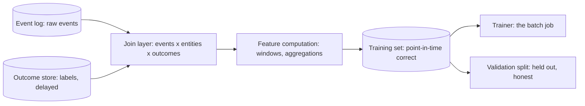

A model is a *function of its training data*, which makes the
pipeline that produces that data the highest-leverage component in
any ML system: a bug here is not a wrong answer, it is a *wrong
model*, manufactured at scale and deployed confidently. The
training data pipeline is the
[warehouse](/system-design/fundamentals/olap-vs-oltp) tier's ETL
with one extra discipline that classic data engineering never
needed: **point-in-time correctness** — every training example must
look exactly like a *real request looked at that moment*, or the
model learns from information it will not have when it matters
(the **leakage** problem, this page's central hazard).

## The pipeline shape

The stages, each a familiar concept wearing ML's requirements:

**Collection and join**: the raw material is the
[event log](/system-design/fundamentals/event-sourcing-and-cqrs)
plus entity tables plus *outcomes* (labels:
[the labeling page](/system-design/ai-ml/data-labeling-annotation)'s
delayed ground truth). The join is
[time-windowed](/system-design/fundamentals/stream-vs-batch-processing)
(each training example joins "what was known at time T" with "what
happened after T": the label side is *the future relative to the
feature side, by construction*), which is what makes the whole
thing a training set rather than a pile of correlated rows.

**Feature computation**: the same
[windowed aggregates](/system-design/hld/fraud-detection) that
serving uses (7-day counts, 30-day sums, distinct merchants), and
the discipline that connects the two halves: **training features
and serving features must be the same computation** (the
[training/serving skew](/system-design/hld/fraud-detection)
problem: a training feature computed "over the last 7 calendar
days" and a serving feature computed "over the trailing 7*24*
hours" are *different features*, and the model trained on one is
silently mismatched with the other — the quiet killer, and the
argument for a [feature store](/system-design/ai-ml/feature-stores)
that computes both from one definition).

**The split** (train / validation / test): the held-out discipline
with ML's own traps — *leakage across the split* (the same user in
train and validation: the model memorizes the user, not the
pattern), *temporal leakage* (validation data from *before* training
data: the split must be **by time**, because in production the
model always predicts the future from the past), and the honest
test set's sanctity (used once, never tuned against: the
[evaluation](/system-design/ai-ml/ml-system-design-basics)
page's subject).

## Point-in-time correctness, the leakage family

The pipeline's one genuinely ML-specific hazard, worth a full
listing because every item is a classic production bug:

- **Label leakage** (a feature computed *using* the outcome: "days
  since last chargeback" as a fraud feature — the chargeback *is*
  the label. The model learns the answer, evaluates perfectly,
  ships, and fails at everything).
- **Temporal leakage** (features computed "as of now" over data
  that includes the prediction's future: "user's 30-day spend"
  computed from *today* for an example timestamped 20 days ago
  includes 10 days of future. The fix: every feature computation
  takes an *as-of* timestamp, and the pipeline joins against
  history at that moment — the "point-in-time" contract).
- **Entity leakage across splits** (the same user, session, or
  device appearing in both train and validation: the split must
  respect entity boundaries or the evaluation measures memorization).
- **Serving-skew leakage** (features that *cannot exist* at serving
  time, trained on anyway: anything computed from the full dataset
  rather than "what a request could see", which is why the
  point-in-time discipline is the *serving* contract, applied
  backward to training).

The detection discipline: an offline metric that is *too good*
(the [fraud](/system-design/hld/fraud-detection) model at 99.9%
accuracy: nothing is 99.9% accurate, something is leaking) and the
persistent honesty that **evaluation happens on the
[hung-out](/system-design/ai-ml/ml-system-design-basics) data, and
the pipeline's job is to keep that data honest.**

## The operational shape

The training pipeline is a [batch](/system-design/fundamentals/stream-vs-batch-processing)
job on a schedule (nightly, weekly, on label arrival), and the
[warehouse](/system-design/fundamentals/olap-vs-oltp) is its natural
home: SQL-shaped joins, windowed features, and the *reproducibility*
that [experiment tracking](/system-design/ai-ml/ml-system-design-basics)
requires (the same query over the same snapshot: the same training
set — which is the [data versioning](/system-design/ai-ml/data-versioning-lineage)
page's subject). The incremental variants
([streaming](/system-design/fundamentals/stream-vs-batch-processing)
joins, continuously-updated training sets) are the same
discipline with a tighter cadence, and the cadence is the
[batch-vs-realtime](/system-design/ai-ml/batch-vs-real-time-prediction)
product decision, applied to learning rather than serving.

## Capacity sketch

The arithmetic that shapes it: a [feed](/system-design/hld/recommendation-system)-class
system collects ~10B events/day-class, joins into training sets of
~10^9 examples with ~100 features each (the
[hundreds of GB](/system-design/fundamentals/object-storage)-class
[warehouse](/system-design/fundamentals/olap-vs-oltp) workload),
and the nightly pipeline is a [batch fleet](/system-design/fundamentals/capacity-planning-and-estimation)
sized by the join (hours) more than the training (the trainer is
the [GPU fleet](/system-design/ai-ml/ml-system-design-basics)'s
bill, the pipeline is the data tier's).

## Related concepts

- [Data Labeling & Annotation](/system-design/ai-ml/data-labeling-annotation):
  the label half of the join.
- [Data Versioning & Lineage](/system-design/ai-ml/data-versioning-lineage):
  reproducibility's machinery.
- [Feature Engineering Basics](/system-design/ai-ml/feature-engineering-basics):
  the computation layer, in depth.
- [Stream vs. Batch](/system-design/fundamentals/stream-vs-batch-processing):
  the windowed-join machinery, formalized.
- [OLAP vs. OLTP](/system-design/fundamentals/olap-vs-oltp): the
  tier this pipeline lives on.
