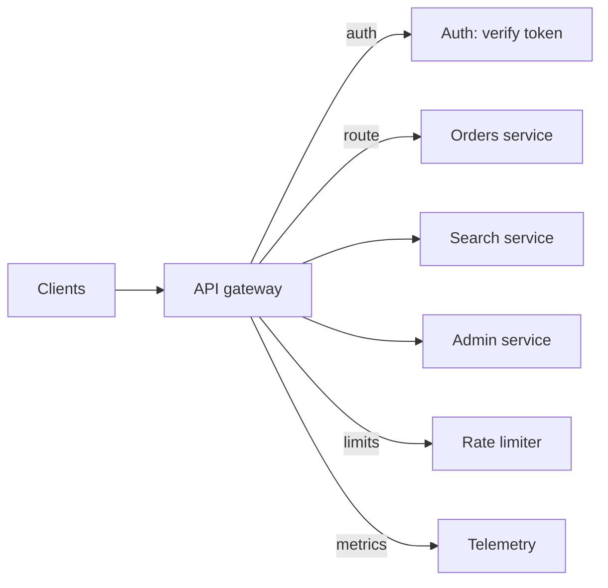
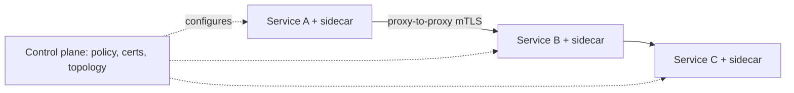

As a system splits into services, two distinct problems appear, and
they are easy to conflate because both are solved by "a proxy in the
middle". The first is **outside-in**: hundreds of internal services,
one public API, clients who should not know or care how many boxes
stand behind the name, and a long list of things every request needs
(auth, rate limits, metrics) that no single service should implement.
The second is **inside-out**: dozens of services calling dozens of
services, and the same cross-cutting concerns (TLS, retries, telemetry,
traffic policy) needed on every one of those calls, without every team
re-implementing them.

The [API gateway](https://en.wikipedia.org/wiki/API_gateway) solves
the first. The **service mesh** solves the second. Both are
[reverse proxies](/system-design/fundamentals/proxies) with a scope,
and the scope is the design.

## The API gateway: the front door

The gateway is the single entry point that clients talk to: one
hostname, one TLS certificate, one place where the cross-cutting
concerns live.

What the position buys, which is the interview's real checklist:

- **Routing**: one public surface, many private services
  (`/api/orders` → orders, `/api/search` → search), and teams deploy
  behind it without touching any client.
- **Authentication**: verify the caller once, at the door, and hand
  services a trusted identity (headers, tokens), so each service does
  not re-implement auth. The boundary discipline:
  [authn at the edge](/system-design/fundamentals/auth-basics),
  authorization per-service (the gateway knows *who*; each service
  knows *what they may do*).
- **Rate limiting and quotas**: per client, per endpoint, enforced at
  the door before capacity is spent
  ([the distributed limiter](/system-design/hld/rate-limiter-distributed)
  is often *behind* this one).
- **Observability**: one access log with every request, the natural
  [trace](/system-design/fundamentals/observability) origin, and
  latency/error metrics per route without instrumenting each service.
- **Protocol translation**: HTTPS externally, whatever internally;
  REST to clients, [gRPC](/system-design/fundamentals/api-design)
  internally; the
  [serialization](/system-design/fundamentals/serialization-and-schema-evolution)
  boundary lives here too.
- **Response shaping**: caching, compression, and coarse-grained
  responses composed from several services ([BFF](https://en.wikipedia.org/wiki/Backend_for_frontend)
  is the gateway pattern specialized per client type).

The honest costs, which the mature answer names: the gateway is a
**single point of failure** (mitigated exactly as the
[load balancer](/system-design/fundamentals/load-balancing)'s is:
redundant pairs), a **latency hop** (one internal round trip per
request), and a **coordination point** (every team's change passes
through gateway config, which at scale becomes its own org-bureaucracy
and the reason "gateway config" is a pipeline, not a YAML file someone
edits).

## The service mesh: the uniform internal layer

Once there are many services, the service-to-service calls need the
same treatment: mTLS (encrypt and authenticate *every* internal hop),
retries with budgets, timeouts, circuit breaking, per-route traffic
policy (canary splits, failovers), and uniform telemetry. The mesh's
move is to take that logic **out of every service** and put it in a
proxy deployed next to each one (the
**sidecar**), with a control plane configuring them all.

- **Data plane**: the sidecars, relaying every call, applying policy
  (the [reverse proxy](/system-design/fundamentals/proxies) position,
  per-service).
- **Control plane**: certificates issued and rotated, routing rules,
  retry budgets, canary weights, pushed to every sidecar.

What it buys: mTLS everywhere with zero application code (the
credential-distribution problem solved once), uniform
retries/timeouts/circuit breaking with configuration instead of
libraries, traffic shaping (deploy 1% canary, watch
[golden signals](/system-design/fundamentals/observability), promote),
and top-level visibility into the call graph that no single service
can see.

The honest costs, which is why the decision is debated: **resource
overhead** (a proxy process per service: memory, a hop), **operational
complexity** (a control plane is a distributed system you now run),
and the classic "day 2 problem" (the mesh is *great* at the things you
discover you needed, and expensive for the things you could have
library'd). At small scale the same features come from a shared
library (retries, telemetry, auth) inside each service; the mesh is
the answer when the polyglot boundary or the uniform-policy need makes
libraries insufficient.

## Gateway vs. mesh: the boundary

The clean division, worth stating out loud:

- **Gateway**: north-south traffic (outside in). Auth of strangers,
  rate limiting of the public, one name for many services.
- **Mesh**: east-west traffic (service to service). mTLS between
  friends, retries, traffic policy, uniform telemetry.

The two compose (nearly every large deployment runs both), and the
vocabulary drifts: "gateway" features end up in mesh products and vice
versa, with the *scope* (whose traffic, what trust level) being the
durable distinction, not the feature list.

## Related concepts

- [Proxies](/system-design/fundamentals/proxies) is the parent
  pattern: both of these are configured middlemen.
- [Load Balancing](/system-design/fundamentals/load-balancing): the
  gateway is a load balancer with policy; the mesh sidecar is one per
  service.
- [Networking Basics](/system-design/fundamentals/networking-basics):
  the L4/L7 and TLS layers these products are built from.
- [API Design](/system-design/fundamentals/api-design): what the
  gateway routes, and where the versioning story attaches.
- [Microservices vs. Monolith](/system-design/fundamentals/microservices-vs-monolith):
  the architecture that creates the problem both products solve.
