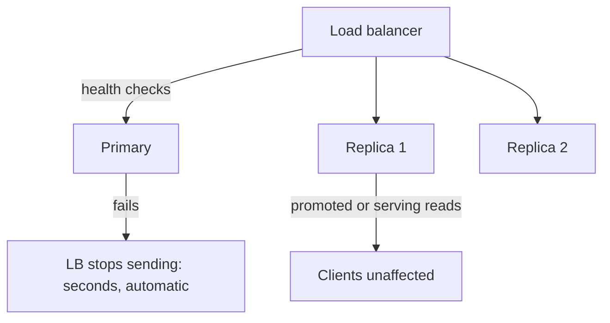

Everything fails: disks, machines, network links, whole regions,
deployed software. **Availability** is the measure of a system that
keeps working anyway: the fraction of time it is up, expressed in
those famous "nines". **Reliability** is the related but broader
question of whether it is working *correctly*, which includes being
up but wrong. This page is about the machinery that makes the first
one true (redundancy and failover) and the design discipline that
makes both survivable (assuming failure rather than preventing it).

The nines themselves, worth knowing cold because the arithmetic
surprises people:

| Availability | Downtime per year | What it implies |
| --- | --- | --- |
| 99% ("two nines") | ~3.7 days | Planned maintenance windows are fine |
| 99.9% ("three nines") | ~8.8 hours | Maintenance must be zero-downtime |
| 99.99% ("four nines") | ~52 minutes | Every deploy is a risk; single components cannot fail visibly |
| 99.999% ("five nines") | ~5 minutes | Hardware failures must be invisible; ops is a serious discipline |

The jump in cost per nine is superlinear, and the
[SLO page](/system-design/fundamentals/reliability-engineering) is the
discipline of deciding how many you actually need (per feature: the
checkout needs more than the filler panel), rather than defaulting to
"more nines is better". The other half of the arithmetic: availability
multiplies across components *in practice* only when failures are
independent, which is the page's central theme.

## The core idea: redundancy plus failover

A single component fails with certainty (given enough time). The only
structural answer is **redundancy** (multiple copies, all able to do
the work) plus **failover** (the system notices a death and moves to
a survivor without human intervention). Everything else, replication
strategies, load balancer health checks, cluster quorums, is the
implementation of that pair.

The standard pattern for a stateful component (a database): a
**primary** that accepts writes, streaming a
[replication log](/system-design/fundamentals/database-fundamentals)
to **replicas** that serve reads and stand ready to be promoted. The
[load balancer](/system-design/fundamentals/load-balancing) probes
every instance (the health check), removes the dead one from rotation
within seconds, and the traffic keeps flowing. The whole trick is
that no human was paged for a *component* failure: humans are for
*system* failures.

**Stateless tiers** are easier: any server serves any request, so
redundancy is just "several servers behind a balancer" and failover is
the balancer's health check. It is the *stateful* components (the
database, the queue, the
[cache](/system-design/hld/distributed-cache)) where
failover is a design, because the data has to be somewhere, and the
promoted replica has to be trustworthy, which is where
[consensus](/system-design/fundamentals/consensus-and-leader-election)
and the split-brain problem enter (a promotion during a network
partition can create two primaries: the
[CAP](/system-design/fundamentals/cap-theorem-and-consistency-models)
page's hardest corner).

## The failure-design discipline

The load-bearing idea of the whole subject: **you cannot prevent
component failure, so you design the system so that failure is
expected, contained, and boring.** The checklist of moves:

- **Eliminate single points of failure**, systematically, on paper:
  every component that must work for the product to work, listed, and
  each given a redundancy and a failover story. The
  [load balancer](/system-design/fundamentals/load-balancing) itself,
  the obvious SPOF, is the classic example (a redundant pair with a
  floating IP).
- **Assume the dependency is down**: every caller designs for its
  dependency's failure, with timeouts (always), retries with backoff
  ([carefully](/system-design/fundamentals/idempotency-and-exactly-once)),
  circuit breakers (stop hammering the dead thing), and graceful
  degradation (serve the stale
  [cache](/system-design/fundamentals/caching), the fallback page,
  the reduced feature). The failure of a *part* should shrink the
  product, not break it.
- **Plan for correlated failure**: the nines arithmetic assumes
  independence, and reality delivers correlation: the same deploy
  kills every instance of a service (the most common real outage:
  software failure, not hardware), the same power strip, the same
  [region](/system-design/fundamentals/multi-region-and-active-active).
  Redundancy in the same failure domain is decorative: this is the
  reason for multi-AZ before
  [multi-region](/system-design/fundamentals/multi-region-and-active-active),
  and the reason "we have three replicas" answers nothing until you
  ask *where*.
- **Test the failure**: failover that has never been exercised is a
  hypothesis. Chaos engineering (killing instances on purpose, in
  production) is the discipline of making the hypothesis a tested
  fact, and "we kill a box every week" is what mature availability
  practice looks like.

## The honest limits

- **Availability multiplies, so complexity has a cost**: a chain of
  five components at 99.9% each is at ~99.5% *if independent*
  (0.999^5), and worse under correlation. Every dependency is a
  withdrawal from the availability budget, which is the deep argument
  for shallow architectures (the
  [monolith](/system-design/fundamentals/microservices-vs-monolith)'s
  quiet advantage).
- **Deploys are the dominant real-world failure source**, not
  hardware: the change you shipped is what broke it, which is why
  zero-downtime deploys, canaries, and rollback discipline live in
  this subject, not in "performance".
- **The last nine is organizational**: five nines means hardware
  failures invisible, deploys canaried, failure drills routine,
  on-call that actually works: it is an ops maturity statement more
  than an architecture one, which is why the
  [error budget](/system-design/fundamentals/reliability-engineering)
  exists (the policy that matches the ambition).

## Related concepts

- [Reliability Engineering (SLOs & Error Budgets)](/system-design/fundamentals/reliability-engineering)
  is the policy layer over this machinery.
- [Load Balancing](/system-design/fundamentals/load-balancing): the
  health checks that make failover automatic.
- [Database Fundamentals](/system-design/fundamentals/database-fundamentals):
  replication, the stateful component's redundancy.
- [Consensus & Leader Election](/system-design/fundamentals/consensus-and-leader-election):
  safe promotion, split-brain avoidance.
- [Multi-Region & Active-Active](/system-design/fundamentals/multi-region-and-active-active):
  the region-level version of this same pattern.
