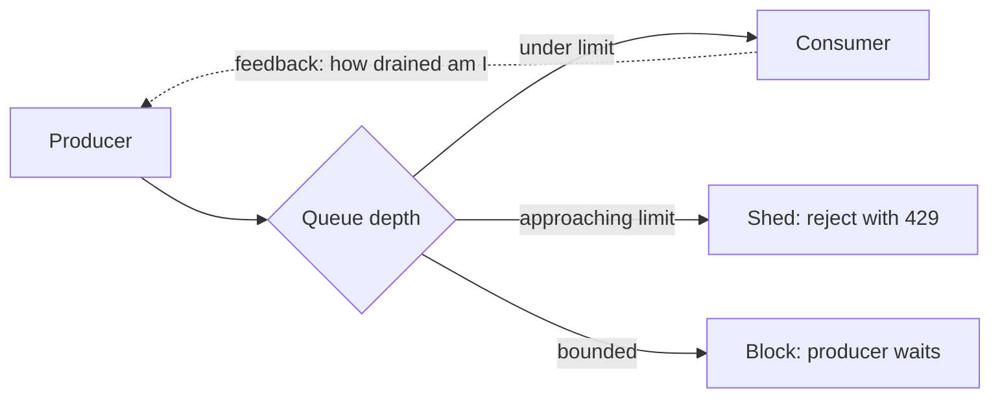

Every queue, every pipeline, every request path has a moment where work
arrives faster than work can be finished. The [queue
page](/system-design/fundamentals/message-queues-and-pubsub) treats
that as a feature: the buffer absorbs a spike. This page is about what
happens when the spike *never ends*, because the buffer is a bathtub,
not an ocean: at some depth, the queue is the outage (memory dies,
latency is a function of queue depth, and old work is worth less than
nothing).

The term is borrowed from fluid systems, and the metaphor is precise:
**backpressure is pressure applied backward up the pipe, from the
consumer to the producer**, because the only durable fix for overload is
producing less, and the consumer is the only party that knows it is
drowning.

## The three answers, and their honest costs

**Buffer (absorb).** Let the queue grow and drain later. Perfect for
*spikes* (the traffic pattern where buffering is exactly right: burst
in, steady out, everyone waits a few seconds and forgets). Wrong for
*sustained overload*, where the buffer grows forever, and each of its
failure modes is a classic production incident: memory exhaustion (the
OOM kill that turns overload into an outage), unbounded latency (a
10-minute queue is a 10-minute outage wearing a 200 response code), and
stale work (the notification that arrives two hours late, worth less
than the cost of storing it).

**Shed (refuse).** Drop or reject the excess, on purpose, at a chosen
point. What is dropped is a *policy*: newest (drop the incoming request:
simple, fair-ish, user-visible), oldest (drop the stale: perfect for
anything whose value decays, dangerous for money), random (fair, easy
in a ring buffer), or *by class* (drop the analytics event, never the
payment). The refusal must be *legible* to the client: a
[429 with Retry-After](/system-design/fundamentals/rate-limiting), an
explicit error, not a timeout, because the client that learns "come back
later" is a client that stops hammering.

**Slow the producer (propagate).** Tell the source to stop producing:
TCP receive windows (the protocol-level backpressure that makes
non-blocking I/O honest), bounded queue semantics ("your enqueue blocks
until there is room"), batch pulls (the consumer takes 100 at a time
and only comes back when it wants more), or application-level signals
(the [job scheduler](/system-design/hld/distributed-job-scheduler)'s
admission control). This is the only answer that fixes *sustained*
overload, and it requires the producer to *cooperate*, which is the
catch: the producer must be in your system (a TCP peer, your own
service), not the general internet.

## The decisions that make it a design

**Where the limit lives.** A queue with no limit is a
[buffer](/system-design/fundamentals/message-queues-and-pubsub) with no
opinion; a bounded queue forces the policy at *enqueue* time (reject,
block, drop-oldest), which is the correct place: the decision is made
before the memory is spent, not after. The
[rate limiter](/system-design/lld/rate-limiter-lld)'s blocking
`acquire()` is the same decision on the *request* path.

**What gets dropped, in what order.** Priority classes (the payment
survives, the analytics dies), age (drop the stale), and fairness across
tenants (one customer's flood must not become everyone's drops) are the
product decisions hiding inside "shed load".

**How the consumer reports.** Backpressure is only real if the producer
*learns* something: the batch-pull consumer that stops asking is the
gentlest signal (the [notification system](/system-design/hld/notification-system)
dispatchers work this way: providers get what they ask for); the
bounded-queue block is the strongest (the producer *cannot* proceed);
a load average exposed as a metric is the weakest (someone must be
watching).

## The failure mode worth studying: the retry storm

Overload's natural follow-up is the retry storm, and it is the reason
shedding must be designed *with* the client's retry policy, not
independently. The system sheds load; every rejected client retries,
ideally immediately (the naive policy), so offered load *doubles* at
the exact moment the system is drowning; the second wave of drops makes
it triple. The two fixes that actually work:

- **Exponential backoff with jitter** on the client, so a cohort of
  rejected requests does not synchronize into waves.
- **Shed *early* and legibly**, so clients learn before their
  timeout, because the client that times out retries blind (and the
  [idempotency](/system-design/fundamentals/idempotency-and-exactly-once)
  question of what that retry then does is its own page).

The [flash sale](/system-design/hld/e-commerce-flash-sale)'s admission
control and the [rate limiter](/system-design/fundamentals/rate-limiting)'s
client protocol are exactly this collaboration, and the
[job scheduler](/system-design/hld/distributed-job-scheduler)'s
retry-delay note is the same policy at the scheduling layer.

## Load leveling versus overload

The design distinction that keeps this page honest: **leveling**
(smoothing a spiky but *average-feasible* load, where buffering is the
whole answer) versus **overload** (offered load exceeds capacity
forever, where no buffer helps). Leveling is a queue doing its job;
overload is a capacity decision (add consumers, shed a class, slow the
producer) that no amount of queue depth fixes. Diagnosing which one you
have is the first question, because buffering an overload is the
classic expensive non-solution: you buy memory and latency and
eventually shed everything *anyway*, at the least favorable moment.

## Related concepts

- [Message Queues & Pub/Sub](/system-design/fundamentals/message-queues-and-pubsub)
  is the buffering half, and the page that asks "what is my queue depth
  limit".
- [Rate Limiting](/system-design/fundamentals/rate-limiting) is
  backpressure applied to *requests*, with the same shed-legibly
  discipline.
- [Observability](/system-design/fundamentals/observability) is how
  you know which regime you are in: queue depth and drain rate are the
  two metrics that decide leveling versus overload.
- [Idempotency & Exactly-Once Delivery](/system-design/fundamentals/idempotency-and-exactly-once)
  makes the client-retry half of the contract safe.
- [Stream vs. Batch Processing](/system-design/fundamentals/stream-vs-batch-processing)
  is where the same questions appear with time-based windows added.
