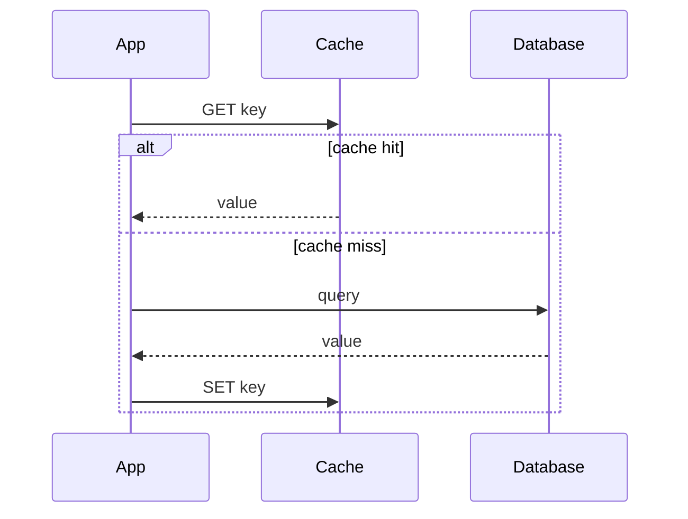

Imagine a product page that takes 400ms to build because it reads from a
database three time zones away. If a thousand people load that page in a
minute, you pay that 400ms a thousand times for the exact same result. A
cache fixes this by keeping a copy of the result somewhere faster, so most
of those requests get an answer in a millisecond or two.

That's the whole idea: trade a little freshness for a lot of speed. The copy
might be a few seconds out of date, but it's close and it's fast.

## Why caching works: locality

Caching only pays off because of a simple fact about real traffic: **the
same data tends to be requested again and again, soon after the first
request.** A trending post, a popular product, a user refreshing their own
dashboard. If every request were for different data, a cache would just be
dead weight.

So the first thing to check before adding a cache is whether your traffic is
actually repetitive. If it isn't, caching won't save you.

## The cache-aside read path

The most common pattern is **cache-aside**. The application checks the cache
first. On a hit it returns immediately. On a miss it reads from the source
of truth, stores the result in the cache, and returns it.

Notice that a miss is *more* expensive than having no cache at all, because
you pay for both the database read and the cache write. That's the bet. The
first request is slower, and every request after it is much faster.

## Where to put the cache

Where the cache lives is a trade-off between speed and control.

An **in-process cache** (a map inside your service) gives the fastest
possible hit because there's no network call at all. The catch is that it
isn't shared. Each server keeps its own copy, it disappears on restart, and
you have to invalidate it on every machine separately.

A **distributed cache** like Redis or Memcached is shared across all your
servers. It survives an individual server restart and gives every instance
the same view. The cost is a network hop on every access, usually well under
a millisecond but never free.

A **CDN** pushes the cache out to the edge, physically close to the user.
It's perfect for content that's identical for everyone, like images or
public API responses, and useless for anything personalized. The browser
caches too, driven by `Cache-Control` headers. That's the fastest hit of all
and the one you control the least.

The rule of thumb: the closer the cache is to the user, the faster the hit
and the harder the invalidation, because there are now more copies of the
same data to keep in sync.

## What to evict when it's full

A cache is finite, so it needs a rule for what to throw away when it fills
up. The two you'll use most:

**LRU (Least Recently Used)** throws out whatever hasn't been touched in the
longest time. It's a good default, because recently used data usually gets
used again soon. Think of a small desk: when it's full, you clear off the
papers you haven't looked at in a while.

**LFU (Least Frequently Used)** throws out whatever has been accessed the
fewest times. It beats LRU when a handful of items are permanently hot and
everything else is noise.

**TTL (Time To Live)** is a different kind of rule. Every entry expires
after a set time, whether or not it's popular. You reach for TTL when being
*stale* is the danger, rather than running out of memory.

In practice you often combine them. TTL caps how out of date an entry can
get, and LRU decides what to drop early if memory runs out before the TTL
does.

## Keeping the cache honest

The hard part of caching isn't storing data. It's keeping the copy from
lying to you after the source of truth changes. There are a few standard
answers.

**Write-through** updates the cache and the database together on every
write. The cache is never stale, but every write now also pays the cache's
latency.

**Write-around** writes only to the database and lets the cache refill on
the next read. Good when written data is rarely read back, but the first
read after a write is always a miss.

**Write-back** writes to the cache first and flushes to the database later.
Writes are fast, but if the cache dies before the flush, you lose data.

**TTL-only** does no active invalidation at all. You simply accept that data
can be stale for up to the TTL. It's the simplest to reason about, and often
the right choice when the business can tolerate a short staleness window.

## When a cache makes things worse

Caches fail in ways that are easy to miss until they do.

A **cache stampede** happens when a hot key expires and thousands of
requests miss at the same instant, all hitting the database together. The
usual fix is to spread out expirations with jitter, or to let only one
request rebuild the value while the rest wait.

A **cold cache** causes the same problem at a larger scale, right after a
deploy or a flush leaves the cache empty.

And the quiet one: a cache can **hide a real problem**. If a query is slow,
caching it makes the symptom disappear while the cause stays. The next time
the cache is cold, the problem returns, now with less warning.

So the question to ask before adding a cache isn't "will this be faster?"
It almost always will. It's "what happens, specifically, the moment this
cache is wrong, empty, or unavailable?"

## Related concepts

- [Content Delivery Networks](/system-design/fundamentals/cdn) push caching
  out to the network edge.
- [Database Fundamentals](/system-design/fundamentals/database-fundamentals)
  covers the source of truth a cache stays in sync with.
- [Consistent Hashing](/system-design/fundamentals/consistent-hashing)
  explains how a distributed cache spreads keys across nodes.
- [Observability](/system-design/fundamentals/observability) is how you
  notice a cache is stale or missing.
