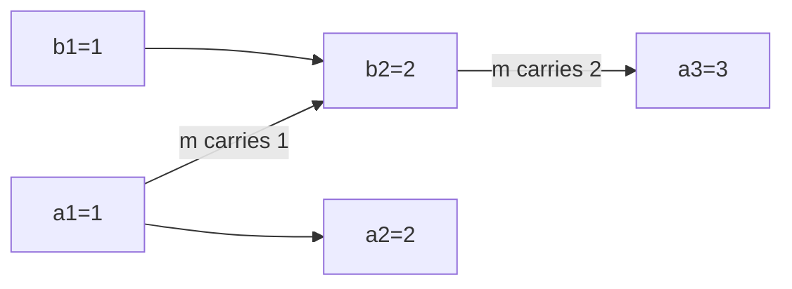

A single machine's clock is a pretty good lie: it drifts a little
(temperature, cheap crystal), the OS hides the drift, and for one machine
the lie is invisible. Distributed systems put that lie next to other
lies and try to build ordering on top: this event "happened at 10:00:03"
on a server whose clock was 200 milliseconds fast, next to an event
stamped 10:00:02 on a server whose clock was 300 milliseconds slow, and
the question "which happened first?" is now being answered with numbers
that were never synchronized with each other. This page is about the
limits of physical clocks, the tool (NTP) that narrows them, and the
logical timestamps that give up on "when" entirely and answer only
"what order".

## Physical clocks: what NTP buys, and what it cannot

**NTP** (and its cousins) synchronizes machines against reference
clocks, and the practical numbers worth knowing: a well-synced machine
is accurate to *milliseconds*; a badly synced one wanders by seconds or
more; and during synchronization (or a VM migration, or a leap-second
event) a machine's clock can *jump backwards*, making "timestamp" a
non-monotonic function of real time.

That last one is the poison: **ordering by wall-clock timestamps
assumes clocks are monotonic, consistent, and correct, and NTP
guarantees none of the three.** Last-writer-wins conflict resolution
([multi-region](/system-design/fundamentals/multi-region-and-active-active))
by timestamp, "expiring" a lock at wall-clock time, and "the latest
write wins" are all designs whose correctness is bounded by the *worst*
clock skew in the fleet. Google's TrueTime (Spanner) is the maximal
answer: GPS+atomic references per datacenter, and every timestamp
delivered as an *interval* (`[earliest, latest]`) with a bound on the
uncertainty, so the database can honestly say "these two events do not
overlap in time" when their intervals are disjoint. It works, and it
costs dedicated hardware plus write latencies that wait out the
uncertainty, which is why almost nobody has it.

The design rules that fall out of honest clock use: use physical time
for *durations and coarse scheduling* (timeout after 30 seconds:
fine, a few ms of skew is invisible), never for *ordering between
machines* unless the loss you risk on skew is acceptable, and never for
*a single machine's monotonicity* (use a monotonic clock source for
measuring elapsed time, since a wall clock can jump).

## Lamport clocks: counting happens-before

The logical move: give up on "when" and keep only what ordering needs.
Define the **happens-before** relation: on one machine, event A before
event B is real order; across machines, A before B if a *message* sent
after A is received before B. Everything else (two events on different
machines with no message path between them) is *concurrent*,
unorderable, and no timestamp will honestly order it.

The **Lamport clock** implements a counter over that relation: every
machine keeps a counter, incremented on each local event and set to
`max(my counter, message counter) + 1` whenever a message arrives (so
time advances with information flow). The guarantee is a clean
half-truth: **A happens-before B implies L(A) < L(B)**. The converse is
false (L(A) < L(B) does not imply order), so equal-or-smaller timestamps
mean "unknown", and the clock totally orders what was only partially
ordered by *tie-breaking on machine ID*, which is an arbitrary but
consistent rule.

## Vector clocks: proving concurrency

The Lamport clock's blind spot is that it cannot *detect* concurrency:
two events with different Lamport counts might be ordered or concurrent,
and you cannot tell which. **Vector clocks** fix that: each machine
tracks a *counter per machine* (a vector), incremented for local events
and merged element-wise on message receipt. Two events' vectors compare
component-wise: one is smaller in every position if and only if one
happens-before the other, and if each is larger in *some* position, they
are *provably concurrent*.

That "provably" is the value: it is how Dynamo-style stores label
conflicting versions. Two writes that both accepted during a partition
carry vectors that are concurrent by construction, so the store *knows*
these are siblings needing resolution (application merge, or LWW, or a
human) rather than guessing that one preceded the other. The cost is
memory proportional to the number of participants, which is why vector
clocks live in databases (per-key, bounded by the nodes that touched
that key) rather than in application code, and why Lamport clocks are
the budget option for "causal ordering" when concurrency *detection* is
not needed.

## Hybrid logical clocks: the practical modern answer

The production compromise (CockroachDB, YugabyteDB, MongoDB): a
**hybrid logical clock** (HLC) pairs a physical timestamp with a logical
counter. The physical part keeps timestamps humanly meaningful and
roughly ordered; the logical part restores monotonicity (no clock jump
can reorder events) and refines order within the physical tick. It is
"Lamport with a readable face", and it is the honest answer to "why
not both": physical for display and coarse causality, logical for the
guarantee.

## Choosing the tool

- **Timeouts, durations, TTLs**: wall or monotonic clock, physical is
  fine, skew is invisible.
- **Ordering events within one machine**: a sequence number or the
  machine's own counter; never cross-machine wall clocks.
- **Causal ordering** ("this reply happened after that request"):
  Lamport or HLC.
- **Detecting conflicts** ("these two writes are concurrent, surface
  both"): vector clocks, per-entity.
- **Globally consistent strict ordering**: consensus
  ([Raft](/system-design/fundamentals/consensus-and-leader-election))
  with a log position, or TrueTime with the hardware bill. Nothing
  cheaper is honest.

## Related concepts

- [Consensus & Leader Election](/system-design/fundamentals/consensus-and-leader-election)
  uses *terms* (a logical counter) rather than timestamps, for exactly
  the reasons on this page.
- [Multi-Region & Active-Active](/system-design/fundamentals/multi-region-and-active-active)
  is where LWW-by-timestamp and its skew bill show up in practice.
- [Design a Key-Value Store](/system-design/hld/key-value-store) uses
  vector clocks for its sibling versions.
- [CAP Theorem & Consistency Models](/system-design/fundamentals/cap-theorem-and-consistency-models)
  is what "ordering" is ultimately in service of.
