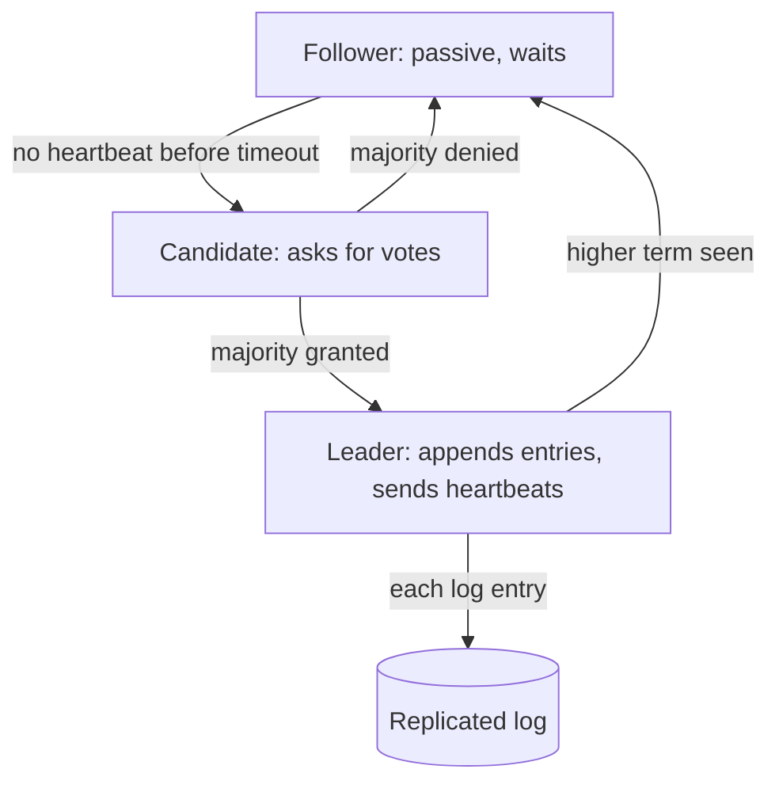

A cluster of three database nodes gets a request: "which of you is the
primary?" Each node can answer, but any individual answer can be wrong
(the node is stale, partitioned, or lying about being alive), and the
cluster *must* answer as one. That is the consensus problem, and it is
the load-bearing machinery behind every "exactly one" guarantee in
distributed systems: exactly one primary, exactly one lock holder,
exactly one committed value per log position. Everything else in this
catalog that promises "no split brain" is renting this machinery.

The deep reason consensus is hard: **you cannot distinguish "dead" from
"slow"**. A node that has not answered for ten seconds may be crashed
(or its network may be down, or it may be fine and *your* network to it
is down), and no amount of timeout-tuning makes the distinction honest.
So a consensus protocol is a design that reaches agreement *despite*
never knowing who is actually up, only who answered.

## How many faults can you survive

The fundamental arithmetic: with 2f + 1 nodes, the system tolerates f
failures, because any two *majorities* overlap in at least one node.
3 nodes tolerate 1 failure, 5 tolerate 2: an odd number, and a majority
(2 of 3, 3 of 5) is the unit of truth. The minority side of a partition
*must* refuse to make progress (it cannot reach a majority), which is
exactly [CAP](/system-design/fundamentals/cap-theorem-and-consistency-models)
trading availability for consistency, and it is why even-numbered
clusters buy nothing: 4 nodes tolerate 1 failure, same as 3, with one
more machine to feed.

## Raft: the readable consensus protocol

Raft is the protocol to learn first, because it was *designed* to be
understandable, and because every real system you interview about
(Etcd, Consul, CockroachDB, TiKV) runs it or its cousin.

**Terms and elections.** Time is divided into *terms*, each with at most
one leader. A follower that hears nothing from a leader for a random
election timeout becomes a *candidate*, increments the term, and asks
all peers for votes. A majority of grants makes it leader. The random
timeout is load-bearing: it desynchronizes elections so two candidates
do not perpetually tie, and it is the difference between electing
quickly and electing *eventually*.

**The log and the heartbeat.** The leader owns an ordered log of
entries. A client write goes to the leader, which appends it locally and
replicates it to followers; when a *majority* has the entry, the leader
commits it (it is now decided) and notifies everyone. The heartbeats
that keep the leader in power are empty log entries: same message, same
term-number check, no data.

**Why a committed entry can never be lost.** The invariant that makes
the whole protocol safe: an entry is committed when a majority holds it,
and any *future* leader must have the entry to win an election, because
elections are decided by log recency (voters refuse candidates whose
log is behind theirs), so any candidate that wins a majority *must*
hold every entry a majority previously held. Overlapping majorities are
the entire safety argument, the same arithmetic as the fault-tolerance
count.

**Paxos**, the original, is the same guarantees with a famously
impenetrable formulation (multi-phase ballots, no built-in leader, no
log). Knowing it exists and what it buys is enough: Raft is Paxos with
an explicit leader and an explicit log, engineered for implementability,
and it is the interview answer.

## Leader election as a *use* of consensus

The common framing "we need leader election" (a scheduled job, a
partition's owner, a cache's writer) is usually two questions in
sequence, and conflating them is the classic mistake:

1. **Who decides who the leader is?** That is consensus (or the
   disaster of everyone deciding for themselves, which is split brain).
2. **What does the leader do?** Whatever domain problem you have.

ZooKeeper/etcd/Consul exist precisely so systems rent answer (1): the
coordination service runs Raft, and your services contend on its keys
("the lock on partition 3", the ephemeral "who is alive" node) to decide
(2). A lock *acquired* through the service's linearizable operations has
the guarantee that the lock is exclusive, which is the entire point: a
distributed lock built out of a non-consensus store (a plain Redis
`SETNX`, without the fencing) can be violated by exactly the failure it
exists to prevent.

**Fencing** is the safety net for systems that rent election
asymmetrically: the leader's decisions carry a term/token number
(monotonic), and executors reject requests with a stale token, so a
zombie old leader (alive, partitioned, still believing it is in charge)
cannot corrupt state with its stale authority. "A former leader must not
be obeyed" is the property that naive leader election gets wrong and
that terms buy you.

## The honest limits

- **Consensus cannot survive a full partition of the majority**: with 5
  nodes and 3 unreachable, the 2-side stops (no majority), by design. A
  system that keeps working on both sides is *not* running consensus
  and will split brain.
- **Every machine lying (Byzantine faults)** breaks the majority
  arithmetic, needing 3f + 1 nodes and a different protocol (PBFT).
  Databases assume crash faults; blockchains assume Byzantine, which is
  where that machinery lives.
- **A leader is a serialization point**: all writes through one node is
  a throughput ceiling and a latency floor for far-away writers, which
  is the trade that [multi-region](/system-design/fundamentals/multi-region-and-active-active)
  designs keep negotiating.

## Related concepts

- [CAP Theorem & Consistency Models](/system-design/fundamentals/cap-theorem-and-consistency-models)
  is what "majority or nothing" is buying.
- [Clock Synchronization & Logical Time](/system-design/fundamentals/clock-synchronization-and-logical-time)
  explains why terms (logical) replace timestamps (physical) for
  ordering authority.
- [Multi-Region & Active-Active](/system-design/fundamentals/multi-region-and-active-active)
  rents this machinery for its single-writer designs.
- [Design a Key-Value Store](/system-design/hld/key-value-store) is the
  Dynamo answer: no consensus, conflicts surfaced instead, the other
  side of the trade.
