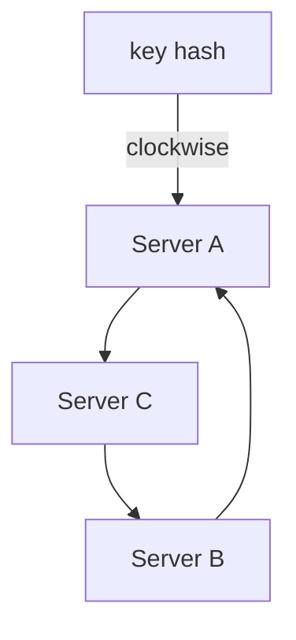

You run a cache across three servers and route each key by taking its hash
modulo 3: `server = hash(key) % 3`. It spreads load evenly and never misses.
Then a fourth server arrives, and you recompute the modulus to distribute
against 4. Suddenly `hash(key) % 4` points somewhere else for roughly **three
out of every four keys**. Every key is being looked up from a server that no
longer holds it. Your hit rate collapses, and the database behind the cache
absorbs the entire inventory in a single afternoon.

Consistent hashing exists to prevent exactly this failure: **when the number
of servers changes, almost all keys stay where they were.**

## The ring idea

Instead of mapping each key to a numbered slot (`% n`), map *both keys and
servers* onto a giant ring of hash values, say all integers from 0 to 2^32.
Then the routing rule is beautifully simple:

1. Hash the key onto the ring.
2. Walk clockwise until you hit a server's position.
3. That server owns the key.

Now watch what happens when Server B is removed. Only the keys whose
clockwise walk used to end at B are affected, and they simply fall through
to the next server (Server C). Everything else didn't move: their walks
never touched B. The same holds in reverse when you add a server: it only
steals keys from its immediate clockwise neighbor.

**The math worth remembering**: with a plain `% n` scheme, changing n
remaps essentially all keys. With consistent hashing, changing the server
count remaps roughly `1/n` of the keys: a third for three servers, a
quarter for four. That is the entire value proposition.

## The real-world fix: virtual nodes

There's a catch with the naive ring: with only three servers, their hash
positions are random, and the spacing is lumpy. One server can end up
owning 60% of the ring while another owns 5%.

The standard fix is **virtual nodes**: instead of placing each server on the
ring once, place it a few hundred times, at independent hash positions, all
mapping back to the same physical machine. The hundreds of little slices
average out, giving each physical server a nearly equal share of the ring.
A useful side effect: when a server dies, its keys scatter across *all*
other servers instead of dumping onto one neighbor, so load after a failure
spreads instead of concentrating.

## Where it's used

The pattern shows up anywhere a cluster of machines must share a keyed
dataset:

- **Distributed caches** (Memcached clients, Discord's storage) were the
  original motivation: maximizing the keys that survive a topology change.
- **DynamoDB and Cassandra** use it as the partitioning mechanism for data:
  the ring decides which node owns each row and its replicas.
- **CDNs** use it to assign content to edge servers.
- Any **consistent sharding** layer where nodes come and go.

One nuance: in storage systems (as opposed to caches), each key's position
is backed by real data, not a disposable copy. Systems like Cassandra handle
the "data moved to a new owner" part with hand-off protocols, so the ring
tells you *who is responsible*, while the storage engine keeps the data in
sync during transitions.

## Trade-offs and limits

- **It balances the ring, not the traffic.** Consistent hashing gives each
  server an equal share of *key space*. If one key is 100x hotter than the
  rest, it still lands on exactly one server and overloads it. Hot-key
  problems need application-level answers (replicate the hot key, split it,
  or cache it locally), not a different ring.
- **Cross-server queries still scatter.** If a request needs keys that hash
  to different servers, it becomes a multi-server request. Consistent
  hashing places single keys well; it does nothing for queries that
  correlate keys.
- **Only "add/remove a node" is cheap.** Changing the *replication factor*,
  or re-balancing a heavily skewed ring, still moves large amounts of data.
  The trick covers the most common operation, not every operation.

## Related concepts

- [Database Fundamentals](/system-design/fundamentals/database-fundamentals)
  covers sharding, where consistent hashing is the most common partitioning
  strategy.
- [Caching](/system-design/fundamentals/caching) is where the
  hit-rate-preservation property matters most.
- [CAP Theorem & Consistency Models](/system-design/fundamentals/cap-theorem-and-consistency-models)
  governs what happens to replicas of a key during ring transitions.
- [Load Balancing](/system-design/fundamentals/load-balancing) is the
  stateless counterpart: it routes requests, while the ring routes *data*.
