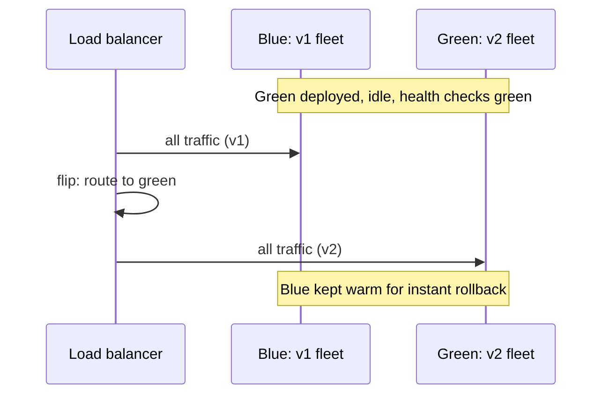

Every deployment is a bet. You believe the new version is better, and you
put the production system on the table to prove it. The naive way to
collect on that bet is to stop the old version and start the new one,
which is exactly the maintenance window nobody wants at 2 a.m. The
strategies on this page exist to make the bet recoverable: deploy in a
way that can be reversed in seconds, not hours, and that exposes bad
releases to 1% of traffic instead of 100%.

The deeper principle: **decouple release from deploy**. Releasing (making
a new version available) and deploying (routing production traffic to it)
can be the same instant or two separate decisions. Most of what follows
is machinery for prying them apart.

## Rolling deployment

The default in most orchestration platforms: replace instances of the
old version one batch at a time, until none are left.

Each new version instance passes a health check before the next batch
replaces more old ones, so the rollout stalls on failure instead of
finishing it. The cost is capacity: during the rollout you run a mix of
versions at once, so the fleet needs headroom for two, and every client
needs to tolerate talking to either version.

Rolling is the strategy with the least waste and the least control. If
version 1 and version 2 disagree about a request's meaning (a renamed
field, a changed validation rule), the mixed fleet serves inconsistent
answers for the length of the rollout. That is the signature failure of
rolling deploys, and it pushes teams toward the next two strategies.

## Blue-green deployment

Keep two full production environments: **blue** (live) and **green** (the
new version, fully deployed, receiving no traffic).

The cutover is a single load balancer flip, and so is the rollback: no
redeploy, just route back to blue while it still exists. That instant
reversibility is the whole value. The costs are real: you pay for double
capacity during the window, the flip can drop long-lived connections,
and any [schema
change](/system-design/fundamentals/database-fundamentals) must be
compatible with *both* versions, because blue is still running when
green goes live.

The compatibility rule is the one that bites teams. A blue-green cutover
is only as reversible as the least reversible change bundled into it.
The discipline is to make the release backward- and forward-compatible
(both orders tolerated), and keep migrations out of the same release as
the code that depends on them.

## Canary deployment

Route a small slice of real traffic to the new version first, watch it,
and widen the slice only if it behaves.

A 1% canary followed by 10%, 25%, 50%: each step is a pause where you
compare the new version against the old on real
[metrics](/system-design/fundamentals/latency-vs-throughput): error
rate, latency percentiles, business signals. The exposure is bounded by
the slice size, which is the point: a broken release meets 1% of your
users instead of all of them, and the
[observability](/system-design/fundamentals/observability) you already
run is what tells you whether to continue.

Canary analysis only works if the canary and the baseline share a
request path. The slice must be *random*, not "internal users first":
otherwise you compare populations, not versions, and the analysis lies.

## Feature flags: the fourth strategy

All three strategies route *infrastructure*. A feature flag routes
*behavior*: the new code ships dark, deployed to every instance but
disabled, and a separate switch turns it on for a percentage of users,
a specific tenant, or everyone.

This decouples release from deploy completely. The trade: you can now
deploy without fear but must now *manage* flags, because every flag is
a branch of behavior that lives in production until someone deletes it.
Old flags that never get cleaned up are the tax this strategy charges.

## Choosing between them

Rolling when the change is small and boring. Blue-green when rollback
speed matters most and double capacity is affordable. Canary when the
change is risky and you have the metrics to judge it. Flags when the
risky part is a product behavior rather than the code that carries it.
Real teams use several at once: roll out the fleet, canary the feature
behind a flag.

What none of them save you from: a change that is *not* backward
compatible. No traffic-shaping strategy can route around a database
column that no longer exists. Compatibility is the hard constraint every
strategy on this page assumes you already solved.

## Related concepts

- [Observability](/system-design/fundamentals/observability) is the
  measurement that decides whether a canary widens or aborts.
- [Container Orchestration & Kubernetes](/system-design/fundamentals/container-orchestration)
  implements rolling deployments natively, and pauses them on failed
  health checks.
- [Reliability Engineering](/system-design/fundamentals/reliability-engineering)
  frames releases against the SLO: a bad deploy spends the error budget.
- [Database Fundamentals](/system-design/fundamentals/database-fundamentals)
  covers the schema compatibility that makes any cutover reversible.
- [Testing at Scale](/system-design/fundamentals/testing-at-scale)
  is the rehearsal: the load a release must survive before it ships.
