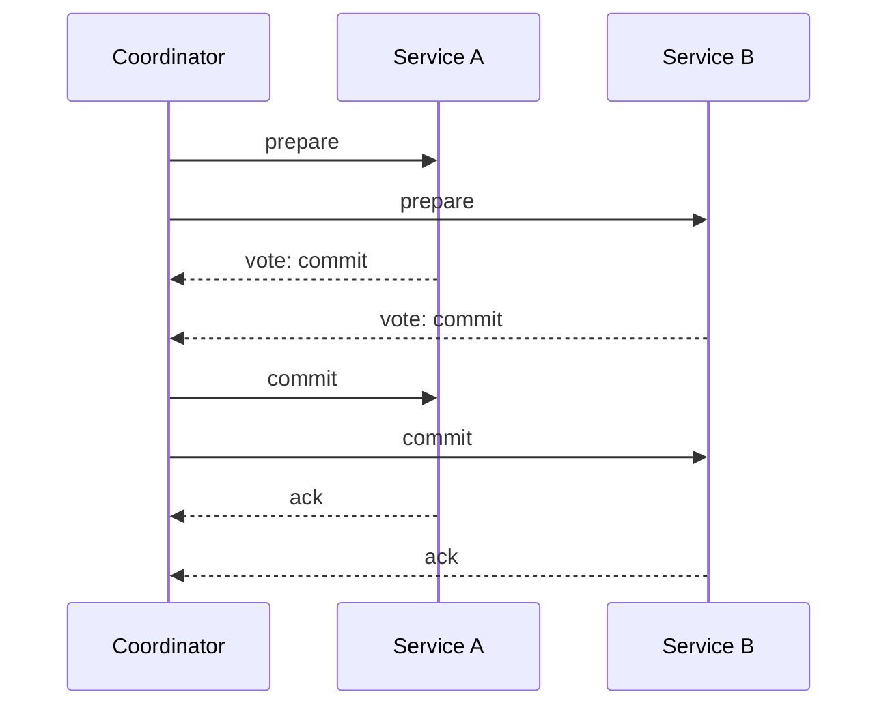
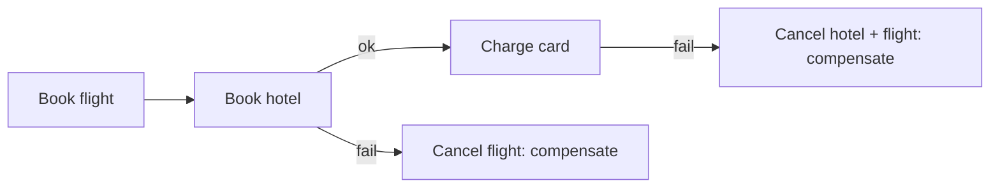

The problem seems small: update two things, and make both updates happen or
neither. On one machine, a database transaction does this; it has been
solved since the 1970s. The moment the two things live behind two network
calls, the problem stops being small and starts being the reason a whole
family of patterns exists, because the network can fail *in the middle*,
in both directions, and there is no shared transaction manager to catch
it.

Say it precisely: a distributed transaction must make a change across
multiple systems such that either every system commits the change or every
system abandons it. The difficulty is that there is no moment where you can
ask all participants "are you in?" and get a trustworthy simultaneous
answer. A participant can say yes and then crash before acting on it. A
participant can say yes and its *yes* can arrive after you've already
given up. There is no way to distinguish "crashed" from "slow", and every
protocol below is a different answer to exactly that ambiguity.

## Two-phase commit: the traditional answer

**2PC** has a coordinator ask every participant to prepare (vote), then,
if all vote yes, ask them all to commit.

The *prepare* phase is the mechanism: a prepared participant has written
the change to durable storage and promised to commit it, holding a lock
until the commit arrives. That promise is what makes the protocol
correct, and it is also what makes it fragile:

- **It blocks.** A prepared participant holds locks while it waits. If
  the coordinator is slow (or dead), everything the participant locked is
  stuck, and the protocol *cannot safely unblock* on its own, because
  the commit message may still arrive.
- **The coordinator is a single point of failure** for the duration,
  mitigated only by adding a consensus protocol underneath it (which is
  what real 2PC systems do, and why "2PC with Paxos" appears in
  databases).
- **Latency adds up**: two full network rounds across every participant,
  plus a disk sync in prepare.

Modern databases use 2PC internally (it's the right answer *inside* a
database cluster, where the participants are trusted and colocated). It
has mostly fallen out of favor *between* services, where the blocking
cost and the trust assumptions both fail.

## Sagas: no locks, but compensate

The **saga** pattern abandons atomicity and accepts a different contract:
each step commits locally, and if a later step fails, earlier steps are
*undone* by compensating actions. Book the flight, then book the hotel;
if the hotel fails, cancel the flight.

The trade is honest: no locks, no blocking, each step is fast and local.
The cost is that intermediate states are *visible*: for a while, the
flight is booked but the hotel isn't, and the saga's compensations must
actually work (a "compensation" that itself fails is the pattern's hard
part). Sagas also require every step to have a defined reverse, which
shapes the business design as much as the technical design: "send the
email" is easy to compensate ("send a retraction") but "fire the missile"
is not, and systems that can't compensate must design the step to be
[ idempotent](/system-design/fundamentals/idempotency-and-exactly-once)
and retryable instead.

## The outbox: the quiet standard

The pattern most event-driven systems actually converge on is the
**transactional outbox**, which solves the narrowest and most common
case: "write to my database and publish a message, atomically."

The problem it solves: a service updates its database, then publishes to a
[queue](/system-design/fundamentals/message-queues-and-pubsub), and
crashes between the two. Either the write lands and the message doesn't
(the rest of the system never learns about it), or the reverse. The
naive fix (publish inside the transaction) drags the broker into the
database's transaction, which couples two systems that should never meet.

The outbox decouples them with a two-step dance inside one local
transaction:

1. Insert the business row *and* an event row into an `outbox` table, in
   the same local database transaction. Local, so it's genuinely atomic.
2. A separate publisher process reads the outbox table and publishes each
   event to the broker, then marks it sent. At-least-once, deduplicated
   downstream by event ID.

The write and the publish can no longer disagree, because the publish is
*derived from* a durable local write rather than sequenced after it.
Combined with idempotent consumers, this is effectively exactly-once
*end-to-end* in practice, and it is the glue behind most "microservices
that actually work" systems.

## Choosing between them

- **Inside one database cluster**: use its native transactions (2PC under
  the hood, but not your problem).
- **Across services, money or inventory involved**: saga with explicit
  compensations, because locks are untenable and the business logic of
  "undo" already exists.
- **Publish a message about a local change**: the outbox, always. Direct
  publish after commit is how silent data divergence is born.
- **Anyone offering you "distributed ACID transactions across
  microservices" as a feature**: ask what happens when the network
  partitions, and listen very carefully to the answer
  ([CAP](/system-design/fundamentals/cap-theorem-and-consistency-models)
  has one).

## Related concepts

- [Message Queues & Pub/Sub](/system-design/fundamentals/message-queues-and-pubsub)
  is the transport layer underneath the outbox and the saga.
- [Idempotency & Exactly-Once Delivery](/system-design/fundamentals/idempotency-and-exactly-once)
  is what makes at-least-once delivery safe to build on.
- [Event Sourcing & CQRS](/system-design/fundamentals/event-sourcing-and-cqrs)
  extends the outbox idea from "an event happened" to "events are the
  system of record".
- [CAP Theorem & Consistency Models](/system-design/fundamentals/cap-theorem-and-consistency-models)
  explains why "distributed ACID" is always a trade rather than a
  feature.
