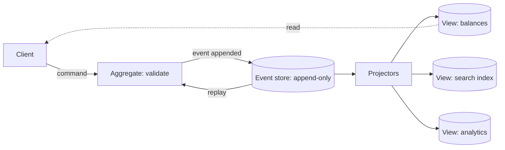

Most systems store the *state* of the world: this row has this balance,
this order has this status. **Event sourcing** proposes storing the
*events* that led there instead: deposit 40, withdrawal 15, refund 40,
and deriving the balance by replay. The current state becomes a
*function of the event history*, which is a dramatic change in what the
database means: nothing is ever updated or deleted, only appended.

The motivation is not elegance. It is that most serious systems *already
need* the event history: an audit trail is the same information
reconstructed painfully from logs, a dispute needs "what exactly
happened, in order", a bug needs "replay my data to this morning's
state", and a bank that overwrote balances with a mutable column has
none of it. Event sourcing is the admission that the history is the
asset and the current state is just a cache of it.

## The core shape

- **Commands** come in ("transfer 40"), and an **aggregate** (the domain
  object: an account, an order) validates them against its *current*
  state.
- Validated commands produce **events** ("transferred 40"), which are
  *facts*: immutable, past tense, indisputable. Events are appended,
  never edited.
- **Projections** consume events and build *views*: the balance table,
  the search index, the analytics cube. Views are derived, disposable,
  rebuildable: delete one and replay the log, and it comes back.
- Reads go to the views; writes go through the aggregates. Two
  different models for two different jobs, which is the CQRS half of the
  pattern.

That last split is **CQRS** (command query responsibility segregation):
commands (writes) and queries (reads) get *different models*, not just
different endpoints. The write model is the aggregate, guarding
invariants over a small amount of state. The read models are whatever
each query needs: denormalized, wide, indexed by exactly the access
pattern the page wants. The classic example of why: a write model needs
"account and its balance" (tiny, invariant-guarded); the read model
needs "customer, last 10 transactions, merchant names, dispute status"
(one join-fest of a query). Forcing both through one model makes one of
them lie, and the join-fest is usually the loser.

## The honest costs

Event sourcing is not free, and the costs are the reason "just use CRUD"
is usually right:

- **You must handle the questions CRUD never asks.** Events are
  immutable, so a *wrong* event (bug, bad input) cannot be fixed by an
  update: it is corrected by a *compensating* event, and the history
  forever records both. Schema evolution: events written years ago must
  remain replayable by current code, so projections deal with
  versioning (upcasters, tolerant readers).
- **The read model is eventually consistent.** The command commits, the
  projection runs *after*, so a read immediately following a write may
  miss it: the usual
  [eventual consistency](/system-design/fundamentals/cap-theorem-and-consistency-models)
  trade, and the reason read-your-own-writes needs a query against the
  write model or a projection wait.
- **Replay cost is real.** Rebuilding a view means replaying history,
  which at year-ten of events is a batch job. Production event stores
  snapshot (checkpoint aggregate state) so *command* handling does not
  replay from the beginning, and views rebuild from checkpoints plus
  the tail.

## Where it is the right answer

- **The ledger is the point**: money, inventory, compliance-heavy
  domains. The [bank ledger LLD](/system-design/lld/bank-ledger-system)
  is exactly this, in miniature, and the
  [payment system HLD](/system-design/hld/payment-system) adds processors
  and reconciliation.
- **Audit is a requirement, not a feature**: any system where "prove
  what happened" has legal weight.
- **The read and write shapes genuinely diverge**: heavy query loads
  with rich views and sparse, invariant-guarded writes.
- **You need temporal queries**: "the balance as of March" is a replay
  to a timestamp, free with an event log and expensive to fake with
  mutable state.

And where it is the wrong answer: when the domain is naturally
*current-state* (a cache, a config blob, a session store), when
[simple replication](/system-design/fundamentals/database-fundamentals)
already solves the availability question, or when a
[queue](/system-design/fundamentals/message-queues-and-pubsub) is all
the decoupling you need. The pattern is a large structure; the instinct
to check whether the problem is already solved by a smaller one is the
senior move.

## The family, and where each sits

- **Event sourcing**: the log *is* the system of record.
- **[Transactional outbox](/system-design/fundamentals/distributed-transactions)**:
  a *single table* of events guaranteed to be published, which is event
  sourcing's minimal viable cousin: no projections, no aggregates, just
  "the write and its event are atomic".
- **[Change data capture](https://en.wikipedia.org/wiki/Change_data_capture)**:
  events derived *from* a CRUD database's log (Debezium-style), which
  gives the projections and read models without changing the write
  model: CQRS for systems that keep their tables.
- **[Message queues & pub/sub](/system-design/fundamentals/message-queues-and-pubsub)**:
  the transport underneath, and the boundary of the pattern: a queue
  delivers events, an event *store* answers "give me all events for
  entity X, in order, forever", which is a different query and the real
  dividing line.

## Related concepts

- [Message Queues & Pub/Sub](/system-design/fundamentals/message-queues-and-pubsub)
  is the transport that projections consume.
- [Idempotency & Exactly-Once Delivery](/system-design/fundamentals/idempotency-and-exactly-once)
  makes projection delivery safe under redelivery.
- [Distributed Transactions](/system-design/fundamentals/distributed-transactions)
  contains the outbox, the pattern's smallest form.
- [Design a Bank / Ledger System](/system-design/lld/bank-ledger-system)
  implements the core of it, in code.
- [Design a News Feed](/system-design/hld/news-feed) builds its read
  model exactly the way a projection does.
