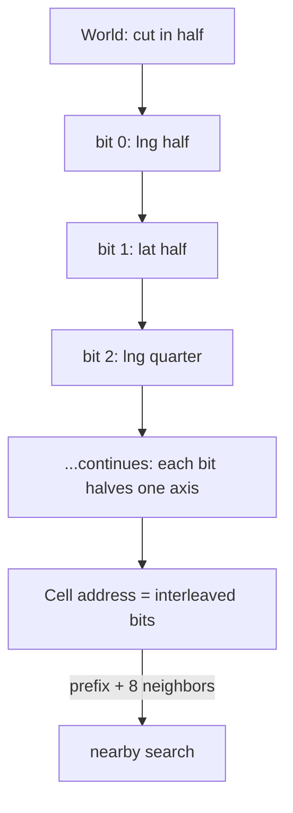
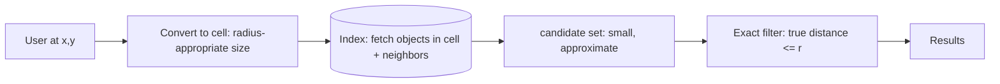

Almost every interesting location question has the same shape: "what
is *near* this point?", asked at scale, asked continuously. Delivery
apps ask which driver is nearest, dating apps ask who is around,
mapping apps ask which roads and places are in view, games ask which
players are in the same region. And the naive answer, "compute the
distance to every object and take the best", is O(n) per query against
a fleet of moving objects, which is exactly the trap.

The fix is the same move as every other index: **convert the question
into a lookup.** But "near me" is not a key, so the geospatial family
converts *space itself* into keys: cut the world into cells, give each
cell an address, and "near me" becomes "my cell, plus its neighbors",
which is an index hit. This page is the three schemes that dominate
that idea, and the trade each one makes.

## The core trick: locality must survive the addressing

The whole subject rests on one property: **objects that are physically
close must have addresses that are close** (share a prefix, or sit in
the same subtree), so that a range of space is a *contiguous range of
addresses* and an index can fetch it. The schemes differ in how they
build the address, but the goal is shared.

**Geohash** interleaves the bits of latitude and longitude into one
number, then base32-encodes it. The interleave is the trick: each
successive bit halves one dimension, alternating, so a shared prefix
of length k means the two points are in the same cell of side length
~determined by k. `9q8` is a neighborhood-sized cell, `9q8yy` is a
city block, and "everything in 9q8yy and its 8 neighbors" is a
neighborhood search.

The two properties worth knowing cold:

- **Longer prefix = smaller cell**, so precision is a dial, and the
  right dial is query-sized: filter by a cell at the radius you want,
  then refine with exact distance on the (small) candidate set.
- **Neighbor calculation**: a cell's 8 neighbors have *related* (not
  adjacent) addresses, computable by arithmetic rather than stored in
  a table, and the standard library move.

The honest weaknesses: the **boundary problem** (two points across
the street can be in different top-level cells, so a nearby search
*must* include neighbors, or it will miss obvious results), and the
**non-uniform cells** (a degree of longitude shrinks toward the poles,
so geohash cells cover wildly different areas across latitudes, and
all fixed-grid schemes have some version of this).

**Quadtrees** address space with a *tree* instead of a string: the world
is a square, each node splits into four quadrants, and subdivision
continues until cells are small or sparse. The property that makes it
a better structure than a fixed grid: **adaptive density**. Downtown
with 100k drivers subdivides to house-sized cells; the ocean sub-divides
not at all, one cell covering a thousand empty square miles. The cost
is that the structure is a *tree you maintain* (splits, merges, rebalancing)
rather than pure arithmetic on a key, which is why databases with
built-in geospatial types (PostGIS, and the
[R-tree](https://en.wikipedia.org/wiki/R-tree) lineage it descends from)
are the usual production answer, and why the in-memory
[autocomplete-style](/system-design/hld/search-autocomplete) systems
prefer the stateless geohash.

**S2** (Google's library, used by Google Maps and Uber's older systems)
is the geometrically serious version: the sphere projected onto a
cube, each face subdivided, cells addressed with the
[ Hilbert curve](https://en.wikipedia.org/wiki/Hilbert_curve), which
gives cells that are both compact in address space (contiguous regions
have contiguous addresses: the boundary problem's mitigations work) and
adjustable in size over a huge range. It is the standard answer for
"we need real geometry at scale": S2 cells for indexing, plus exact
distance/containment for the final filter, the same two-step shape as
the other schemes.

## The standard pipeline: filter, then refine

Every production geospatial search is the same two steps, and the
second step is where correctness lives:

The **index fetch** is approximate and cheap: it grabs everything in the
candidate cells, with false positives (things in the cell but not
within the radius) and, if the neighbor logic is wrong, false negatives
(the boundary problem: things just outside the cell). The **exact
filter** then computes real distances on the small candidate set and
removes the false positives. Skipping the exact step is the classic
bug, and forgetting the neighbors is the second.

## The moving-objects problem

Nearby search over *static* data (restaurants) is one index hit per
query. Over *moving* data (drivers, players), the objects churn, and
the [ride-sharing HLD](/system-design/hld/ride-sharing-app) covers the
pipeline that handles it: position updates stream into a
[queue](/system-design/fundamentals/message-queues-and-pubsub), a
worker updates the geospatial index (the driver's new cell), and
queries hit the index, never the raw stream. The pattern worth
internalizing: **the index is a materialized view of the position
stream**, rebuildable from it, which is why losing it is survivable and
why its update lag (a few seconds) is a product decision.

## Choosing a scheme

- **Geohash**: stateless (the key *is* the address), prefix-friendly
  (Redis sorted sets, string keys), and the standard for cache-based
  nearby search.
- **Quadtree / R-tree**: adaptive density, the database's built-in
  geometry types (PostGIS), and the answer when the data is static or
  when you want the database to own the geometry.
- **S2**: the serious geometry: adjustable cell sizes, compact
  regions, spherical correctness, and the standard for
  platform-level geo infrastructure.
- **Vector-native**: some databases now index points directly (space
  filling curves under the hood), and the choice is less visible every
  year.

## Related concepts

- [Design a Ride-Sharing App](/system-design/hld/ride-sharing-app) is
  the canonical consumer of this machinery.
- [Design a Proximity Service](/system-design/hld/proximity-service)
  is the same core without the trips.
- [Design a News Feed](/system-design/hld/news-feed)'s fan-out is the
  same "who is affected by this event" question in a different
  dimension.
- [Hash-Based Structures](/dsa/patterns/hash-based-structures): the
  cell address is a hash of space, and its "same key, same bucket" is
  "same cell, same nearby set".
