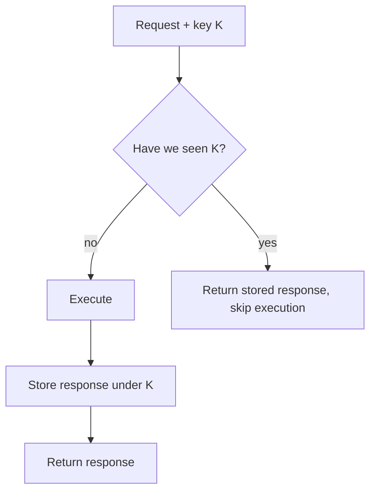

Here is a claim that surprises people: **exactly-once delivery does not
exist**, and cannot, and the reason is not a limitation of any particular
technology. The sender can send, the receiver can process, and the network
can lose the *acknowledgment* while delivering the *message*. The sender
cannot distinguish "delivered and dropped the ack" from "never delivered",
so the only safe move is to resend, and now the receiver has seen it
twice. Any protocol you build from these parts hits the same wall: the
ack can be lost, so the resend is mandatory, so duplicates are inevitable.

So the guarantee "this happens exactly once" cannot come from the
transport. It has to come from somewhere else, and that somewhere is the
operation itself.

## Idempotency: the property that absorbs duplicates

An operation is **idempotent** when doing it twice has the same effect as
doing it once. `set x = 5` is idempotent (the second write changes
nothing). `x = x + 1` is not (the second call double-counts). DELETE is
usually idempotent ("delete user 42" twice converges to "user 42 is
gone"). "Create order" is not (two creates are two orders), which is
exactly why order creation is the classic duplication disaster.

The point of the property: **when duplicates are inevitable, idempotent
operations are immune to them.** The retry, the resend, the
at-least-once delivery all become harmless, because the effect of
arriving twice is the effect of arriving once. This is why idempotency is
the load-bearing wall of every reliable system: not because it's
elegant, but because it's the only place the guarantee *can* live.

## Idempotency keys: how real systems do it

"Make create-order idempotent" sounds impossible (two orders are two
orders), so real systems cheat with an **idempotency key**: a unique
token the client sends with the request, generated once per logical
operation.

The server's contract: the first request with key K executes and stores
the response; a second request with the same K returns the *stored*
response, without executing anything new.

This is how Stripe's payment API works, and the shape is worth internalizing:
the *storage of the response* is what makes it safe. It's not "skip if
you've seen K" (races), it's "the response is durable and replayed", which
is safe under concurrent retries too, provided the check-and-store is
atomic (a database unique constraint on K is the usual mechanism).

Two production details that matter more than the happy path:

- **Keys must be scoped.** Per client, per operation, or per endpoint,
  but scoped *somehow*, or one client's key blocks another's.
- **The storage needs a TTL or a lifetime policy.** Keys accumulate; you
  must decide how long "safe to replay" lasts (Stripe: 24 hours), and
  what a *late* retry after expiry does (usually: executes again, so
  document it).

## At-least-once plus idempotency: the actual industry answer

With the impossibility established and the property in hand, the standard
architecture falls out:

1. The transport delivers **at-least-once** (retries until
   acknowledged, redelivers on consumer crash mid-processing).
2. The consumer is **idempotent** (keyed operations, or naturally
   idempotent effects), so duplicates are absorbed rather than observed.
3. The result is **effectively-once**: every logical operation takes
   effect exactly once, as far as any observer can tell.

This is why [message queues](/system-design/fundamentals/message-queues-and-pubsub)
default to at-least-once and let you build the rest: it's the honest
transport guarantee, and idempotency is the honest application answer.
"Exactly-once" *does* appear as a product feature (Kafka's
`enable.idempotence` and transactional APIs), and it's worth knowing what
it actually means: exactly-once *within the Kafka cluster's control*,
which is to say, exactly-once delivery to the log plus
exactly-once-ish processing (the framework deduplicates and commits
offsets atomically). It is genuine engineering, but the guarantee is
bounded, and the moment your consumer touches an outside system (a
database, an HTTP call, anything), you're back to building idempotency
yourself.

## Where the duplicates actually come from

The mental model worth keeping: every duplicate has one of four origins,
and each is a different bug to hunt.

- **Client retries.** Timeout, retry, and the original *succeeded*: the
  classic. Idempotency keys fix this.
- **Producer re-sends.** The producer crashed after storing "send this"
  but before marking it sent: the [outbox](/system-design/fundamentals/distributed-transactions)
  publisher restarts and sends twice.
- **Consumer re-processing.** The consumer processed, then crashed before
  acknowledging: the queue redelivers. The consumer must be idempotent,
  not the producer.
- **At-least-once transport semantics.** The queue's stated contract:
  duplicates are a *feature*, in the sense that they're the price of not
  losing messages.

Note that only the first is under the client's control, which is why
"make the server idempotent" is the industry answer rather than "make the
client better": you can't fix all the clients, but you can fix the effect.

## Related concepts

- [Message Queues & Pub/Sub](/system-design/fundamentals/message-queues-and-pubsub)
  is the transport whose at-least-once default makes this topic load-bearing.
- [Distributed Transactions](/system-design/fundamentals/distributed-transactions)
  covers the outbox pattern, which is idempotency applied to
  "write and publish" as a pair.
- [API Design](/system-design/fundamentals/api-design) covers where the
  idempotency key lives in a REST contract.
- [CAP Theorem & Consistency Models](/system-design/fundamentals/cap-theorem-and-consistency-models)
  is the umbrella under which "you must choose your guarantee" lives.
