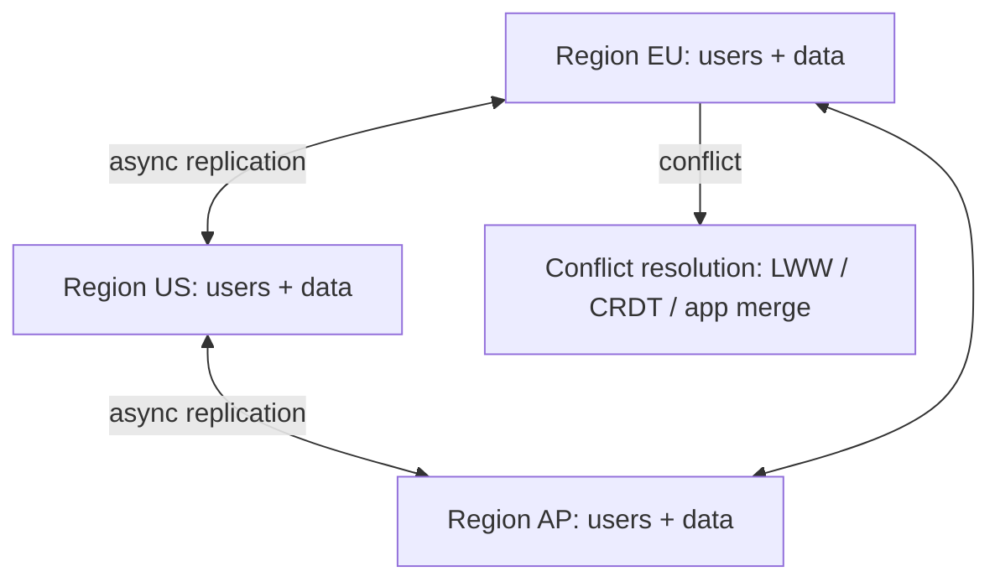

Single-region deployment has a quiet virtue: one copy of the truth, one
latency story, one failure domain. Multi-region exists because that
virtue expires: users far from the region pay a full round-trip's
latency, a regional outage takes the whole product down, and some data
legally cannot leave some borders. The fix, running in *several* regions
at once, trades those problems for the hardest class of problem in this
catalog: **keeping copies of the same data coherent when the network
between regions is slow, expensive, and occasionally absent.**

This page assumes the machinery from
[CAP](/system-design/fundamentals/cap-theorem-and-consistency-models) and
[replication](/system-design/fundamentals/database-fundamentals): it is
about what those tools look like when the replicas are separated by an
ocean instead of a rack.

## The topologies

**Active-passive**: one region serves traffic; the others are warm
standbys receiving replication. Failover promotes a standby. Simple,
cheap (standby hardware idles), and the standby buys *disaster*
recovery but not *latency*: distant users still cross the ocean. It is
the right first step for availability, and it delays every hard
consistency question, because only one region *writes*.

**Active-active**: every region serves reads and writes. Each region's
latency is excellent (users hit the near region), and no single regional
outage takes the product down. The bill: two users writing the same
entity from two regions, both accepted locally, both eventually
replicated, and now the copies *disagree*, and the system must decide
what the disagreement means.

## The write strategies, honestly priced

**Region-local writes, async replication** is the common
active-active shape: each region accepts writes to its local copy and
replicates in the background. Availability is maximal (writes proceed
even during a partition), latency is minimal, and a *conflict* is
possible whenever the same entity is written in two regions between
replication windows. Resolution is the whole design question:

- **Last-writer-wins** (LWW) is the cheap resolution: highest timestamp
  wins. It silently drops one of the two writes, which users notice when
  the dropped write was theirs ("my profile change reverted"). Its
  correctness depends on
  [clocks](/system-design/fundamentals/clock-synchronization-and-logical-time)
  agreeing across regions, which they do only approximately.
- **Application merge** pushes the conflict to the code: the two versions
  are kept as *siblings*, and a merge function (or a human, for critical
  paths) reconciles them. Expensive, and the only honest answer for data
  where dropping a write is unacceptable (money: never LWW).
- **CRDTs** (conflict-free replicated data types) are structures whose
  merge operation is *mathematically* commutative and idempotent, so
  concurrent writes merge deterministically without coordination: a
  grow-only set, a counter, a max. They resolve conflicts by *not
  existing*: the data structure guarantees convergence. The cost is that
  CRDTs exist only for certain shapes of data, so adopting them is a
  data-modeling decision.

**Single-region writes** sidestep conflict by routing all writes (for
an entity, or globally) to one region: users keep local *reads* (often
from a local replica) and pay a cross-region hop for writes. The trade
is explicit and often correct: writes are rarer than reads, and paying
100ms to keep "one writer" is cheaper than resolving conflicts forever.
Per-*entity* routing (the "home region" pattern: an account's writes
always go to the region that owns it) is the standard middle ground,
with a cross-region handoff when the user *moves*.

## The questions that decide the design

Multi-region is a product decision wearing a technical costume, and
three questions do the deciding:

1. **What data may be multi-region, per the law?** Data residency rules
   (GDPR and its relatives) require some *user* data to live in (or at
   least not leave) a specific region, which forces per-region storage
   for that subset and its own routing: the
   [multi-tenancy](/system-design/fundamentals/multi-tenancy-and-data-residency)
   question, and the reason "just replicate everything everywhere" is
   not an answer.
2. **What consistency does each feature need?** The catalog page, the
   search box, the feed: eventual, and local (serve from anywhere, lag
   is fine). The account balance, the inventory count: strongly
   consistent, which means *one place* writes it, per
   [CAP](/system-design/fundamentals/cap-theorem-and-consistency-models),
   and that place has a latency story for everyone else. The honest
   multi-region design assigns consistency *per feature*, not per system.
3. **What does failover mean here?** In active-active, "regional
   failover" is mostly DNS and routing: stop sending traffic to the dead
   region, and the survivors absorb. But *the data written to the dead
   region before it died* is in limbo: was it replicated out? Was it
   *committed* there and lost? Answering that on failover is the
   reconciliation pass, and whether those writes can be lost or must be
   recovered is a per-feature decision again.

## Latency and the read story

The quiet half of multi-region success is keeping *reads* local without
serving garbage. The standard pattern: each region holds a full replica
(usually via the database's own replication), *stale by the replication
lag* (tens of milliseconds intra-region, seconds cross-region), and the
application picks per-read: local-and-stale for tolerant features
( [eventual consistency](/system-design/fundamentals/cap-theorem-and-consistency-models)
as a *latency optimization*), and the primary's answer for strict ones.
The [cache](/system-design/fundamentals/caching)-and-[CDN](/system-design/fundamentals/cdn)
layers in front are regional by nature and mostly orthogonal: they
absorb the read traffic before any of this matters.

## The failure modes worth designing for

- **Split brain during a partition**: both regions believe they are the
  primary (the classic: failover misfires, the old primary comes back).
  Resolution needs [consensus](/system-design/fundamentals/consensus-and-leader-election)
  or a fencing mechanism, and it is the most expensive failure in this
  family.
- **The thundering re-merge**: a partition heals, and two large divergent
  copies must reconcile, all at once. Conflict resolution that is cheap
  per-conflict becomes a batch job under this load, and merges that need
  humans need a queue.
- **The home-region handoff**: a user moves from the EU region to the US
  region, and their *data ownership* must migrate. Doing it without
  downtime is its own small migration project (the
  [strangler](/system-design/hld/large-scale-migration) discipline in
  miniature).

## Related concepts

- [CAP Theorem & Consistency Models](/system-design/fundamentals/cap-theorem-and-consistency-models)
  is what every conflict-resolution choice here is negotiating.
- [Database Fundamentals](/system-design/fundamentals/database-fundamentals)
  covers the replication mechanics each region pair runs.
- [Clock Synchronization & Logical Time](/system-design/fundamentals/clock-synchronization-and-logical-time)
  is what LWW timestamps lean on, dangerously.
- [Consensus & Leader Election](/system-design/fundamentals/consensus-and-leader-election)
  is the machinery for the single-writer and fencing designs.
- [Design a Key-Value Store](/system-design/hld/key-value-store) is the
  Dynamo-style system that made these trades famous.
