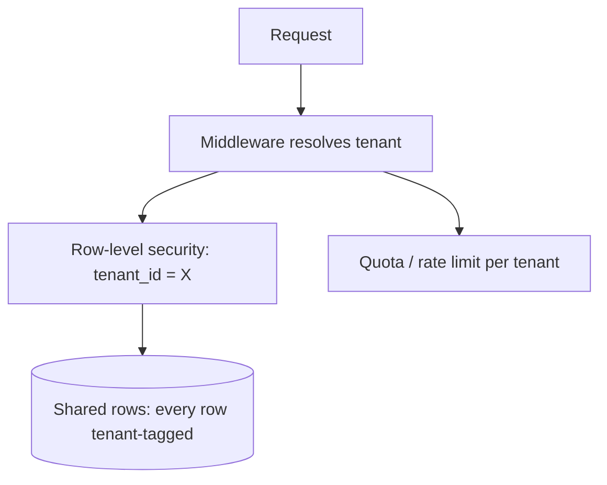

Two questions appear the moment a system serves more than one
customer, and they arrive together because they both turn "one
system" into "one system with internal boundaries." **Multi-tenancy**
is the isolation question: how do you serve customers A, B, and C
from shared infrastructure such that A never sees B's data, B's
failure never degrades A, and B's cost never becomes A's bill?
**Data residency** is the legal question: several countries and
regulations now say certain data must physically remain in (or out
of) particular geographies, which constrains where bytes may live
even when engineering would prefer otherwise.

Both questions are fundamentally *boundary* questions, and the
boundaries have teeth: the multi-tenancy boundary is a security
guarantee (a tenant crossing it is a disclosure, sometimes a
headline), and the residency boundary is a compliance guarantee (a
byte crossing it is a violation, sometimes a fine).

## The tenancy models

The classic spectrum, from most to least isolated:

1. **Dedicated (single-tenant) deployment**: each customer gets their
   own stack. Perfect isolation, perfect per-customer freedom, and
   the cost is per-customer stacks: the operations burden scales with
   customers, upgrades ship N times, and the
   [noisy-neighbor](https://en.wikipedia.org/wiki/Cloud_computing_issues#Performance_interference)
   problem is solved by spending the most money. The enterprise
   tier's traditional answer, and the one that quietly kills margin
   as N grows.
2. **Shared infrastructure, separate databases**: one application
   fleet, one database per tenant. Isolation at the storage layer
   (the strongest practical boundary, and the one
   [least-privilege](/system-design/fundamentals/security-fundamentals)
   reasoning likes), cross-tenant features expensive (they span N
   databases), fleet-wide migrations N-fold.
3. **Shared database, separate schemas or rows**: the common
   middle. One database, every row tagged `tenant_id`, and *every*
   query filtered by the tenant: enforced by
   [row-level security](https://www.postgresql.org/docs/current/ddl-rls.html)
   (the database does it, which is the trustworthy version) or by
   application discipline (which is a bug waiting for the first
   forgotten `WHERE` clause).

The spectrum's real axis is **operational cost vs isolation
strength**, and the honest design usually lands mixed: shared
infrastructure for the fleet, with dedicated or semi-dedicated tiers
for the customers who pay for isolation (the
[noisy-neighbor](https://en.wikipedia.org/wiki/Cloud_computing_issues#Performance_interference)
escape valve, and the enterprise SKU).

## The isolation disciplines

Whichever model, the guarantees come from the same disciplines, and
each is a failure mode when skipped:

- **Tenant resolution at the edge**: every request resolves *exactly
  one* tenant (from
  [auth](/system-design/fundamentals/auth-basics), the subdomain,
  the token), before any data access, and the resolution is
  tamper-proof (a forged or missing tenant claim is a closed-door
  failure, never a default).
- **Enforced, not remembered, filtering**: the tenant filter that
  lives in every query's `WHERE` clause is a convention; the filter
  that lives in
  [row-level security](https://www.postgresql.org/docs/current/ddl-rls.html)
  (or an equivalent mechanism) is a guarantee. The difference is the
  difference between "no developer ever forgets" and "the database
  refuses".
- **Noisy-neighbor containment**: one tenant's load (a runaway
  query, a batch job, a viral moment) must not degrade the fleet:
  per-tenant
  [rate limits](/system-design/fundamentals/rate-limiting) and
  quotas, query timeouts, and
  [backpressure](/system-design/fundamentals/backpressure-and-flow-control)
  that identifies *which* tenant is flooding, so the blast radius is
  one tenant's experience.
- **Cross-tenant features are a design decision**: "admin sees all
  tenants" (the support tool, the analytics view) breaks the isolation
  model on purpose, and needs its own authz path, its own audit
  log, and its own threat model (that path is the highest-value
  target in the system: an attacker with the support tool *is* the
  cross-tenant disclosure).
- **Testing the boundary**: dedicated tests that assert tenant A
  cannot read tenant B, run continuously, because isolation
  regressions are silent (nothing breaks; data just leaks).

## Data residency: the law is a placement constraint

Residency regulations (GDPR and its descendants, sector rules, and
country-specific data-localization laws) constrain *where data may
physically be processed and stored*, and the constraint bites
exactly where the nicest architecture crosses it:

- **The replication problem**: a
  [multi-region](/system-design/fundamentals/multi-region-and-active-active)
  system replicates data globally, and a residency-bound dataset must
  not be replicated out of its region. So residency becomes a
  *per-dataset property* that replication, backup, and caching
  policies must respect: the EU-user rows replicate EU-only, which
  means the [home-region](/system-design/fundamentals/multi-region-and-active-active)
  routing exists partly to keep writes local, and the *read*
  replicas for those rows are EU-only too.
- **The pipeline problem**: analytics
  ([warehouses](/system-design/fundamentals/olap-vs-oltp)), log
  aggregation, and ML training all want *all* the data in one place,
  and residency says no. The standard answers: region-local
  processing with aggregated-only exfiltration (process in-region,
  export only sums), or per-region analytical stores, which is a
  genuine architecture cost, not a checkbox.
- **The backup problem**: backups replicate *everywhere* by default
  (for durability), and a residency-bound dataset's backups must be
  as bound as its primary. The classic violation is the backup or
  the disaster-recovery copy leaving the region, discovered years
  later.
- **The metadata question**: often the regulation is about *personal*
  data, and the split between "regulated personal data" and
  "unregulated operational metadata" (usage counts, aggregated
  metrics) is a modeling decision that determines how much of the
  system is actually constrained. Designing that split deliberately
  (IDs and personal fields in the bound store, everything else
  derivable without them) is the cheapest compliance move available.

The operational summary: residency is a data-placement constraint
with the same status as capacity or latency, and the discipline is
*tagging data with its constraint* (a schema field, a policy label)
so that every system that touches it can be checked, rather than
"knowing" which tables are European.

## Related concepts

- [Security Fundamentals](/system-design/fundamentals/security-fundamentals):
  the threat model and least-privilege principles the isolation draws
  on.
- [Authentication & Authorization Basics](/system-design/fundamentals/auth-basics):
  tenant resolution is authn-adjacent, and the cross-tenant admin
  path is its hardest case.
- [Multi-Region & Active-Active](/system-design/fundamentals/multi-region-and-active-active):
  the geography machinery that residency constrains.
- [Rate Limiting](/system-design/fundamentals/rate-limiting): the
  noisy-neighbor containment tool.
- [OLAP vs. OLTP](/system-design/fundamentals/olap-vs-oltp): the
  analytics pipelines that residency fences off.
