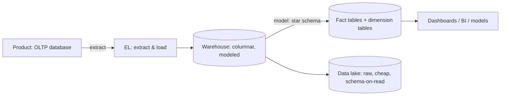

The word "database" hides the deepest split in data engineering. A
system recording "user 42 paid $19" (a transaction, small, now, must be
exactly right) and a system answering "what was our average margin by
region, by month, for the last three years" (a query, huge, yesterday,
must be exactly fast) are both "databases", and they are optimized for
opposite things. The names for the two shapes are **OLTP** (online
transaction processing: the operational record) and **OLAP** (online
analytical processing: the analytical read), and the split is not a
preference, it is physics: the physical design that makes one fast
makes the other slow.

## The two workloads, stated as opposites

| Dimension | OLTP | OLAP |
| --- | --- | --- |
| Query shape | small, known, repeated ("fetch order 47") | huge, ad-hoc, aggregating ("sum by month") |
| Rows touched | 1 to 100 | millions to billions |
| Writes | frequent, small, concurrent | bulk, batched, from pipelines |
| Correctness need | transactional (money must be exact) | eventually right (yesterday's number can be fixed today) |
| Latency need | milliseconds | seconds to minutes |
| Who uses it | the product, the user | analysts, dashboards, models |

The row count line is the load-bearing one: an OLTP query touches a
handful of rows via an index (that is its whole speed), and an OLAP
query scans a huge fraction of the table (that is its whole cost), and
no amount of indexing makes a scan a lookup. The
[index](/system-design/fundamentals/database-fundamentals) that makes
"fetch order 47" instant actively hurts "sum by month", because the
index forces row-by-row access where the analytical engine wants
columnar streaming.

## Why columnar storage wins analytics

The physical insight behind every analytical database (Redshift,
BigQuery, Snowflake, DuckDB): **store by column, not by row.**

A row store packs each record together: `(order_id, region, month,
amount, …)`, row after row. A column store splits each field into its
own file: all the regions together, all the amounts together. For
"average amount by region", the column store reads *two* columns, skips
everything else, and touches a fraction of the bytes; the row store
reads the entire table because the other columns are physically in the
way. Add cheap compression (a column of one value repeated 10 million
times compresses absurdly well) and vectorized execution (same
operation, millions of values, one tight loop), and the analytical
speedup is orders of magnitude, which is why the entire industry moved.

OLTP rows keep row storage for their own reasons: a transaction touches
all of one record, indexes point at rows, and the
[ACID](/system-design/fundamentals/database-fundamentals) machinery
needs the record in one place. Hence two systems, and the split is
structural, not historical.

## The pipeline between them: the warehouse

With two systems comes the classic architecture: the product's OLTP
database stays the source of truth, and a pipeline copies, transforms,
and loads its data into the analytical store (the **warehouse**), which
is where the queries live.

The **warehouse** is the modeled, structured, usually columnar store:
the same data, re-modeled for analytical workloads, typically as a
**star schema** (a big *fact* table of events: sales, clicks, shipments,
with integer keys to small *dimension* tables: dates, products,
regions) rather than the product's normalized shape. The star is for
aggregation: the fact table is the "sum this" part, the dimensions are
the "group by" part, and a decade of BI tooling assumes it.

The **data lake** is the other half of the modern stack: raw files
(csv/parquet) in [object storage](/system-design/fundamentals/object-storage),
schema-on-read, and essentially unlimited capacity at commodity prices,
holding the data *before* modeling. The lake is where the "keep
everything, decide later" instinct lives (raw events you have not yet
found a use for), and the **lakehouse** (Iceberg/Delta-style tables over
lake storage) is the current convergence: warehouse-quality structure
and speed, directly on lake files, with the two stacks merging.

The **ELT vs ETL** distinction worth knowing: classic ETL transformed
the data *before* loading (into the warehouse's shape); the modern
default, with cheap lake storage and powerful warehouse engines, is
ELT (load raw first, transform *inside* the analytical system, as SQL),
because the transformation is itself a query, and re-doing it is cheap
when the model changes.

## The feeding discipline

The honest problems in this architecture are the pipeline's, and they
are the problems every data platform team actually lives with:

- **Freshness**: how stale is the warehouse? Nightly batches are cheap
  and widely tolerated; hour-level freshness needs
  [CDC](https://en.wikipedia.org/wiki/Change_data_capture) (log-derived
  change events from the OLTP database, the
  [outbox](/system-design/fundamentals/distributed-transactions)
  pattern's cousin); minute-level is a
  [streaming](/system-design/fundamentals/stream-vs-batch-processing)
  pipeline with its whole cost.
- **Reconciliation**: the two systems *will* disagree (a bug, a
  backfill, a late-arriving fact), and "why does the dashboard not match
  the database" is the perpetual incident. The discipline is the same
  as the [payment system](/system-design/hld/payment-system)'s: expect
  divergence, build the checker, and define which answer wins.
- **Backfills and schema drift**: a fixed model needs yesterday's data
  re-processed under today's definition, which is the lake's argument
  for itself: raw is re-derivable.

## Choosing per question

The self-check for any system: "where does this query run?" A
transactional need (exact, small, current) belongs in the OLTP
database, period, and "we also run our reports there" is the classic
OLTP-killer (the report's table scan locks the checkout's rows, or at
best eats its capacity). An analytical need (large, aggregating,
historical) belongs in the analytical store, and asking the product
database for it is how "the dashboard took down checkout" happens.
The two-system split is exactly the
[CQRS](/system-design/fundamentals/event-sourcing-and-cqrs) read-model
idea at data-platform scale: one write model for correctness, derived
models for the reads, each shaped for its question.

## Related concepts

- [Database Fundamentals](/system-design/fundamentals/database-fundamentals)
  is the OLTP side: indexes, transactions, replication, sharding.
- [Object Storage](/system-design/fundamentals/object-storage) is the
  lake's substrate.
- [Stream vs. Batch Processing](/system-design/fundamentals/stream-vs-batch-processing)
  prices the freshness ladder between them.
- [Event Sourcing & CQRS](/system-design/fundamentals/event-sourcing-and-cqrs)
  is the same separation of write and read models, at application scale.
