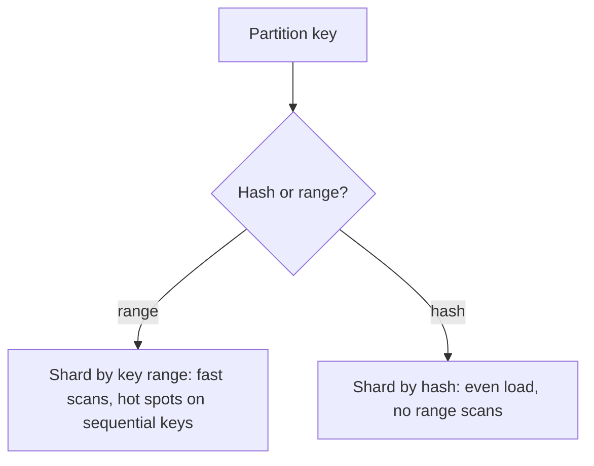

Start with the constraint. One machine has a ceiling: so much disk, so
much memory, so many writes per second. When your data or your write
rate passes that ceiling, copying it to more machines does not help,
because every copy still holds everything. You have to split the data
itself. Each machine, called a **shard** or **partition**, holds a
slice, and together they hold the whole.

Sharding buys near-linear growth. Twice the shards, roughly twice the
storage and write capacity. The cost is that the data no longer lives in
one place, and every query must now know where to look.

## Choosing a partition key

Every row needs one field that decides its shard: the **partition key**.
This is the most important decision in the design, because it decides
which queries stay on one shard and which must visit all of them.

Pick the key that matches your main access pattern. For a chat app, the
hot query is "messages in this conversation", so partition by
conversation ID. One conversation's messages then sit together, and
reading a conversation touches a single shard.

## Range or hash

There are two ways to map keys to shards.

**Range partitioning** gives each shard a contiguous range of keys:
A to F, G to M, and so on. Range scans are cheap, because nearby keys sit
together. "All orders from March" reads one or two shards. The risk is
uneven load. If keys arrive in order, like timestamps, every new write
lands on the shard holding "now", and that shard melts while the others
sit idle.

**Hash partitioning** runs the key through a hash function and uses the
result to pick a shard. Keys spread evenly, so load spreads evenly too.
The price is that range scans are gone: "all orders from March" now
lives on every shard.

Many systems combine the two. Cassandra hashes the first part of the key
to choose a shard, then keeps rows sorted by the rest of the key inside
that shard. You get even spread across shards and cheap scans within
one.

## Hot keys

Even a perfect hash cannot split a single key. If one celebrity account
gets a million writes a second, the shard holding that key takes all of
them. Hashing spreads *different* keys. It cannot spread one popular key.

The usual fix is to split the hot key on purpose. Append a small random
suffix, so writes for `celebrity` go to `celebrity#0` through
`celebrity#9` across ten shards. Reads must then gather all ten and
combine them. You pay on reads to survive the writes, and you do it only
for the few keys that need it.

## Secondary indexes

Partitioning by user ID makes "find user 42" cheap. What about "find
users in Berlin"? City is not the partition key, so you need a secondary
index, and it has two possible shapes.

- **Local index.** Each shard indexes only its own rows. Writes stay on
  one shard. Reads must ask every shard and merge the results, which is
  called scatter-gather.
- **Global index.** The index itself is partitioned by city, so "Berlin"
  lives on one index shard. Reads are fast. Writes must update a second
  shard, often asynchronously, so the index can briefly lag behind the
  data.

## Rebalancing

Shards get added as data grows, and data must move to them. The naive
mapping, `hash(key) mod N`, is a trap. Change N from 10 to 11 and almost
every key moves to a different shard.

Two approaches avoid that. **Many fixed partitions**: create far more
partitions than machines up front, say 1,000 partitions on 10 machines,
and move whole partitions when a machine joins. Keys never change
partition. Only the partition-to-machine map changes.
[Consistent hashing](/system-design/fundamentals/consistent-hashing) is
the other route: it arranges keys and nodes on a ring so that adding a
node moves only the keys next to it.

Either way, something must know which shard holds which key. That is
either a routing tier, a coordination service such as ZooKeeper, or the
client itself with a copy of the map.

## A worked example

A URL shortener stores 12 billion links, about 6 TB. That is too much for
one database to handle comfortably, so you shard.

The main query is "look up this short code", always by code. So the
partition key is the code, and you hash it, because codes are generated
in sequence and range partitioning would pile every new link onto one
shard. You create 256 logical partitions on 8 machines, 32 each. When you
add machines, you move partitions, not keys.

There is no cross-shard query in the hot path. The one analytics query,
"links created per day", runs on a separate copy built for scans, not on
the shards.

## Trade-offs and failure modes

- Queries that include the partition key are cheap. Queries that do not
  must visit every shard.
- Cross-shard transactions are hard. They need
  [distributed transactions](/system-design/fundamentals/distributed-transactions)
  or a design that avoids them.
- Sharding does not protect against failure. Each shard is still one
  machine, so every shard is usually also
  [replicated](/system-design/fundamentals/replication).
- Shard before you must, and you pay for complexity you do not need yet.
  Shard too late, and you migrate under load.

## Related concepts

- [Replication](/system-design/fundamentals/replication) copies each
  shard for durability; the two are almost always used together.
- [Consistent Hashing](/system-design/fundamentals/consistent-hashing) is
  the mapping that makes adding shards cheap.
- [Distributed Transactions](/system-design/fundamentals/distributed-transactions)
  is what you need when one operation spans shards.
- [Database Fundamentals](/system-design/fundamentals/database-fundamentals)
  introduces sharding alongside indexes and replication.
