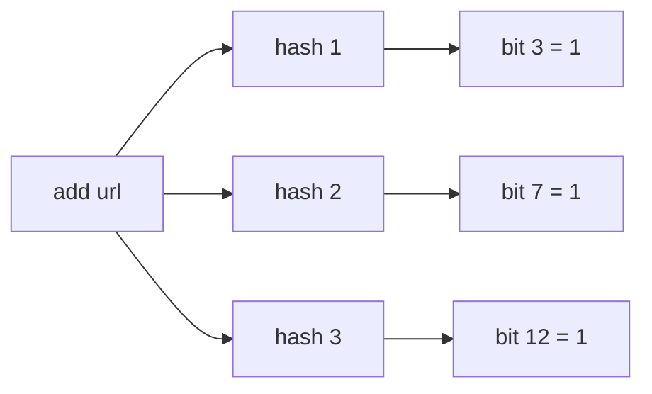

The trade is simple. You give up exactness, and you get answers in a
tiny, fixed amount of memory. "Have I seen this URL?" across 1 billion
URLs takes about 1.2 GB as a Bloom filter at a 1% error rate, where an
exact set of the URLs themselves would need around 100 GB. "How many
distinct visitors today?"
takes 12 KB with HyperLogLog, whatever the traffic. The answers carry a
small, known error, and for many questions that is a good deal.

Three structures cover most real uses. Each answers one kind of
question.

## Bloom filter: "have I seen this?"

A Bloom filter answers set membership. It can say "definitely not" or
"probably yes". It never gives a false "no".

It is a bit array of `m` bits, all starting at 0, plus `k` hash
functions. To add an item, hash it `k` ways and set those `k` bits. To
check an item, hash it the same `k` ways. If any of those bits is 0, the
item was never added. If all are 1, it probably was, though another
combination of items might have set those bits.

The false-positive rate depends on bits per item. About 10 bits per item
with 7 hash functions gives roughly a 1% false-positive rate. Plain
Bloom filters cannot delete an item, because clearing a bit might
"forget" other items that share it.

**Where it is used.** A
[web crawler](/system-design/hld/web-crawler) checks "already
crawled?" before fetching a URL. A rare false positive skips one page,
which is acceptable. Databases built on LSM trees, like Cassandra and
RocksDB, keep a Bloom filter per file, so a read can skip files that
definitely lack the key instead of opening every one. Caches use one to
avoid queries for keys known not to exist.

## HyperLogLog: "how many distinct?"

Counting distinct items exactly means remembering every item. HyperLogLog
counts them in a fixed few kilobytes, with about 1% error.

The idea rests on one observation. Hash each item to a random-looking
number. In random numbers, a run of `z` leading zero bits shows up about
once every 2^z values. So if the longest run you have seen is 20 zeros,
you have probably seen around 2^20, about a million, distinct values.
Duplicates hash identically, so they never change the answer. One such
estimate is noisy, so HyperLogLog splits items into thousands of buckets,
tracks the longest run in each, and averages them.

Two HyperLogLogs merge by taking the larger value in each bucket. That
makes them ideal for distributed counting: each server keeps its own,
and you merge them to get the global count. Redis exposes this directly
as `PFADD` and `PFCOUNT`.

## Count-min sketch: "how often?"

A count-min sketch estimates how many times each item has appeared in a
stream, using memory that does not grow with the number of distinct
items.

It is a small grid of counters: `d` rows, each with its own hash
function and `w` columns. To record an item, hash it once per row and
increment that counter. To estimate its count, look at its counter in
every row and take the *smallest*. Collisions can only add to a counter,
never subtract, so every counter overestimates, and the minimum is the
closest. The estimate is never below the true count.

**Where it is used.** Finding heavy hitters, such as the top trending
hashtags or the IP addresses sending the most requests. Pair it with a
small heap of current leaders and you can track the top k items in a
stream of billions.

## A worked example

You build a dashboard for a site with 500 million page views a day. It
shows three numbers: distinct visitors, the 100 most-viewed pages, and
whether a given visitor has been seen before.

- **Distinct visitors.** One HyperLogLog per server per hour, merged for
  the daily total. 12 KB each, about 1% error.
- **Top pages.** A count-min sketch of a few hundred kilobytes, plus a
  heap of the 100 highest estimates.
- **Seen before?** A Bloom filter sized for the expected visitors at a 1%
  false-positive rate. A rare "seen" for a brand-new visitor is a
  harmless error for this purpose.

The exact version of the same dashboard would keep a set of every
visitor ID and a counter for every page: gigabytes of memory, growing
every day. The sketches stay the same size forever.

## Trade-offs and failure modes

- Know which way each structure errs. A Bloom filter never says "no"
  wrongly. A count-min sketch never undercounts. Design around that
  direction.
- Size them up front. A Bloom filter that receives far more items than
  planned degrades toward "everything is present".
- Do not use them where an error is unacceptable. Never let a Bloom
  filter decide that a payment was already processed. Use an exact
  [idempotency](/system-design/fundamentals/idempotency-and-exactly-once)
  record for that.

## Related concepts

- [Web Crawler](/system-design/hld/web-crawler) uses a Bloom filter to
  skip URLs it has already fetched.
- [Database Fundamentals](/system-design/fundamentals/database-fundamentals)
  covers the storage engines that keep a Bloom filter per file.
- [Stream vs. Batch Processing](/system-design/fundamentals/stream-vs-batch-processing)
  is where sketches do most of their work: one pass, bounded memory.
- [Ad Click Aggregator](/system-design/hld/ad-click-aggregator) shows
  approximate real-time counts sitting next to exact billing totals.
