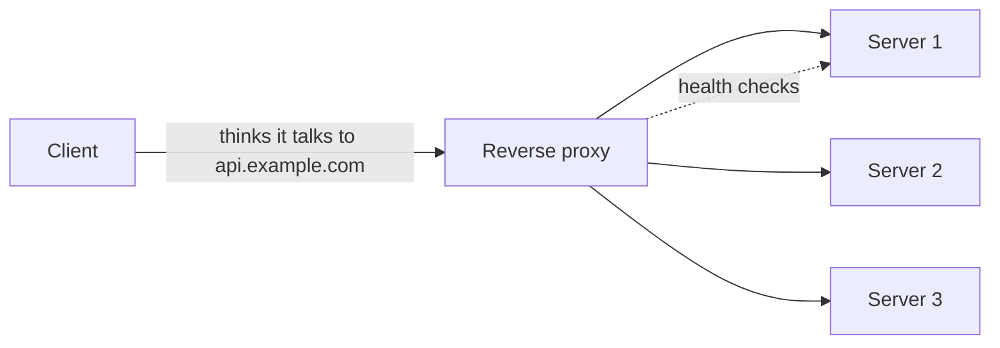

A proxy is a middleman: a process that accepts your connection, makes
its own connection onward, and relays bytes (or messages) between
them. That simple position, *in the path*, buys surprising powers: the
proxy can see everything (observability), change anything (routing,
caching, compression), hide either side (anonymity, load
distribution), and enforce policy (auth, filtering, rate limits).
The entire
[API gateway](/system-design/fundamentals/api-gateway-and-service-mesh)
and [load balancer](/system-design/fundamentals/load-balancing) family
is a proxy wearing features, which is why this page is their common
ancestor.

The two words "forward" and "reverse" describe *which end configured
the proxy*, and the distinction is the classic interview trap because
the mechanics are nearly identical while the purposes are opposite.

## Forward proxy: the client's agent

A **forward proxy** is configured by (and works for) the *client*: your
laptop or company network sends everything through it, and the proxy
forwards to destinations on your behalf. The destination sees the
proxy, not you.

What that position is used for:

- **Policy enforcement and filtering**: the corporate proxy decides
  which sites and protocols are allowed, and inspects outbound traffic
  before it leaves (security teams care a lot about exfiltration).
- **Anonymity / egress control**: the destination sees the proxy's IP
  (the basis of both legitimate privacy and circumvention).
- **Caching shared fetches**: many employees fetching the same
  updates? The proxy caches them ([forward
  caching](/system-design/fundamentals/caching) is rare now that
  everyone has fast direct lines, but it was the original purpose).
- **Breaking the direct line**: internal services reaching external
  APIs through one controlled exit point, so credentials and rules
  live in one place.

## Reverse proxy: the server's agent

A **reverse proxy** is configured by the *server* (the destination
side), and clients connect to it without knowing what stands behind
it: you hit `api.example.com`, and something decides which of a
hundred boxes answers. The client sees only the proxy's name, which
is the reverse of the forward case: there, the *destination* was
hidden; here, the *origin* is.

This position is the load-bearing one for system design, because it
is where the standard production architecture attaches:

- **Load distribution**: the reverse proxy is the
  [load balancer](/system-design/fundamentals/load-balancing),
  spreading traffic across a pool and health-checking it.
- **TLS termination**: decrypt at the proxy, re-encrypt (or not)
  internally: certificate management in one place, and the standard
  topology question of where the trust boundary sits.
- **Caching and compression**: the reverse proxy is the natural
  [CDN](/system-design/fundamentals/cdn) origin or the
  [cache](/system-design/fundamentals/caching) tier, serving the
  repeated answers without bothering the pool.
- **Routing**: path-based and host-based routing to different
  services (`/api` to one, `/admin` to another) with one public
  name: the [gateway](/system-design/fundamentals/api-gateway-and-service-mesh)
  function.
- **Security perimeter**: rate limits, DDoS absorption,
  authentication in front of services, header hygiene, and the
  "shield the origin" pattern that makes the origin invisible to the
  public internet entirely.
- **Observability**: every request logs here (one place with the full
  view), and the [observability](/system-design/fundamentals/observability)
  tier's request-level metrics usually start at the proxy's access log.

The transparency both proxies share: they are *invisible* by design.
The forward proxy hides the client; the reverse proxy hides the
server, and clients cannot tell (and should not care) how many boxes
stand behind one name.

## The L4 vs L7 distinction

Proxies (and
[load balancers](/system-design/fundamentals/load-balancing), their
most featureful descendants) come in two working depths:

- **Layer 4** (transport): reads addresses and ports, routes TCP/UDP
  flows, no awareness of the message. Extremely fast, very simple,
  and unable to do anything smart (no per-path routing, no caching, no
  auth).
- **Layer 7** (application): reads the full HTTP (or other protocol)
  request, and can route, rewrite, cache, authenticate, and rate-limit
  *per request*. This is where almost every interesting feature lives,
  at the cost of parsing and the CPU that goes with it.

The standard production topology is both: a fast L4 edge for
connection handling, and L7 proxies (or gateways) behind it for the
policy and routing, which is exactly the
[load balancer page](/system-design/fundamentals/load-balancing)'s
two-tier shape.

## Where the theory cashes out

If you can say what a proxy *is* (a configured middleman), which end
configured it (forward: client; reverse: server), and what its
position buys (seeing and shaping everything that passes), then every
product in this family is a specialization: nginx as a reverse proxy
with routing and caching, an
[API gateway](/system-design/fundamentals/api-gateway-and-service-mesh)
as a reverse proxy with auth and API-specific features, a
[CDN](/system-design/fundamentals/cdn) as a geographically distributed
reverse proxy with caching as the point, and a
[service mesh](/system-design/fundamentals/api-gateway-and-service-mesh)
as *every service's* private reverse proxy. The middleman position is
one of the most profitable in systems design, which is why so much
infrastructure lives there.

## Related concepts

- [Load Balancing](/system-design/fundamentals/load-balancing): the
  reverse proxy's most famous job.
- [API Gateway & Service Mesh](/system-design/fundamentals/api-gateway-and-service-mesh):
  the feature-rich reverse proxy, and the per-service version.
- [Caching](/system-design/fundamentals/caching) and
  [CDNs](/system-design/fundamentals/cdn): what the position can
  serve for you.
- [Networking Basics](/system-design/fundamentals/networking-basics):
  the layers underneath (L4 vs L7, TLS termination).
