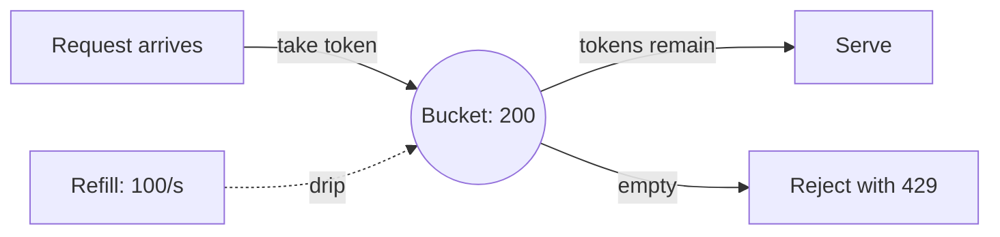

A public API is a promise to be available, and the internet responds to
promises of availability with traffic shaped like a weapon. Ten million
requests per second from one script, a login endpoint brute-forced with
every password ever leaked, a retry loop in your own client code
accidentally hammering your own service: all of these are the same event,
which is *demand exceeding what you built for*, arriving from a single
source that has no reason to stop.

Rate limiting is the system's answer: **a rule about how many requests are
allowed, from whom, in what window, and what happens to the rest.** It is
upstream of every other protection. A [load balancer](/system-design/fundamentals/load-balancing)
spreads the load you accept; a rate limiter decides what gets accepted.

## The design space: four questions

Before any algorithm, four decisions that shape everything:

- **What is the unit?** Per user, per API key, per IP address, per
  endpoint, per tenant? Each choice changes who gets throttled: per-IP
  rate limiting punishes everyone behind one corporate NAT; per-user
  limits a shared account from being hammered by one script.
- **What is the window?** Per second, per minute, per day, or tiered (100
  per second, 10,000 per day)? Tiered limits are normal, and cheap
  requests may get a different budget than expensive ones.
- **What happens on excess?** Reject (429), queue it for later, or
  degrade gracefully (serve a cached page, a cheaper answer, a
  maintenance response)?
- **Where does the rule live?** In each service instance, or in a shared
  store? The honest distributed question, covered below.

## The algorithms

**Fixed window.** "At most 100 requests per calendar minute." A counter
keyed to the current minute; reset when the minute flips. Simple, and
broken in a well-known way: a burst of 100 requests at the end of minute
one plus 100 at the start of minute two gives you 200 requests in a
single second. The window boundary is arbitrary, and attackers align
with it.

**Sliding window log.** Keep the timestamp of every request and count the
ones in the last 60 seconds. Perfectly accurate and exactly what the spec
says. The cost: memory proportional to traffic, and every request pays a
scan of the log. Used for billing-grade accuracy on low-volume, precious
endpoints.

**Token bucket.** The industry default. A bucket holds up to `capacity`
tokens; each request consumes one; tokens refill at `rate` per second.
Arrive steadily at the refill rate and you never run out; arrive in a
burst and you drain the bucket; keep going and you're rejected until it
refills. The two parameters *are* the policy: `rate` is the sustained
speed, `capacity` is the tolerated burst. That separation is why it wins:
most real systems want "100 per second sustained, but a burst of 200 is
fine", and fixed windows can't say that sentence.

**Leaky bucket.** The reverse emphasis: requests pour into a bucket, and
it *drains* at a fixed rate, one request at a time. Output is perfectly
smooth, no bursts allowed, ever. Used where downstream systems need
protection from bursts (the "shape the traffic" case rather than the
"cap the traffic" case).

**Sliding window counter.** The pragmatic hybrid: keep a counter per
minute (cheap), and estimate the current window's count as a weighted
blend of the previous and current minute's counters. Close to accurate,
O(1) memory, and immune to the fixed-window boundary burst. This is what
many production systems actually run.

## The distributed problem

A single-instance limiter is trivial: a token bucket in memory. But your
service runs on 20 instances behind a load balancer, and each instance
only sees 1/20 of the traffic. Limit 100/second per instance means the
real limit is 2000/second: the rule you configured is not the rule you
enforced.

The honest options:

1. **A shared counter store** (Redis): every instance checks and
   increments the same bucket. Correct, and costs a network round trip on
   the hot path, which is why limiter services exist as
   infrastructure.
2. **Independent per-instance limits, divided**: 20 instances, 100/second
   total, so each enforces 5/second. No shared state, no round trip, but
   load must be spread evenly or the limit is wrong in both directions.
   Also: one instance dying shifts the burden, and the limit silently
   degrades.
3. **Local + global hybrid**: each instance keeps a fast local bucket
   (say 90% of its share), and a shared store backs the global count.
   Absorbs most traffic locally, with the shared store consulted only
   near the boundary. The standard production answer, because it makes
   the common case local and the boundary case coordinated.

## The surrounding protocol

The limit itself is half the design; the communication around it is the
other half.

- **429 Too Many Requests**, not 500 or 403. The client did nothing wrong;
  it asked too fast.
- **`Retry-After` header**: when the client may retry. Without it, the
  client's natural response is an immediate retry loop, which is exactly
  the traffic you were trying to stop.
- **`X-RateLimit-*` headers** (remaining, limit, reset): visible budget.
  Well-behaved clients throttle *themselves* when they can see the
  limit coming, which is the cheapest capacity you will ever buy.
- **Exponential backoff with jitter** on the client side: the answer to
  thundering herds of synchronized retries, and the reason a limiter
  should never be designed alone, without its client counterpart.

## When it doesn't fit

Rate limiting is a blunt instrument for anything beyond traffic shaping.
It's not authentication (a rejected request was still seen), not
authorization (a limit says nothing about what a request may touch), and
not abuse detection (a slow, patient attacker stays under any sane
limit). When the problem is *what* is being done rather than *how fast*,
you want validation, permissions, or anomaly detection instead.

## Related concepts

- [Idempotency & Exactly-Once Delivery](/system-design/fundamentals/idempotency-and-exactly-once)
  covers what happens to the *requests that get through*, which matters
  because rate limiting and retries interact badly without it.
- [Backpressure & Flow Control](/system-design/fundamentals/backpressure-and-flow-control)
  is the internal counterpart: shaping load you generate, not load you
  receive.
- [Load Balancing](/system-design/fundamentals/load-balancing) decides
  where accepted traffic goes; the two systems together form the front
  door.
- [Caching](/system-design/fundamentals/caching) is the *other* answer to
  overload: absorb repeats instead of rejecting them.
