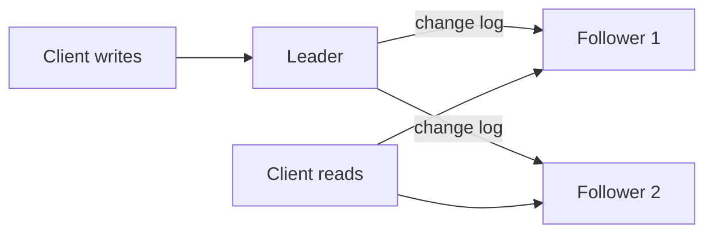

Replication makes one promise: if a machine dies, your data does not die
with it. You keep the same data on several machines, called replicas, so
any one of them can fail and the others still answer. Copies also let you
spread reads across machines and put data closer to users.

The promise has a price. Copies drift. A write lands on one machine first
and reaches the others later. Every replication design is a choice about
how long that gap can be, and what a reader sees while it lasts.

## Leader and followers

The most common design has one **leader** and several **followers**. All
writes go to the leader. The leader records each change in a log and
ships the log to the followers, which apply the changes in the same
order. Reads can go to any replica.

This is how PostgreSQL, MySQL, and MongoDB replica sets work by default.
It is simple to reason about because there is exactly one order of
writes: the leader's.

## Synchronous or asynchronous

The leader can wait for followers before it tells the client "done", or
it can answer right away and ship the change afterwards.

- **Synchronous.** The write is confirmed only after a follower has it.
  A confirmed write survives the leader dying. But one slow follower
  slows every write, and one dead follower can block them all.
- **Asynchronous.** The leader confirms immediately. Writes are fast, but
  if the leader dies before shipping its latest changes, those confirmed
  writes are gone.

Most systems pick a middle path called **semi-synchronous**: wait for one
follower, ship to the rest asynchronously. One extra copy is guaranteed,
and a single slow machine cannot stall the whole system.

## Replication lag and what users notice

With asynchronous followers, a follower can be seconds behind the leader.
Here is the bug that causes in practice. You update your profile name.
The write goes to the leader. You reload the page, the read goes to a
follower that has not caught up, and your old name comes back. It looks
like the save failed.

Three fixes are common:

- **Read your own writes.** For a short time after a user writes, send
  that user's reads to the leader.
- **Monotonic reads.** Pin each user to one replica, so they never see
  data go backwards by bouncing between a fresh replica and a stale one.
- **Consistent prefix.** Apply writes in order everywhere, so nobody sees
  an answer before the question it replies to.

These are weaker than full consistency and much cheaper. The
[consistency models](/system-design/fundamentals/cap-theorem-and-consistency-models)
article names the whole range.

## When the leader dies

Losing a follower is easy: start a new one and let it catch up from the
log. Losing the leader means **failover**. You must detect the failure,
choose a new leader (usually the most up-to-date follower), and redirect
writes to it.

Each step can go wrong. Detection uses timeouts, and a timeout cannot
tell a dead leader from a slow one. Declare it dead too eagerly and you
fail over on every network hiccup. Too slowly and writes stall. Worse,
the old leader may come back still believing it is in charge, giving you
two leaders accepting writes. That is called **split brain**. Systems
prevent it with a
[consensus protocol](/system-design/fundamentals/consensus-and-leader-election)
and by fencing the old leader so its writes are rejected.

## Multi-leader and leaderless

Two other designs trade the single write order for availability.

**Multi-leader** replication runs a leader in each region. Users write to
their nearest leader, and leaders sync with each other. Writes stay fast
and local, and a region can lose its link to the others and keep
working. The cost is conflicts: two regions can change the same row at
the same moment. You need a rule to resolve that, such as last write
wins, or a data type that merges cleanly. This is the shape of
[multi-region active-active](/system-design/fundamentals/multi-region-and-active-active).

**Leaderless** replication, used by Dynamo-style stores like Cassandra,
lets any replica take a write. A client writes to several replicas and
reads from several, and uses **quorums** to stay correct. With `n`
replicas, require `w` acknowledgements per write and query `r` replicas
per read. If `w + r > n`, every read overlaps at least one replica that
saw the latest write. A common setting is `n = 3, w = 2, r = 2`.

## A worked example

You run a store with one leader and two asynchronous followers. Reads
outnumber writes 20 to 1, so the followers carry almost all the read
traffic. That is the main win.

Now the checkout flow. A customer places an order and is sent to the
"your orders" page. That page must show the new order, so you route it
to the leader for the next few seconds. The product catalog, where a
second of staleness is harmless, keeps reading from followers.

You also decide that losing a confirmed order is unacceptable, so you
make one follower synchronous. Writes now take one extra network round
trip, about a millisecond inside a data center. That is the price of
knowing every confirmed order exists on two machines.

## Trade-offs and failure modes

- More replicas mean more read capacity and more durability, and more
  machines to keep in step.
- Asynchronous replication is fast and can lose recent writes on
  failover. Synchronous is safe and slower.
- Replication copies all of the data to every replica. It does not help
  when the data is too big for one machine. That is what
  [partitioning](/system-design/fundamentals/partitioning-and-sharding)
  is for, and real systems use both together.

## Related concepts

- [Partitioning & Sharding](/system-design/fundamentals/partitioning-and-sharding)
  splits data that is too big for one machine; replication then copies
  each piece.
- [Consensus & Leader Election](/system-design/fundamentals/consensus-and-leader-election)
  is how replicas agree on a leader without split brain.
- [CAP Theorem & Consistency Models](/system-design/fundamentals/cap-theorem-and-consistency-models)
  names the guarantees replication lag forces you to choose between.
- [Database Fundamentals](/system-design/fundamentals/database-fundamentals)
  introduces replication alongside indexes and sharding.
