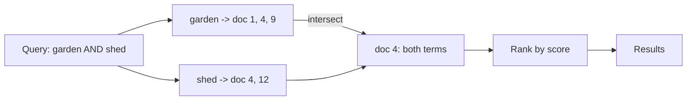

"Find me all documents containing 'garden shed'" is a fundamentally
different question from "fetch the record with id 47", and the
difference is the whole subject. A
[key-value lookup](/system-design/fundamentals/database-fundamentals)
asks the store for a known thing; text search asks which *unknown*
things contain a known thing, and the only way to answer it cheaply is
to invert the data: instead of document-to-words, store
**word-to-documents**, and the search becomes a lookup after all. That
inversion is the **inverted index**, and it is the engine inside
Elasticsearch, Solr, Lucene, and every search box you have ever used.

## The core structure

The index maps each **term** to a **posting list**: the documents that
contain it, plus enough per-document information to rank them.

- `garden` points at `[doc 1, doc 4, doc 9]`
- `shed` points at `[doc 4, doc 12]`
- "garden shed" (both terms) is the *intersection*: `[doc 4]`, and an
  intersection of sorted lists is a merge you can do in one pass.

That intersection is why search is fast: the index turns a
"scan everything and check" into "fetch two lists and intersect them",
and the work is proportional to the postings, not to the corpus. The
same structure answers OR (union), NOT (complement against the full
list, which is why NOT is the expensive one), and phrase search
("garden shed" as *adjacent words*, which needs the posting list to
store *positions*, not just document ids).

## The pipeline: from text to postings

The index is built by a text-processing pipeline, and every stage is a
design decision that shapes what can be found:

**Tokenization** splits text into terms (words, roughly): on
whitespace and punctuation, handling the apostrophes and hyphens of a
real language. Language-specific rules (where Chinese segmentation
breaks words without spaces, or German compounds run together) live
here, and it is the first reason a search engine is not "a regex over
the database".

**Normalization** folds the variants together: lowercase (garden =
Garden), stemming (running = run: the classic
[Porter stemmer](https://en.wikipedia.org/wiki/Porter_stemmer)), and
stopword removal (drop "the", "a": they are in every document, so
their posting lists are the entire corpus, and they contribute nothing
but cost). Every fold is a trade: stemming matches "running" and "run",
and also loses the distinction between them.

**Analysis at write and at query must match**, which is the discipline
that makes or breaks a search setup: if documents are indexed with
stemming and queries are not, "running" finds nothing, and "reindex
with the same analyzer" is the fix people learn the hard way.

## Ranking: which documents first

The intersection is a *set*, and the set is useless without an order,
which is the ranking half of the problem. The classic scheme to know
(and the baseline every modern system modifies) is
**TF-IDF**: a term's score in a document rises with its frequency
there (term frequency: "garden" 5 times in doc 4 suggests doc 4 is
*about* gardens) and falls with its frequency in the corpus (inverse
document frequency: "garden" in a gardening corpus is worth little,
"zucchini" is worth a lot, because rare terms discriminate). Sum the
per-term scores, order the results, done.

**BM25** is the modern descendant (saturation: the tenth occurrence
of a term adds less than the second; document length normalization:
a 300-word page mentioning "garden" twice beats a 10,000-word one
mentioning it thrice), and it remains the workhorse of relevance: it
is a *statistical* model, no learning, just counting, and it is
startlingly hard to beat with fancier machinery for plain keyword
search.

**Vector search** is the new member of the family, and the relationship
is complementary rather than competitive: text (or anything) embedded
into a dense vector, searched by *nearest neighbor* rather than term
match, which finds "things that mean approximately this" where
BM25 finds "things containing these exact stems". Semantic matching,
cross-lingual matching, and typo-tolerance fall out of it, at the cost
of the exactness and explainability that posting lists give. The
modern pattern (hybrid search) runs both and merges, and the
RAG systems of the AI era are vector search wearing a product.

## The operational shape

**Write path**: analyze the document, append to each term's posting
list (a real engine: an
[LSM](https://en.wikipedia.org/wiki/Log-structured_merge-tree)-style
segment that merges in the background, which is why writes are fast
and why a just-written document is searchable "soon" rather than
"now"). **Read path**: analyze the query, fetch the posting lists,
combine, rank, return the top page. The read cost is proportional to
the *query's* terms, which is the design's entire promise.

**Sharding** is by document (each shard holds a subset of documents,
every query fans out to all shards and merges), which is the standard
split for search: terms are correlated (a document about gardens uses
garden-words together), so document sharding keeps the postings
co-located that a query needs together. It is the opposite of the
[cache's](/system-design/fundamentals/consistent-hashing) key-sharding,
and the contrast is the teaching point: shard by the access pattern,
not by the name of the store.

## Choosing per question

- Exact match on a field: a database (an
  [index](/system-design/fundamentals/database-fundamentals) does
  equality better than any text pipeline).
- Prefix/autocomplete: a [trie](/dsa/patterns/trie-prefix-tree),
  which is what [autocomplete HLD](/system-design/hld/search-autocomplete)
  builds.
- Full-text: the inverted index, this page's subject.
- Semantic / fuzzy / "more like this": vector search.
- All of the above at once: hybrid, which is where the serious
  products converge.

## Related concepts

- [Search Autocomplete](/system-design/hld/search-autocomplete) is the
  prefix-shaped sibling (tries), and the two compose into one search
  box.
- [OLAP vs. OLTP](/system-design/fundamentals/olap-vs-oltp): search
  indexes are read models, the same split as warehouse vs. database.
- [Caching](/system-design/fundamentals/caching): the posting lists
  themselves are the cache that makes search fast.
- [Tries](/dsa/patterns/trie-prefix-tree) and the
  [autocompletes](/dsa/patterns/trie-prefix-tree/problems/implement-trie)
  are the data-structure ancestors of the prefix half.
