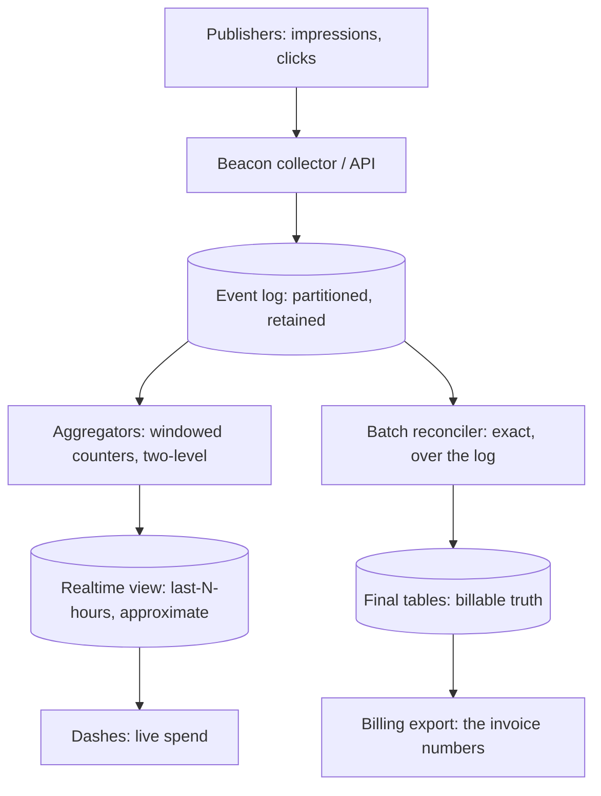

An ad click aggregator ("count the clicks, bill the advertisers", the
[DDA](/system-design/hld/news-feed)-class of data products) is the
purest *streaming analytics* HLD: a firehose of events (impressions
and clicks), a **windowed aggregation** (counts per
advertiser/ad/campaign, per hour and per day), and a
billing-critical correctness bar, which is what separates it from
every "just count it" system: **a miscounted click is a mis-billed
dollar** ([the payment system](/system-design/hld/payment-system)'s
correctness discipline applied to arithmetic), and the design is
dominated by making streaming counts *exactly right* in a world
where [exactly-once delivery does not exist](/system-design/fundamentals/idempotency-and-exactly-once).

## Requirements

**Functional**

- Ingest impression and click events (per ad, per publisher, per
  user) at firehose rate.
- Aggregate: counts (and sums: revenue per click) over time windows
  (hourly, daily, per campaign), queryable and reportable.
- Deduplicate: the same click delivered twice is one click
  ([at-least-once](/system-design/fundamentals/message-queues-and-pubsub)
  is the transport's honest guarantee).
- Late data: clicks arriving minutes/hours after the window closed
  (retransmits, offline clients) must land somewhere principled.
- Billing export: the daily per-advertiser numbers that invoices
  are cut from.

**Non-functional**

- **Throughput: the firehose** (millions of events/sec peak: the
  [Super Bowl](/system-design/hld/e-commerce-flash-sale)-class burst
  profile), absorbed and aggregated with bounded lag (minutes, not
  hours).
- **Correctness: reconcilable** (every number must be derivable
  from the raw event log, and any two computations over the same
  log must agree: the [ledger](/system-design/lld/bank-ledger-system)
  discipline).
- **Bounded state**: the aggregator cannot hold "every event
  forever" in memory, so the windowing machinery is a state
  discipline.
- Availability over freshness (a late number is fine, a wrong
  number is not: the trade that separates this design from the
  [fraud detector](/system-design/hld/fraud-detection)'s hard
  real-time bar).

## The architecture

The two-tier shape ([the stream-vs-batch](/system-design/fundamentals/stream-vs-batch-processing)
page's Lambda/Kappa argument in production clothes): a **streaming
tier** for freshness (approximate, minutes-lag, live dashboards)
and a **batch tier over the retained log** for the exact numbers
(the billable truth), with the *reconciliation* between them being
the design's honesty mechanism.

## The counting pipeline, windowed

The aggregator's core machinery, which is the
[stream](/system-design/fundamentals/stream-vs-batch-processing)
page's toolkit applied to counting:

- **Partition by key** (advertiser/ad/campaign: the
  [partition-by-key](/system-design/hld/distributed-message-queue)
  move, so one entity's events are one stream, in order, handled
  together: the counters for an entity are local to its partition,
  which is what makes them cheap).
- **Windowed counters, in state** (the per-entity running counts:
  a rolling structure of "current hour, current day" buckets, the
  bounded [state](/system-design/fundamentals/stream-vs-batch-processing)
  discipline), which *flip over* at window boundaries (the hour
  closes: the bucket is emitted to the realtime view and a new one
  opens: the **tumbling window**).
- **Late events land in the late bucket** (the
  [watermark](/system-design/fundamentals/stream-vs-batch-processing)
  machinery: events behind the watermark update a *correction*
  stream rather than the closed bucket, and the honest design is
  "the realtime view was approximate, the correction stream is the
  running errata, the batch reconcile below is the truth").
- **Dedup at ingest** (the click's event id, hashed into a
  short-TTL seen-set: [the idempotency](/system-design/fundamentals/idempotency-and-exactly-once)
  move applied per-event, bounded because the dup window is
  minutes): the streaming tier's dedup is *best-effort* (TTL'd,
  memory-bounded), and the *exact* dedup lives in the batch
  reconcile (which sees all the data), which is the two-tier design
  doing exactly what it is for.

## The exactly-once question, answered honestly

The billing bar ("the number on the invoice is the number of unique
clicks") meets the [theorem](/system-design/fundamentals/idempotency-and-exactly-once)
("exactly-once *delivery* is impossible"), and the design's answer
is the **idempotent, replayable computation**: 

- Every event carries an id (the
  [idempotency key](/system-design/fundamentals/idempotency-and-exactly-once)),
  and the *aggregation is a pure function of the event set* (the
  batch tier: `count(distinct event_id) group by window, ad`), so
  "exactly once" is bought by **recomputing from the log** rather
  than by trusting any delivery: the
  [event-sourcing](/system-design/fundamentals/event-sourcing-and-cqrs)
  argument, and the reason the log's retention is a billing
  requirement, not an archive decision.
- The streaming tier's numbers are *allowed to be approximate*
  (dedup TTLs, watermark-truncated late data: the dashboards), and
  the **reconciler** (the nightly [batch](/system-design/fundamentals/olap-vs-oltp)
  job over the raw log, computing the exact same aggregates) is the
  authority: when the reconciler disagrees with the stream (it
  will, occasionally: a late event the stream dropped), the batch
  number *wins by definition*, and the delta is logged (the
  [payment system](/system-design/hld/payment-system)'s
  reconciliation discipline, applied to counts: divergence is
  expected, detected, and resolved by construction).
- **Replay-ability as the correctness proof**: because the
  computation is pure over the log, the *audit* ("prove this
  invoice") is a replay: the same fold, the same log, the same
  number, and that reproducibility ([the ledger](/system-design/lld/bank-ledger-system)
  discipline, verbatim) is what makes the billable number
  defensible.

## The pipeline engineering around the counts

The machinery the counting rides: **the beacon collector** (the
edge ingestion: [rate-limited](/system-design/fundamentals/rate-limiting),
validated, *acknowledged-then-durable*: the collector's job is
"get it into the log", never "count it"), the **event log** (the
[message queue](/system-design/hld/distributed-message-queue)'s
Kafka-class retention: days-to-weeks of raw events, partitioned by
ad id, the retention sized by the reconcile window), and the
**[backpressure](/system-design/fundamentals/backpressure-and-flow-control)
story** (the firehose burst: the collector sheds *beacons* (the
impression side, which is the vast majority and is *already*
sampled in practice) before it sheds *clicks* (the billable event),
which is the [drop-policy](/system-design/fundamentals/backpressure-and-flow-control)
conversation with money on the table: clicks are the product,
impressions are the context).

## Capacity sketch

The arithmetic: 10M impressions/min and 100k clicks/min peak (the
100:1 impression-to-click reality), which is ~170k events/sec of
ingestion, partitioned over a few hundred keys-partitions, with
per-entity counters in bounded windows (the
[state](/system-design/fundamentals/stream-vs-batch-processing) is
entities x open windows: ~100M entities x 2 windows x a few dozen
bytes = tens of GB of hot state: the
[cache](/system-design/hld/distributed-cache)-class tier), and the
nightly reconcile is a [batch](/system-design/fundamentals/olap-vs-oltp)
fold over ~10^11 raw events (the warehouse-class job). The
*dashboards* read the realtime view (the approximate counts: the
advertiser's live spend), and *billing* reads the reconciled
tables only: the split, again, as the architecture.

## Related concepts

- [Stream vs. Batch Processing](/system-design/fundamentals/stream-vs-batch-processing)
  is the machinery this design is built from (windows, watermarks,
  the two-tier truth).
- [Idempotency & Exactly-Once Delivery](/system-design/fundamentals/idempotency-and-exactly-once)
  prices the delivery guarantee the design works around.
- [Design a Distributed Message Queue](/system-design/hld/distributed-message-queue)
  is the event log's architecture.
- [Design a Payment System](/system-design/hld/payment-system) is
  the money-flow this design feeds (and the reconciliation
  discipline it borrows).
- [Event Sourcing & CQRS](/system-design/fundamentals/event-sourcing-and-cqrs)
  is the log-as-truth architecture the reconciler embodies.
