The [fundamentals page](/system-design/fundamentals/cdn) covers what
a CDN *is* (edge caches, TTLs, why invalidation gets harder with
distance) and when to use one. This page is the HLD of building the
CDN itself, which is a different problem in three ways: the cache is
**geographically distributed** (every PoP is its own cache with its
own hit rate), the traffic is **bandwidth-dominated** (bytes per
second, not requests per second, is the product), and the
**invalidation is planetary** (a content change must reach every edge
that holds it, or must be designed around).

## Requirements

**Functional**

- A global set of PoPs (points of presence), each serving cached
  content for its region.
- Cache HTTP content by URL, honoring TTL semantics, with a parental
  hierarchy for misses.
- Purge/invalidate a URL (the "planet must forget this" path).
- Origin shielding (one cache in front of the origin for everyone).

**Non-functional**

- **Latency**: serve a hit from the PoP in single-digit milliseconds;
  the cache lookup itself must be nanosecond-scale (one lookup per
  request, no chaining).
- **Egress is the product**: the aggregate bandwidth of the PoP fleet
  is the capacity metric, so cache hit rate is the efficiency metric.
- **The cache is disposable**: losing a PoP's cache degrades latency,
  not correctness (the origin still has the truth), which is the
  design's most valuable property.
- **Purge is hard-realtime-ish**: legal/embargo content must be gone
  within minutes, everywhere.

## The architecture: PoP, parent, shield, origin

```mermaid
graph TD
    U[User in Mumbai] --> POP[Mumbai PoP: N cache servers]
    POP -->|miss| PARENT[Regional parent cache]
    PARENT -->|miss| SHIELD[Origin shield: one cache]
    SHIELD -->|miss| ORIGIN[Customer origin]
    POP --> HIT1[Hit: served from PoP, ms]
    CTRL[Control plane: routing, purge, config] -.purge.-> POP
    CTRL -.-> PARENT
    CTRL -.-> SHIELD
```



The hierarchy is the load-bearing design: each PoP serves its region,
its misses go to a **parent** (a larger regional cache that absorbs
the same miss from many PoPs: the object is fetched once per region,
not once per PoP), and the parents' misses go through an **origin
shield** (a single cache in front of the origin, so a global cache
miss storm arrives at the customer as one request). The shield is the
CDN's quiet killer feature: without it, a viral object that misses at
every PoP is a
[thundering herd](/system-design/fundamentals/backpressure-and-flow-control)
at the origin, and the shield absorbs it into one fetch plus
synchronized cache fills.

## The data plane: the hot path is a hash lookup

Per-request work must be one cache lookup, and the structure is the
one [the fundamentals page](/system-design/fundamentals/caching)
implies at edge scale: a sharded in-memory hash of URL -> entry,
where the entry is (object bytes, headers, TTL, size class), with the
bytes themselves possibly on a local SSD tier (memory for hot
objects, disk for the long tail).

```cpp
class PoPCache {
public:
    // The hot path: ONE hash lookup, O(1), no lock on the read.
    std::optional<CachedObject> lookup(const std::string& url) {
        std::shared_ptr<const CacheTable> table = current_.load();
        auto it = table->entries.find(url);
        if (it == table->entries.end()) {
            return std::nullopt;              // miss: go up the hierarchy
        }
        if (now() > it->second.expiresAt) {
            return std::nullopt;              // expired: treat as miss
        }
        return it->second.object;             // hit: bytes, headers, all here
    }
    // Eviction: bytes-based (LRU by size class), not entry-count.
    void store(const std::string& url, CachedObject object);
private:
    std::atomic<std::shared_ptr<const CacheTable>> current_;   // RCU swap
};
```

Two edge-specific details: the **read-copy-update table swap** (new
entries go into a rebuilt table, swapped atomically; readers never
lock), and **size-class eviction** (a 4 KB HTML page and a 4 GB video
cannot share one LRU: the video would evict a million pages), which
is why real PoPs partition the cache by object size class, each with
its own eviction and its own memory budget.

**Cache fills** (the miss path) need the
[stampede](/system-design/fundamentals/caching) discipline at PoP
scale: two requests for the same cold URL must trigger one fetch
(single-flight: the first request fetches and the rest wait on it,
releasing into the same response), because a PoP with a cold cache
under load is thousands of simultaneous origin fetches per URL,
exactly the herd the shield exists to absorb.

## Purging the planet

The invalidation design, the part that makes or breaks a CDN:

- **Purge-by-URL** (the common case): the control plane fans a purge
  message to every PoP (a
  [pub/sub](/system-design/fundamentals/message-queues-and-pubsub)
  control channel), each PoP removes the entry, and an
  acknowledgment protocol proves it happened (the "gone within
  minutes" promise).
- **Purge-by-prefix/wildcard** (the deploy story: "invalidate
  everything under /assets/v42/"): the table entry gains a generation
  tag, the purge bumps the generation for the prefix, and lookups
  check the generation, so a million-entry purge is one metadata
  bump.
- **The versioned-URL alternative** (the design-around-it answer):
  assets ship as `app.7f3b.js` (content-hashed names), a deploy
  publishes new names, and *nothing needs purging*: the old URLs
  expire on TTL and the new ones start cold. This is why the
  fundamentals page called rename-instead-of-update the standard
  production answer, and a CDN you build should push its customers
  toward it.

## The routing and control planes

**Anycast** is the standard geographic routing: the same IP address
is announced from every PoP, and BGP delivers the user to the
*nearest* one by network topology, which is the load balancer's job
solved by the routing layer (and why "the PoP is chosen" before any
CDN code runs). The **control plane** (separate from the data plane,
the [load balancer](/system-design/hld/load-balancer-system)'s
two-plane discipline) owns: PoP membership and anycast announcements,
per-customer config (which hostnames, which rules), purge messaging,
and the **observability** story (hit rate per PoP, per customer: the
billing metric is bytes served from edge, and the operational metric
is hit rate, the two numbers the whole product optimizes).

## Capacity sketch

The numbers: a single PoP node serves ~10-100 Gbps (the SSD tier
matters: a 4 GB RAM tier holds ~1M 4 KB pages, and the disk tier
holds the tail), a PoP is ~tens of nodes, and the fleet is hundreds of
PoPs. The origin-shield ratio is the design's arithmetic: at a 90%
edge hit rate, the shield sees 1/10th of traffic; at 99%, 1/100th,
which is why hit rate percentage points are the product's economics.

## Related concepts

- [Content Delivery Networks](/system-design/fundamentals/cdn) is
  the concepts page (TTLs, cacheability, the invalidation trade).
- [Caching](/system-design/fundamentals/caching) is the single-node
  machinery (eviction, stampedes) this design distributes.
- [Load Balancing](/system-design/hld/load-balancer-system) is the
  sibling data-plane design (health checks, the two-plane split).
- [Design a Video Streaming Service](/system-design/hld/video-streaming-service)
  is the product this architecture exists to carry.
- [Design an Object Storage](/system-design/hld/object-storage-system)
  is where the origin's bytes usually live.
