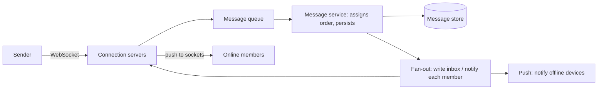

Slack, WhatsApp, Discord, iMessage: chat looks like one product but is
really two systems wearing one interface. There's a *message path*
(deliver this message to the people in this room, now, exactly once as far
as anyone can tell) and a *history path* (when I open the app after two
weeks offline, show me everything I missed, in order). They have opposite
requirements (the first is latency-critical and throwaway; the second is
throughput-oriented and forever), and the whole design is about refusing
to build one system that does both badly.

## Requirements

**Functional**

- One-to-one and group conversations; send and receive text (media is a
  stretch goal).
- Message history, per conversation, scrollable on reconnect.
- Online/offline "presence" indicators.
- Delivery and read receipts, optionally.

**Non-functional**

- **Latency**: delivering a message should feel instant. Target well
  under 500ms end-to-end; users perceive a chat as broken past one
  second.
- **Ordering**: messages within a conversation must arrive in a stable,
  agreed order. This single requirement drives half the design.
- **Durability**: history is forever (or years), and must survive client
  loss, offline periods, and server failures.
- **Scale asymmetry**: reads of history are bursty and huge (scroll
  back), writes are steady and small. A group of 10k people (a Discord
  channel) turns each send into 10k deliveries: fan-out, not throughput,
  is the real load.

The classic scoping trap is "how many users" without "how many
conversations, how large, and how active". State those assumptions before
designing: 100M users, average 50M concurrent, median conversation has 3
people, 1% of conversations are large groups.

## The first hard question: how do messages arrive?

HTTP request/response is the wrong shape: the *receiver* must be
notified, and no server knows to expect their next poll. Two honest
options:

**WebSockets** hold a bidirectional, persistent connection open per
client, so the server can *push*. This is the industry answer for
production chat: it's the lowest-latency option (no per-message
handshake), and it gives presence "for free" (a connected socket *is*
presence signal). The cost is a stateful server tier: every connected
user is memory and a file descriptor on some machine, so connection
servers become their own [scaled tier](/system-design/fundamentals/scalability)
with their own [load balancing](/system-design/fundamentals/load-balancing)
(and sticky routing, or a router that knows who's connected where).

**Long polling** (client asks, server holds the request open until
something arrives or times out) is the fallback: works everywhere,
including through hostile proxies, and is how several huge chat systems
started. More overhead (repeated handshakes), strictly worse latency, but
deployable in environments where sockets aren't.

A third component rides either: a **notification service** for offline
users. Delivery to a connected socket is easy; delivery to a phone with
the app closed means APNs/FCM, a push token per device, and a decision
about *what* wakes the user (not every message in a 10k-person channel
should wake everyone).

## The message path: send, sequence, fan out

The core pipeline, in the order the requirements force it:

Walk the load-bearing pieces:

**Ordering is a *per-conversation* problem, not a global one.** No system
puts a global order on all messages; each conversation needs its own
sequence, and the sequence must be assigned by something that sees the
conversation's messages in order. The standard answer: a partition key
by conversation ID (all messages for a conversation handled by one
partition, one [queue](/system-design/fundamentals/message-queues-and-pubsub),
one shard), so the assignment is single-threaded per conversation and
therefore trivially monotonic. The cost is that a hot conversation is
one partition's problem, which is exactly the right trade: you cannot
order a conversation without serializing it *somewhere*.

**Fan-out is the scale question.** For a 3-person conversation, write
the message once and let each member's "fetch history" find it (this is
fan-out *on read*: cheap, simple). For a 10k-person channel, writing
10k inbox entries per message is fan-out *on write*: expensive per
message, but each member's read is instant. The crossover is the
interview's arithmetic moment: at small group sizes, read-fanout wins
and the message store *is* the delivery mechanism; past some size, the
pre-materialized inbox wins. Hybrid is normal: fan out to the most
recently active members, and let the idle ones read on their next
visit. This is exactly the [news feed](/system-design/hld/news-feed)
fan-out decision, and the same reasoning, in real-time clothes.

**Persistence is append-only.** Messages are never updated, only
appended, in a store keyed by (conversation, sequence) with
[time-ordered access](/system-design/fundamentals/database-fundamentals)
(range scan per conversation, which is either a partitioned SQL table or
a wide-column store like Cassandra, whose partition-per-conversation
layout is *literally built for this access pattern*). Two weeks offline
is just a range scan from the last sequence the client saw.

## Presence: the system that lies on purpose

Presence looks like a boolean (online/offline) and is actually a *recent
heartbeat* with a publication policy. The truth is fuzzy: a socket
disconnects and you don't know if the user left or their train went
through a tunnel. So presence systems are designed around a heartbeat TTL
(a user is "online" if their device pinged within N seconds) plus a
*throttled publication*: don't announce 500 offline/online transitions
when a phone on bad subway wifi flaps; hold the state, publish the
latest, suppress the noise.

The second design decision is *who learns about presence*: announcing
every status change to every contact of a 500-contact user is its own
fan-out problem, and the standard answers are either push-to-subscribed
(the people with an open conversation with you) or presence-as-poll
(fetch on profile view), each with its own cost. Getting the interviewer
to *talk about presence throttling* is a strong signal in this problem:
it's the part where the requirement ("boolean online status") is a lie
that the design must expose.

## The failure modes

- **Ordering violations on retry**: a client sends, times out, retries,
  and the duplicate lands with a new sequence. The fix is the
  [idempotency](/system-design/fundamentals/idempotency-and-exactly-once)
  treatment: client-generated message IDs, the server deduplicating per
  conversation. Ordering *plus* dedup is what makes delivery feel
  exactly-once.
- **The reconnect sync problem**: a client offline for a day reconnects
  and asks "what did I miss". This is why every message carries a
  per-conversation sequence: sync is "give me everything after sequence
  X", a single range query, and why "just resend what they missed" is
  never the design.
- **Group consistency on membership changes**: someone leaves a 10k
  channel; the fan-out list and the history permissions must agree, and
  the answer is the same as everywhere else in this problem: a
  per-conversation source of truth that both read.

## The interview arc

1. Two systems, one interface: real-time delivery vs. durable history.
2. Delivery: persistent connections, partitioned ordering, fan-out sized
   by group size.
3. History: append-only, sequence-keyed, range-scanned on reconnect.
4. Presence: heartbeats, TTLs, throttled publication, and honest
   conversations about who needs to know.
5. Cross-cutting: idempotent sends, sync-after-offline, and the explicit
   decision about what reordering or loss the product can tolerate.

## Related concepts

- [Message Queues & Pub/Sub](/system-design/fundamentals/message-queues-and-pubsub)
  is the transport underneath the partitioned ordering and fan-out.
- [Idempotency & Exactly-Once Delivery](/system-design/fundamentals/idempotency-and-exactly-once)
  covers the retry/dedup machinery that makes ordering survivable.
- [CAP Theorem & Consistency Models](/system-design/fundamentals/cap-theorem-and-consistency-models)
  is what "per-conversation ordering" trades against availability at
  scale.
- [Scalability](/system-design/fundamentals/scalability) covers the
  stateful connection tier, the one place this design's scaling story
  is unusual.
- [Design a News Feed](/system-design/hld/news-feed) shares the fan-out
  decision with a different latency budget.
