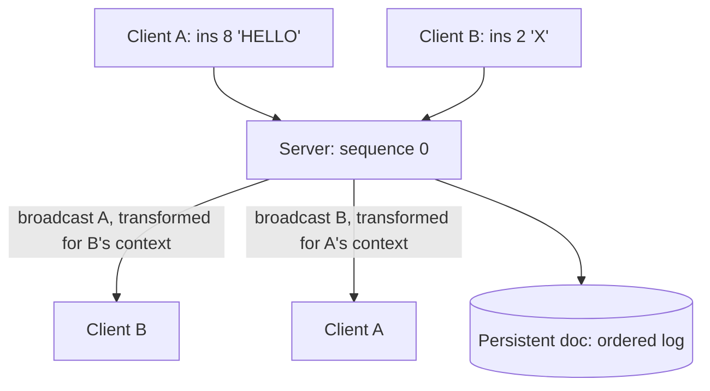

Two people editing the same document at the same time is the
hardest real-time problem in ordinary product engineering, because
the naive designs all fail invisibly: *last-write-wins* overwrites
paragraphs (one editor's work vanishes), *locking* serializes humans
(each edit waits for the other's release), and *merge-on-save*
conflicts at the end instead of during. The correct designs converge:
**both editors end up with the same document, both edits preserved,
without either waiting for the other**, and the two structures that
deliver it are **OT** (operational transform: Google Docs' lineage)
and **CRDT** (conflict-free replicated data types: the modern
answer), which differ in *where* the convergence work happens.

The problem's shape, stated once: an edit is an *operation*
(insert at position 12: "hello"), operations from two clients
arrive in different orders, and positions are **meaningless across
concurrent edits** (my "insert at 12" refers to a document you just
changed at position 8). The entire design is about giving
concurrent operations a shared meaning.

## Requirements

**Functional**

- A shared document, multiple simultaneous editors, per-character
  edits propagating in real time (under a second).
- Presence (cursors, selections of other users).
- Offline tolerance: edit disconnected, reconnect, merge.
- Persistent document state, revision history.

**Non-functional**

- **Convergence** (the core invariant): all clients, given the same
  set of operations, end at the same document. No silent data loss.
- **Latency budget**: local edits render instantly (never wait for
  the network), remote edits arrive in ~100ms-1s.
- **Causality**: if I type "world" after "hello ", "world" lands
  after "hello " everywhere. (Concurrent edits may interleave;
  sequential edits may not reorder.)

## The OT design: transform on the server

Operational transform's idea: every operation is *transformed*
against the concurrent operations it did not see, so it applies
correctly to the newer document. An insert at position 12, arriving
after another client inserted 5 characters at position 8, becomes
an insert at position 17: the position is *shifted*, the intent
(where "this text goes") is preserved.



The server ([the chat design](/system-design/hld/chat-application)'s
connection machinery underneath) is the **sequencer**: operations
arrive, the server assigns a global order, transforms each operation
against everything concurrent, and broadcasts the transformed
versions. Client-side, an operation is applied *locally first*
(the instant-edit feel: zero-latency typing against the local copy),
sent up with the client's last-seen sequence number, and the client
transforms *incoming remote* operations against its own
*outstanding* operations (the ones the server has not yet
acknowledged): the same transform function, run in both places, is
what makes the design symmetric.

The [transform function](https://en.wikipedia.org/wiki/Operational_transformation#Transform_functions)
is the design's mathematical heart, and its famous subtlety (the
**TP1 property**: transform(apply(a, b), b) = transform(apply(b, a),
a) for every pair: both orders converge) is *only proven for
text-insert pairs* in the general case, which is the honest
historical reason Google Docs kept a centralized server (the
server's single transform point dodges the hardest composition
cases) and the reason OT implementations are famously full of
corner-case bugs.

## The CRDT design: convergence by construction

The modern answer inverts the burden: make the *data structure*
converge, so no transform function is needed. The text CRDT idea:
every character gets a **unique, ordered identifier** (not a
position), and the document is the characters sorted by identifier.
Inserts are then *commutative by construction* (two clients insert
different characters with different identifiers: both orders sort to
the same document), and the identifier scheme's ordering (the
[RGA](https://en.wikipedia.org/wiki/Conflict-free_replicated_data_type#List-based)
or [Yjs-style](https://github.com/yjs/yjs) interleaving rules) is
what preserves intent (a character typed "after" another lands after
it, using a [logical clock](/system-design/fundamentals/clock-synchronization-and-logical-time)
per-insertion rather than wall time).

```cpp
struct CharId {
    uint64_t siteId;        // which client
    uint64_t counter;      // that client's nth insertion
    // Ordering: lexicographic over (counter, siteId) with parent
    // links for the "after" intent -- the CRDT's whole trick.
};

struct Char {
    CharId id;
    CharId parentId;        // insert intent: after this character
    char value;
    bool deleted;          // tombstone: deletes never vanish
};
// Document = the set of chars, sorted by the identifier ordering.
```

The costs that trade against OT: **identifier size** (every
character carries a few bytes of identity, so a CRDT document is
fatter than its text), and **tombstones** (a deletion is a flag, not
a removal, because concurrent deletes and inserts must stay
convergent: the dead character stays in the structure forever, or
until a garbage-collection epoch everyone agrees on). The payoff:
**no server** (any client, or any order of message arrival,
converges: offline editing, [P2P](/system-design/fundamentals/cap-theorem-and-consistency-models)
editing, and serverless operation all fall out), and no transform
function to get subtly wrong, which is why the modern stack
(Figma, Yjs, Automerge) went CRDT.

## The machinery both designs ride

- **The connection layer** is the [chat design](/system-design/hld/chat-application)'s:
  WebSockets, per-user sessions, a fan-out to the document's
  participants, presence riding the same channel (cursor positions
  are just another update: high-frequency, small, lossy-tolerant).
- **The persistence** is [event sourcing](/system-design/fundamentals/event-sourcing-and-cqrs)
  with the document as a fold: the ordered operation log (OT) or the
  CRDT state (the merge-able structure) is the source of truth, the
  current text is a view, and **revision history is the log at a
  checkpoint** (free, the same payoff every event store gives).
- **Offline/reconnect**: the client holds its own operations
  ([the outbox](/system-design/fundamentals/distributed-transactions)
  pattern at client scale), reconnects, and reconciles: OT does it
  through the server's sequence ("give me everything after N"),
  CRDT by merging (every offline edit already has identifiers:
  merge is sort-and-tombstone).
- **The ordering clock**: OT's sequence numbers and CRDT's
  per-site counters are both [logical time](/system-design/fundamentals/clock-synchronization-and-logical-time)
  (never wall clocks, for the reasons that page gives: causality
  must be derivable, not timestamped).

## Capacity and the honest trade

The scale story: a document's participants are few (the fan-out is
tens, not the [feed's](/system-design/hld/news-feed) millions), so
the load is *per-document concurrency*, and the fleet's sharding is
by document id (all of a document's traffic on one server: the
sequencer's home). The memory is the CRDT/OT state per document
(~characters times identity overhead), and the broadcast traffic is
edit-rate per document (small) times participants (small): the
problem is never throughput, always correctness, which is the
sentence to say out loud.

| | OT | CRDT |
| --- | --- | --- |
| Server | required (the sequencer) | optional (any relay) |
| Offline | awkward (sequence catch-up) | native (merge on reconnect) |
| Payload | operations (tiny) | identifiers per char (fatter) |
| Correctness | the transform function (TP1, hard) | by construction (proven) |

## Related concepts

- [Design a Chat Application](/system-design/hld/chat-application)
  is the connection and fan-out machinery underneath.
- [Design a Text Editor (Undo/Redo)](/system-design/lld/text-editor-undo-redo)
  is the single-user sibling, and the undo problem (undo *an
  operation* in a concurrent world: CRDT undo is its own research
  area) is the standard follow-up probe.
- [Event Sourcing & CQRS](/system-design/fundamentals/event-sourcing-and-cqrs)
  is the persistence model (log as truth, document as view).
- [Clock Synchronization & Logical Time](/system-design/fundamentals/clock-synchronization-and-logical-time)
  is the causality machinery both designs substitute for timestamps.
- [CAP Theorem & Consistency Models](/system-design/fundamentals/cap-theorem-and-consistency-models)
  is the framework the convergence invariant lives in.
