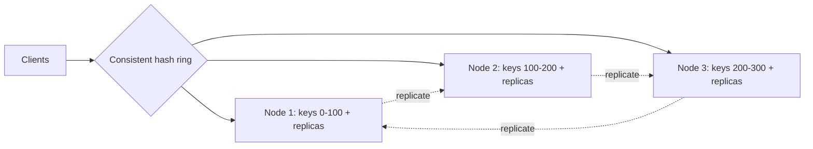

A [single-node cache](/system-design/fundamentals/caching) is easy: a map
with an eviction policy. A distributed cache is what you build when the
working set no longer fits on one machine or one machine's throughput, and
the moment you split the cache across nodes, three new problems appear that
the single-node version never had: how do you decide which node holds a
key, what happens when a node dies, and how do you add a node without
destroying the cache's usefulness. This is the system-level version of the
[LRU/LFU cache LLD](/system-design/lld/lru-lfu-cache), and the delta is
entirely about distribution.

## Requirements

**Functional**

- `get(key)`, `set(key, value, ttl)`, `delete(key)`.
- A cache, not a database: losing data on failure is acceptable (the
  source of truth can refill it), but losing *all* of it is an outage.
- Horizontal scale: add capacity by adding nodes.

**Non-functional**

- **Very low latency**: sub-millisecond, because a cache that is slower
  than the thing it caches is pointless.
- **High availability**: a node failure should not take the cache down.
- **Predictable behavior under rebalancing**: adding or removing nodes
  should not collapse the hit rate (which is the entire point of the
  cache).

## The core decisions

**Routing: consistent hashing.** The naive `hash(key) % N` routing breaks
the moment N changes: adding one node remaps almost every key, so nearly
every lookup misses and the database behind the cache is suddenly hit with
its full load. [Consistent hashing](/system-design/fundamentals/consistent-hashing)
fixes this by mapping keys and nodes onto a ring, so adding or removing a
node only remaps the keys near it (about 1/N of them). This is the single
most important decision in a distributed cache, and it is why the
[consistent hashing page](/system-design/fundamentals/consistent-hashing)
exists as its own topic.

**Replication: survive a node loss.** Each key's partition is replicated
across a few nodes (say, the next two clockwise on the ring). If the
primary for a key fails, a replica can serve it. This is the same
primary/replica idea as a
[database](/system-design/fundamentals/database-fundamentals), but with a
cache's relaxed consistency: a slightly stale cached value is usually fine,
so replicas can serve reads without coordination.

## The hard parts

**Hot keys.** A single key that gets millions of reads per second (a
celebrity's profile, a viral post) lands on exactly one node and overloads
it, no matter how many nodes exist. Consistent hashing balances the *key
space*, not the *traffic*. The fixes are application-level: replicate the
hot key across many nodes and read from a random replica, split the key
into sub-keys, or cache it at the client. The cache cannot solve this for
you, and recognizing that is part of the design.

**The thundering herd on a miss.** A popular key expires and thousands of
requests miss simultaneously, all hitting the database together. The cache
must coordinate: a **single-flight** (only one request rebuilds the value,
the rest wait) or a lock per key, plus jittered TTLs so keys don't all
expire at once. Without this, the cache's own expiry schedule becomes a
database-DDoS schedule. This is the same stampede risk as the
[caching fundamentals](/system-design/fundamentals/caching), amplified by
having more nodes to coordinate.

**Rebalancing without a cliff.** Adding nodes to a consistent-hash ring
still moves some keys, and moving keys means misses for those keys until
they are repopulated. A cache that warms gradually (accept the miss rate
spike, or pre-warm by copying from the neighbor before the node takes
traffic) smooths this. The virtual-node technique from
[consistent hashing](/system-design/fundamentals/consistent-hashing) also
matters here: it keeps the ring balanced so a new node takes an even share.

**Consistency between replicas.** When a key is written to its primary and
replicated asynchronously, a read from a replica can see the old value. For
a cache this is usually acceptable (the data is a copy anyway), but it
becomes a real problem when the cache is used for coordination (locks,
rate-limit counters), where stale reads break correctness. State the
consistency requirement explicitly, because it decides whether replicas may
serve reads at all.

## What is actually running this

Production distributed caches (Redis Cluster, Memcached clients with
consistent hashing, managed services) are exactly this design: a hash ring
for routing, replication for availability, LRU/LFU eviction per node, and a
coordination layer for rebalancing. The interview version is about naming
the decisions (routing, replication, eviction, stampede control) and the
trade each one makes, because the implementation is a solved problem you
would buy, not build.

## Capacity sketch

Assume a 1 TB working set and 500,000 reads/second. With nodes holding
~100 GB each in memory, ~10-15 nodes hold the data, and replicas triple
that to ~30-45 nodes. Throughput is the binding constraint, not capacity:
a single node handles tens of thousands of operations per second, so 500k
reads/second needs on the order of 20+ nodes just for throughput, before
replication. This is why distributed caches scale on both axes (memory and
ops) and why the routing scheme has to make adding nodes cheap.

## Related concepts

- [Caching](/system-design/fundamentals/caching) is the single-node
  behavior and the eviction/invalidation policies this design inherits.
- [Consistent Hashing](/system-design/fundamentals/consistent-hashing) is
  the routing scheme, in depth.
- [Database Fundamentals](/system-design/fundamentals/database-fundamentals)
  covers the replication model the cache borrows.
- [Design an LRU/LFU Cache](/system-design/lld/lru-lfu-cache) is the
  per-node eviction policy this system distributes.
