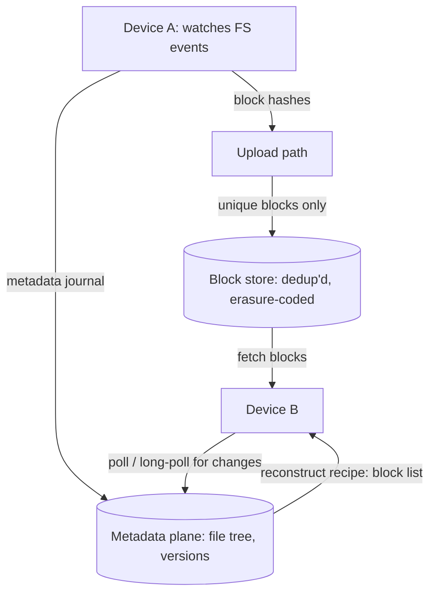

A distributed file system (Dropbox, Google Drive, the HDFS lineage) is
the [object store](/system-design/hld/object-storage-system)'s
sibling with one extra dimension that changes everything: **the
client is a file system driver**, not an HTTP caller. Files are
mutable, directories are hierarchical, and the store's job includes
keeping *many devices in sync* with a set of files one user edits
from three places. The design's center of gravity is therefore the
**sync engine** (the metadata dance that decides who has which
version), while the bytes underneath are the same
[erasure-coded, chunked storage](/system-design/fundamentals/object-storage)
as ever.

## Requirements

**Functional**

- Files and directories (hierarchical namespace), versions, trash.
- Sync: a folder mirrored on many devices, edits propagate within
  seconds.
- Sharing: folders between users, permissions.
- Upload/download of arbitrary-size files (resume, partial).

**Non-functional**

- **Consistency of sync** (the core promise): no device diverges
  silently; conflicts are surfaced, not invented.
- **Bandwidth efficiency**: editing 1 byte must not re-upload 1 GB,
  so chunking and dedup are requirements, not optimizations.
- **Offline tolerance**: the client works disconnected and
  reconciles later (the eventual-consistency contract).
- Durability of the object tier (the storage promise:
  [the object store](/system-design/hld/object-storage-system)'s
  arithmetic).

## The architecture: client, metadata, blocks

The **block store** (the bytes): files are split into fixed-ish
blocks (4 MB, or content-defined chunking: variable boundaries found
by rolling-hash, so an insertion mid-file does not re-shift every
boundary), each block addressed **by its content hash**
(content-addressable storage: the [hash](/dsa/patterns/hash-based-structures)
*is* the identity), which gives dedup for free (two files sharing a
block store it once, two versions differing in one block upload one
block) and integrity for free (the address *is* the checksum). This
is the bandwidth story: edit one slide in a 2 GB deck, and the sync
uploads that slide's block and a new manifest.

The **metadata plane** (the file tree): who owns which path, which
version, composed of which blocks: the manifest/recipe per file
version, the directory entries, and the per-device journal. This is
the strong plane (the
[object store's](/system-design/hld/object-storage-system) same
reasoning: a metadata inconsistency is unrecoverable), and it is the
plane that answers sync.

The **client** (the smart edge): a daemon watching file-system
events, hashing changed files into blocks, uploading *unique* blocks
(streamed, resumable), committing the new manifest atomically, and
downloading on notification: the
[cache](/system-design/fundamentals/caching)-invalidation logic
pushed to where the changes originate.

## The sync protocol: the design's heart

Sync is a [distributed-consistency](/system-design/fundamentals/cap-theorem-and-consistency-models)
problem wearing a product costume, and the honest design makes it a
*metadata* protocol:

1. **The client journals locally** (its own ordered log of
   operations: create/edit/rename/move), so an offline client is
   accumulating a *deterministic sequence*, not a mystery diff.
2. **The commit protocol**: the client uploads the blocks first,
   then commits the new manifest (a
   [compare-and-swap](/system-design/fundamentals/concurrency-and-parallelism):
   "I am version N's manifest, moving to N+1"), and a conflict
   (another device won the CAS) is *detected, not overwritten*.
3. **Conflict resolution** (the product answer): conflicting manifests
   produce both files ("deck (conflicted copy from A's
   laptop).pptx"), because choosing silently between two users'
   edits is the one thing a file system must never do. The rule:
   **conflicts are surfaced, never invented** (the same "park and
   ask" discipline as the [recovery paths](/system-design/lld/atm)
   and the [payment system](/system-design/hld/payment-system)'s
   stuck transactions).
4. **Notification**: a change commits, and other devices learn it
   via long-poll (or a push channel): the
   [chat](/system-design/hld/chat-application)'s delivery problem
   in a calmer form (seconds of latency are fine, so polling
   wins on simplicity).

The **rename problem** is the classic trap in this protocol, worth
knowing: a rename looks like delete-plus-create to a naive sync
(delete the old path, create the new one), which *destroys history*
(and breaks shares, and re-uploads nothing but confuses
everything). The fix: rename is a metadata operation (the file's
identity is its ID, the entry is a pointer), which is why the
metadata plane has file IDs at all, and "sync engines that
understand renames" is a real line item in this design's difficulty.

## Versioning, trash, and retention

The version machinery is [the object store's](/system-design/hld/object-storage-system)
with one twist: **block-level versioning** (each manifest points at
immutable blocks, so a new version is a new manifest plus new blocks,
and the old version costs only the blocks it uniquely references).
Dedup across versions is automatic (unchanged blocks are shared
manifests), and retention policy (30 days of versions, then
garbage-collect unreferenced blocks: the background sweeper that
finds blocks no manifest references) is the
[lifecycle](/system-design/fundamentals/object-storage) rule of this
product. The garbage collector's correctness bar is the design's
quiet hazard: **a block referenced by *any* live manifest (including
a client mid-upload) is alive**, so collection runs after a
grace period beyond the youngest manifest, the same
"park-and-reconcile" safety as every retention system in this
catalog.

## Sharing and permissions

Folder sharing is a metadata-plane concern (entries gaining an ACL,
users added to it), and the sync machinery above handles it per-user
(each device has its own journal and commit path, all against the
shared folder's manifests), with the
[authz](/system-design/fundamentals/auth-basics) discipline
applied: the permission lives at the metadata plane, and the block
store trusts it (pre-signed block URLs, the
[object store](/system-design/fundamentals/object-storage) pattern,
so the dumb tier never learns permissions).

## Capacity sketch

The arithmetic that shapes it: 500M users * 100 GB average, at
maybe 3x storage overhead after [erasure
coding](/system-design/hld/object-storage-system) and dedup ratios
of ~2-4x (users' files duplicate each other: the same installer,
the same presentation template): an exabyte-class block store, which
is why the [block-tier design](/system-design/hld/object-storage-system)
is the same architecture, reused. The metadata plane is billions of
manifests (megabytes each in index terms): the strongly-consistent
database tier, range-sharded by user. The sync traffic (the
[write](/system-design/fundamentals/capacity-planning-and-estimation)
side) is edits-not-files (the dedup win), which is why the block
design *is* the capacity story.

## Related concepts

- [Design S3 / Object Storage](/system-design/hld/object-storage-system)
  is the block-store tier underneath (this design builds on that one).
- [Object Storage](/system-design/fundamentals/object-storage) is the
  model page for the dumb tier.
- [CAP Theorem & Consistency Models](/system-design/fundamentals/cap-theorem-and-consistency-models)
  frames the sync protocol's conflict surfacing.
- [Design a Chat Application](/system-design/hld/chat-application)
  is the notification machinery's bigger sibling.
- [Event Sourcing & CQRS](/system-design/fundamentals/event-sourcing-and-cqrs)
  is the journal-and-manifest architecture's formal name.
