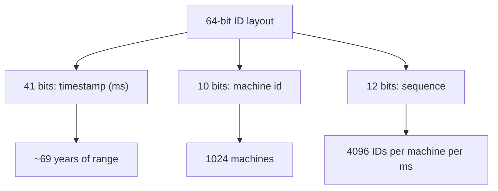

"A distributed ID generator" sounds like a utility, and it is one,
which is exactly why it is a good interview: the requirements are
short, the design space is small (three real options), and *every
option trades something away*, so the whole problem is knowing the
trades. The requirements, stated with the teeth they actually have:

- **Globally unique**: no two calls, from any server, ever produce the
  same ID. Uniqueness is the invariant the system *must* keep, not
  try to keep.
- **Roughly time-ordered**: IDs sort approximately by creation time,
  because the users of IDs (databases, logs, feeds) rely on
  "newer ID, newer thing".
- **Available and fast**: IDs are on the critical path of every
  insert, so latency is a millisecond at most, and an ID-generator
  outage is a total-write outage.
- **Compact enough**: 64-128 bits is the practical envelope (a
  database key, sortable in an index).

The trade that drives everything: **uniqueness without coordination
requires entropy or partition; ordering requires a clock; and
coordination-free is the only way to be fast and available.** Each
real design picks a different point on that triangle.

## Option 1: the database sequence (the partition, centralized)

An auto-increment column or a `SEQUENCE` object in a database:
uniqueness by *construction* (one lock, one counter), perfectly
ordered, and one hundred percent dependent on one database being up.
It fails the availability requirement (the write path is down if the
sequence's home is down), and its latency is a network round trip per
ID (or a cached block of IDs, which is the standard mitigation:
fetch 100 at a time, hand them out locally). The block version is
worth taking seriously as the "small system" answer, and its weakness
is *gaps* (a crashed server's unused block disappears forever: fine
for uniqueness, broken for "no gaps" if anyone wants that, which
nobody should).

## Option 2: random UUIDs (entropy, no coordination)

Generate 122 random bits (a
[UUIDv4](https://en.wikipedia.org/wiki/Universally_unique_identifier#Version_4_(random))),
and uniqueness comes from the birthday bound: the probability of a
collision between two UUIDv4s is ~1 in 10^37 per pair, which is
"physically impossible" territory, achieved with zero coordination
and zero infrastructure (which is why every language ships a uuid4
generator in its standard library).

The costs, both real: **no ordering** (random IDs sort randomly, so
"time-ordered by ID" is dead, and database index locality dies too:
a random primary key scatters inserts across the whole B-tree, the
"write amplification" tax that [LSM](https://en.wikipedia.org/wiki/Log-structured_merge-tree)
databases mitigate and B-trees pay), and **size** (128 bits: fat for
a key, and un-shortenable in a URL).

## Option 3: Snowflake (clock + partition), the standard answer

The design Twitter open-sourced and the industry adopted: **combine a
timestamp, a machine identity, and a per-machine sequence**, so
uniqueness comes from partition (each machine's IDs live in its own
number space) and ordering comes from the timestamp in the high bits.



```cpp
class SnowflakeGenerator {
public:
    SnowflakeGenerator(uint16_t machineId, uint64_t epochOffset)
        : machineId_(machineId), epoch_(epochOffset) {}

    uint64_t next() {
        std::lock_guard<std::mutex> guard(mtx_);
        uint64_t now = millisSinceEpoch();
        if (now == lastTimestamp_) {
            sequence_ = (sequence_ + 1) & 0xFFF;        // 12-bit wraparound
            if (sequence_ == 0) {                       // exhausted this ms
                while ((now = millisSinceEpoch()) == lastTimestamp_) {
                    std::this_thread::sleep_for(std::chrono::microseconds(100));
                }                                      // wait for the next ms
            }
        } else {
            sequence_ = 0;                             // fresh millisecond
        }
        lastTimestamp_ = now;
        return ((now - epoch_) << 22)                  // 41 bits of time
             | (static_cast<uint64_t>(machineId_) << 12)
             | sequence_;
    }

private:
    static uint64_t millisSinceEpoch() {
        return std::chrono::duration_cast<std::chrono::milliseconds>(
            std::chrono::system_clock::now().time_since_epoch()).count();
    }
    uint16_t machineId_;
    uint64_t epoch_;
    uint64_t lastTimestamp_ = 0;
    uint64_t sequence_ = 0;
    std::mutex mtx_;
};
```

Read the bit math: 41 bits of milliseconds gives 69 years of range,
10 bits of machine identity allows 1024 machines (assigned by a
registry at startup: the one piece of *coordination* this design
needs, done once, not per-ID), and 12 bits of sequence allows 4096
IDs per machine per millisecond (a combined ~400M IDs/sec fleet-wide,
which covers every real workload). The ordering is *approximate*
(inter-machine skew means two IDs near-simultaneously generated on
different machines may sort "wrongly" by a few milliseconds), which
is the honest meaning of "roughly time-ordered", and the property
callers actually need (sorting a feed by ID is "newest first" within
noise, which is why [feeds](/system-design/hld/news-feed) and
[tweets](https://blog.x.com/engineering/en_gb/a/2010/announcing-snowflake.html)
use it).

The **clock-skew problem** is the design's one real hazard: if the
machine's clock jumps *backwards* (NTP correction), the generator
would emit timestamps below its last timestamp, and the sequence
could collide with previously-emitted IDs (same machine, same
"timestamp", same sequence). The standard answers: refuse (throw if
`now < lastTimestamp_`, and let the caller retry after the clock
settles) or wait (sleep until the clock passes the last emitted
timestamp), both of which treat
[clock time as untrustworthy](/system-design/fundamentals/clock-synchronization-and-logical-time)
rather than pretending. A related refinement: **UUIDv7** (timestamp
+ random) is the modern standard-library form of the same idea,
ordered *and* coordination-free, with random low bits instead of
machine bits, which trades the machine-partition uniqueness for
birthday-bound uniqueness, and fixes the index-locality problem the
same way.

## Choosing, and the capacity story

| Design | Ordered | Coordination | Size | Fails when |
| --- | --- | --- | --- | --- |
| DB sequence block | perfectly | one block-fetch per N IDs | 64 bits | the database is down |
| UUIDv4 | no | none | 128 bits | nothing (but indexes suffer) |
| Snowflake / UUIDv7 | roughly | machine-id assignment once | 64-128 bits | clock jumps backwards |

The availability story is Snowflake's selling point: the generator
is a *local* computation (some registers and a mutex), so an ID
generator "outage" only happens if the *machine* is out, which makes
it as available as the fleet and as fast as a function call. The
per-machine throughput (4096/ms) is the one number to state, and the
sequence-exhaustion behavior (sleep until the next millisecond) is
the honest answer to "what if you exceed it": brief stalls, not
failure, which is
[backpressure](/system-design/fundamentals/backpressure-and-flow-control)
at microsecond scale.

## Related concepts

- [Clock Synchronization & Logical Time](/system-design/fundamentals/clock-synchronization-and-logical-time)
  is the theory behind the skew hazard and both mitigations.
- [Design a URL Shortener](/system-design/hld/url-shortener) consumes
  IDs as its code base (the counter strategy is option 1, the random
  strategy is option 2's birthday arithmetic).
- [CAP Theorem & Consistency Models](/system-design/fundamentals/cap-theorem-and-consistency-models)
  frames the partition/coordination trade this design navigates.
