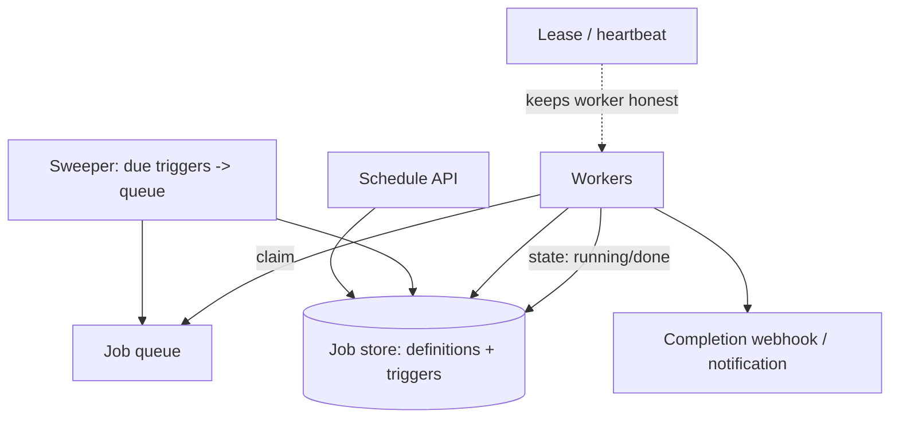

A job scheduler is "run this at this time, possibly repeatedly, and tell
me when it finishes", and the single-machine version is literally cron.
The distributed version is interesting because every guarantee that cron
gets for free (one machine, one clock, one process, jobs die when the
machine dies) is gone, and each missing piece is a real design problem:
**who decides which worker runs which job, what happens when a worker
dies holding a job, how the system avoids running the same job twice,
and how scheduled times mean anything when the workers' clocks disagree.**

## Requirements

**Functional**

- Schedule jobs: one-shot (run at T) and recurring (run every N).
- Workers execute jobs; the system tracks state (pending, running,
  done, failed) and retries failures.
- Completion callbacks / notifications, and manual triggers.

**Non-functional**

- **Exactly-once-per-trigger, effectively**: each scheduled occurrence
  should run once, and a retry must be distinguishable from a
  double-trigger.
- **Survive worker death mid-job**: a job held by a dead worker must be
  noticed, and re-run or marked, never forgotten.
- **Timeliness**: fire within seconds of the scheduled time, not minutes.
- **Fairness and isolation**: one tenant's flood of jobs must not starve
  others, and a bad job (OOM, infinite loop) must not take its worker
  down with it.

## The architecture

**Job store**: the source of truth. Job definitions (what to run, its
schedule) and *trigger instances* (the concrete "run job X at 2026-10-14
09:00:00") are separate tables, and that split is the design's most
important decision: a recurring job is not N rows mutated forever, it is
one definition that a sweeper materializes into trigger rows as time
passes. Exactly-once-per-trigger then becomes "each trigger row is
claimed once", which a database transaction can guarantee, rather than
"count and pray".

**The sweeper** is the component that turns time into work: a process
(or the leader among them) that scans for triggers whose time has come,
enqueues them, and (for recurring jobs) schedules the *next* occurrence.
It is small, it is stateless-ish, and it is where the "who decides" job
lives. Running several sweepers for availability needs coordination,
and the standard answer is optimistic claiming: each sweeper tries to
atomically transition a due trigger from `scheduled` to `queued`, and
whoever wins owns it, which is [idempotent claiming](/system-design/fundamentals/idempotency-and-exactly-once)
rather than leader election.

**The queue** hands claimed triggers to workers, and its semantics are
the design's soul: at-least-once delivery, with the *trigger id* as the
dedup key, so a redelivered message after a crash is recognized by a
worker that sees the trigger already running or completed.

## The hard problems

**The worker that dies mid-job.** This is the problem the whole design
is really about, and the industry-standard answer is a **lease with
heartbeats**: a worker claims a job by writing `running` with a lease
expiry, and renews that lease with a heartbeat every few seconds. If the
heartbeats stop, the lease expires, another sweeper notices the orphaned
`running` trigger, and re-queues it. The trade is explicit and worth
stating: the lease timeout is how long the system waits before assuming
a worker is dead, so it is a dial between "assume dead fast and risk
double-running" and "wait long and stall jobs whose worker died". The
job itself must therefore be **idempotent or resumable**, because the
system's guarantee is *at-least-once per trigger*, with the application
making the retry safe. There is no distributed scheduler that promises
otherwise without making the job itself transactional.

**Double-running and the two generals, again.** A worker finishes, tries
to mark the trigger `done`, and the network eats the update. Another
worker picks the trigger up and runs it again: double-run. The mitigations
are the standard [idempotency](/system-design/fundamentals/idempotency-and-exactly-once)
set: claim-on-transition (only one `queued -> running` succeeds),
completion writes keyed by the trigger id, and jobs written to tolerate
one extra execution. Say out loud that exactly-once execution is a
distributed-system impossibility and the design buys *effectively-once*,
and you have said the most important sentence of this interview.

**Clocks.** "Run at 09:00" is meaningless if workers' clocks disagree
[with each other or with the scheduler](/system-design/fundamentals/clock-synchronization-and-logical-time),
so the scheduled time is the *sweeper's* clock (NTP-synced, one authority),
and workers never decide what time it is; they only run what they are
handed. Interval-based recurring jobs ("every 5 minutes") are additionally
computed from the *previous* trigger time, not "now", so a slow sweep does
not drift the schedule into a burst.

**Fairness and isolation.** A per-tenant queue partition, or priority
queues by tenant, keeps one customer's 10,000 jobs from starving everyone
else's one job. Isolation is a worker-runtime concern: every job runs in
a sandbox (process, container) with timeouts and memory caps, because a
job that hangs or OOMs is not exceptional, it is Tuesday, and it must not
take the worker, the queue, or the schedule down with it.

## What this looks like in practice

Everything above is what Airflow, Temporal, Sidekiq-cron, and
Kubernetes CronJobs actually are: a store of definitions, a sweeper
materializing triggers, a queue, workers claiming with leases, and
heartbeats. Temporal is the most complete version (durable execution:
the job's *state* is checkpointed, not just its claim, so retries resume
rather than restart), and it is worth naming as the "what if the job
itself were the durable thing" endpoint of this design space.

## Capacity sketch

Trigger volume is the scaling axis: a large deployment might see
millions of trigger materializations per day, which is thousands per
second at peak, and each is a small row insert plus a queue write, which
the store shards comfortably by tenant. Job *durations* are the other
axis (long jobs hold leases longer, which is fine, and hold workers,
which is a capacity cost), and the retry storm (a dependency outage
causing every job to fail and retry simultaneously) is the failure mode
to design for with [backoff](/system-design/fundamentals/backpressure-and-flow-control)
and jitter.

## Related concepts

- [Design a Task Scheduler (Code-Level)](/system-design/lld/task-scheduler-lld)
  is the single-process version of the same design.
- [Idempotency & Exactly-Once Delivery](/system-design/fundamentals/idempotency-and-exactly-once)
  is the guarantee the lease/claim machinery is buying.
- [Message Queues & Pub/Sub](/system-design/fundamentals/message-queues-and-pubsub)
  is the claim-and-deliver transport.
- [Clock Synchronization & Logical Time](/system-design/fundamentals/clock-synchronization-and-logical-time)
  covers why the sweeper owns the clock.
- [Backpressure & Flow Control](/system-design/fundamentals/backpressure-and-flow-control)
  is the retry-storm answer.
