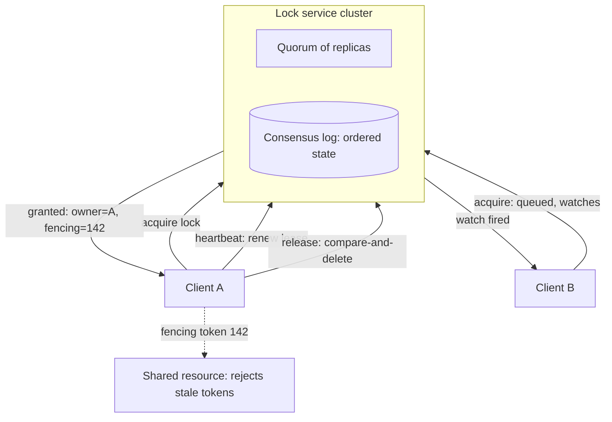

A lock service is the piece of infrastructure other systems trust more
than themselves. When two processes must not touch the same resource at
the same time, a leader must be elected, a job must run on exactly one
machine, or a cache must be rebuilt by one worker and not fifty, they
all ask the same question: who holds the lock? The service answers it
for the whole fleet, which makes its own failure mode special: a lock
service that hands the same lock to two clients silently breaks
everything built on top of it.

The design goal is not throughput. A lock service sees a tiny number of
requests per second compared to the traffic of the systems it
coordinates. The goal is **correctness under failure**: crashed clients,
paused processes, slow networks, and the whole cluster losing and
recovering nodes, without the service ever letting two holders believe
they own the same lock at the same time.

## Requirements

**Functional**

- A client can acquire a named lock and release it when done.
- A lock has exactly one holder at any moment.
- If the holder dies, the lock eventually becomes free again.
- Watchers can be notified when a lock is released or a value changes
  (the coordination use: leader election, group membership, config).

**Non-functional**

- **Safety first**: never two holders for one lock, even across
  failures. This outranks availability, and is the opposite priority of
  a [cache](/system-design/fundamentals/caching).
- **Liveness**: every lock held by a dead client frees within a bounded
  time, or the fleet deadlocks.
- **Low, predictable latency**: lock operations sit on critical paths
  (failover), so milliseconds matter, throughput does not.
- **FIFO fairness**: requesters are granted locks roughly in arrival
  order, which makes leader election deterministic and testable.

## The naive design and why it dies

A shared store, a conditional write: `SETNX lock:resource = client_id`,
and a `GET` to check. A single
[Redis](/system-design/fundamentals/caching)-style node makes this work
for a while, and it fails in three instructive ways.

First, **the holder can outlive its lock**. The client sets the lock,
then a long garbage collection pause freezes it for 60 seconds. The lock
expires, another client acquires it, and the paused process wakes up
still convinced it holds the lock. Two holders. The fix is a **lease**:
the lock has a TTL, and every client must renew it, and more
importantly, must treat "my lease expired" as "I lost the right to act",
checking before every dangerous operation rather than once at acquire
time.

Second, **release by name is unsafe**. The client that expired must not
delete the key, because the key may now belong to someone else. The fix
is **ownership in the value**: the lock stores a unique token
(UUID) at acquire, and release is a compare-and-delete of *my* token,
the [idempotency](/system-design/fundamentals/idempotency-and-exactly-once)
discipline applied to lock release.

Third, **the server itself is a single point of failure**. Replicate it,
and a network partition can leave two sides both believing they can
grant locks. This is where the naive design meets the real one: there is
no way to bolt availability onto a lock service after the fact. Safe
lock granting requires an agreed-upon cluster state, and agreed-upon
state across failure boundaries is exactly the
[consensus](/system-design/fundamentals/consensus-and-leader-election)
problem.

## The architecture

The service is a small [replicated
log](/system-design/fundamentals/replication) kept in order by consensus
(Raft, in ZooKeeper and etcd), with every lock operation recorded as an
entry. A lock is a **znode** or key whose ephemeral existence *is* the
lock, and a monotonic **revision number** stamped on every entry in the
log.

**Acquire**: create the lock znode. If it already exists, watch it and
queue behind it. ZooKeeper's classic recipe sorts lock candidates into
a directory and every watcher watches only the predecessor, so release
wakes exactly one waiter: the FIFO queue, implemented as a watch chain.

**Expiry**: the znode is *ephemeral*, tied to the client's **session**.
The client heartbeats the cluster; if the session dies (crash, or missed
heartbeats across a partition), the cluster deletes the znode and the
lock frees. The lease is enforced by the cluster, not trusted to the
client's clock, which sidesteps
[clock skew](/system-design/fundamentals/clock-synchronization-and-logical-time)
for expiry itself.

**The fencing token**: the deep fix for the outlived-lease problem.
Every acquisition returns a strictly increasing number (the log
revision). Clients must pass that number to the shared resource, and the
resource rejects any request carrying a number lower than the highest
it has seen. Even the frozen-process scenario is now safe: when the
pause ends, the old holder holds token 141, the new holder already used
142 at the resource, and the resource turns the zombie away. Locks make
failure *unlikely*; fencing makes the remaining window
*detectable*, which is the guarantee the systems underneath actually
need.

## What the service is used for

Locks are the headline, but a consensus-backed key store with watches
is a general coordination substrate:

- **Leader election**: acquire a lock, become the active node, watch the
  lock and prepare to take over when it dies. The same primitive
  [consensus and leader election](/system-design/fundamentals/consensus-and-leader-election)
  describes, in service form.
- **Group membership**: members register ephemeral znodes; watchers see
  join and leave events. A job scheduler can notice a dead worker this
  way.
- **Metadata and config**: small, strongly consistent values that every
  node watches, published in one place. Configuration changes propagate
  as watch events, not polling.
- **Barriers and queues**: the recipes are built from the same
  primitives (znodes, sequences, watches) as the lock.

This breadth is why the real deployments are named systems (Chubby at
Google, ZooKeeper in the Hadoop world, etcd under Kubernetes) rather
than features inside an application.

## Capacity sketch

The numbers that shape it: a lock service for a fleet of a few thousand
clients sees tens to hundreds of operations per second, each a few
hundred bytes, so the log is measured in megabytes per day, not
gigabytes. A three- or five-node cluster on ordinary machines handles
this with enormous headroom; ZooKeeper deployments commonly serve
hundreds of thousands of *watched* znodes from a few GB of RAM. The
cluster is small deliberately, because every write pays a
[consensus round trip](/system-design/fundamentals/consensus-and-leader-election):
a quorum must persist the log entry before it counts. The capacity plan
is about latency (a few milliseconds per operation on a healthy
cluster) and about keeping znode payloads small: the service is a
coordination plane, and teams that start storing real data in it
discover that quorum writes scale like a chat room, not like a database.

## Failure modes

- **Session expiry during a client's own pause**: the client recovers
  believing it holds a lock it lost. Every client must handle
  `SESSION_EXPIRED` as an event that invalidates *all* its locks, and
  fencing must back it at the resource.
- **The cluster loses quorum**: the service stops granting locks, which
  is correct. Systems built on it must degrade gracefully: the
  [availability](/system-design/fundamentals/availability-and-reliability)
  trade is the point. A lock service that kept granting during a
  partition would be a lock service you cannot trust.
- **Herd effect**: every watcher watching the same znode wakes on every
  change and storms the service. The predecessor-watch recipe exists
  precisely to make one wake-up, not ten thousand.
- **Application deadlock**: two services each hold a lock the other
  needs. The service grants correctly and the fleet still hangs, because
  the service coordinates but does not understand the
  [transactions](/system-design/fundamentals/distributed-transactions)
  layered above it. Keep lock scope small and timeouts short.

## Trade-offs

The standing one is safety versus availability: this service chooses
safety, and everything above must tolerate its outages. The second is
buying versus building: the consensus core is subtle, and every real
team uses ZooKeeper, etcd, or a managed equivalent rather than rolling
their own. The third is the temptation to use it as a general store:
the moment znodes carry payloads, teams pay quorum-write latency for
data that belongs in a [database](/system-design/fundamentals/database-fundamentals)
or a cache.

## Related concepts

- [Consensus & Leader Election](/system-design/fundamentals/consensus-and-leader-election)
  is the algorithm underneath the service.
- [CAP Theorem & Consistency Models](/system-design/fundamentals/cap-theorem-and-consistency-models)
  explains why the service chooses safety over availability.
- [Idempotency & Exactly-Once Delivery](/system-design/fundamentals/idempotency-and-exactly-once)
  is the compare-and-delete discipline applied to release.
- [Clock Synchronization & Logical Time](/system-design/fundamentals/clock-synchronization-and-logical-time)
  covers why leases avoid trusting client clocks.
- [Design a Distributed Job Scheduler](/system-design/hld/distributed-job-scheduler)
  is a canonical consumer of locks, membership, and leader election.
