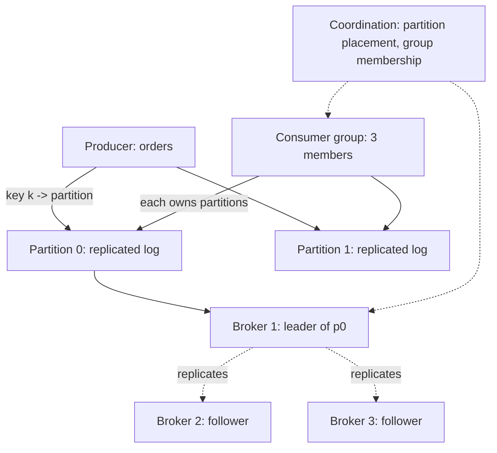

The [fundamentals page](/system-design/fundamentals/message-queues-and-pubsub)
covers using queues (delivery semantics, queue vs. topic, the
[idempotency](/system-design/fundamentals/idempotency-and-exactly-once)
partnership), and the [code-level LLD](/system-design/lld/pubsub-broker-lld)
covers the in-process version. This page is the HLD of the real
thing: **the distributed, durable, partitioned log broker**
(Kafka-shaped), where the product is a hard trio of promises: *write
once, read many, in order per partition, durably replicated*, and
every design decision serves one of them.

The reframe that makes the whole design coherent: a distributed queue
is a **replicated log** ([event sourcing](/system-design/fundamentals/event-sourcing-and-cqrs)
at the storage layer), not a set of queues with messages in them.
Producers append; consumers track their own position in the log; and
"delete" does not exist, only retention windows. That single
reframing answers most of the design questions before they are asked.

## Requirements

**Functional**

- Topics, each partitioned (ordered shards of the topic).
- Producers append to a partition; consumers read in order, tracking
  their own cursor.
- **Consumer groups**: a group of consumers splits a topic's
  partitions among themselves, each partition handled by exactly one
  member at a time.
- Retention by time/size (messages are deleted by age, not by
  consumption).

**Non-functional**

- **Durability**: an acknowledged write survives broker failures
  (replication).
- **Throughput**: sequential-disk-grade write rates (hundreds of
  thousands of messages/sec per partition-broker), which the log
  structure exists to deliver.
- **Ordering per partition, not per topic**: strict order within a
  shard, parallelism *across* shards, which is the trade the whole
  architecture encodes.
- **Rebalance without data loss**: a dead consumer's partitions are
  reassigned, and its uncommitted cursor position is recoverable.

## The architecture

## The data plane: the log, and why it is fast

The log's design in one paragraph: each partition is an
**append-only file** on disk, with an in-memory page cache doing the
reads. Appends are sequential (no B-tree, no random writes: the
[LSM](https://en.wikipedia.org/wiki/Log-structured_merge-tree) idea's
purest form), which is why a commodity SSD sustains hundreds of
thousands of sequential writes per second and a random-write
structure sustains thousands. Consumers read by *offset* (a
monotonic position in the log), and the broker serves them from the
page cache (recent messages) or the disk (older ones), with zero
copy (the bytes go disk -> network card without passing through user
space buffers) for the hot path. **The log structure is not an
implementation detail: it is the throughput story**, and stating
that plainly is the interview's first point.

**Partitioning** is the scaling knob: a topic is split across
brokers, each partition owned by one leader, and the producer picks
a partition by **key hash** (`orderId -> partition`), which is
[consistent hashing](/system-design/fundamentals/consistent-hashing)'s
message-routing cousin: all messages with the same key land in the
same partition, which is *why* per-key ordering is guaranteed, and
the price (a hot key is a hot partition, the same
[noisy-neighbor](/system-design/fundamentals/multi-tenancy-and-data-residency)
problem the cache has).

## Replication: the ISR

The durability design: each partition has a leader (serves writes)
and followers (replicate), and the **in-sync replicas set (ISR)** is
the followers keeping up. An acknowledged write requires a
configurable number of ISR members to have it (`acks=all`), which is
exactly the quorum arithmetic from
[consensus](/system-design/fundamentals/consensus-and-leader-election):
`2f + 1` replicas tolerate f failures, because any two majorities
overlap. When a leader dies, a follower from the ISR is promoted
(an election, coordinated by the controller), and the new leader
*has every acknowledged write*, because only caught-up followers
were in the set. The trade is explicit and tunable:
`acks=1` (leader only: fast, loses data on leader death),
`acks=all` (ISR quorum: safe, pays the round trip), and the
"`acks=all` with a stuck follower" case is exactly why the ISR
*shrinks* (slow followers are dropped from the set, and rejoin when
caught up): quorum over the *reliable* set, not the configured set.

## Consumer groups and the rebalance

The consumption side's machinery: a **group** (a name) has members
(subscribed consumers), and the group's
[coordinator](/system-design/hld/distributed-job-scheduler) assigns
partitions to members: partition p is handled by exactly one member
of the group at a time (the parallelism unit), and each member's
position (offset) is *committed* back to the broker (an offset log,
one commit per partition: the cursor's durability).

The **rebalance** (membership change: a member dies, a new member
joins) is the design's hardest part, and the classic problem: it
must not double-assign a partition (two members processing the same
messages: duplicate work) or drop one (unprocessed messages), and it
must not lose committed offsets. The standard protocol: an epoch
([the fencing](/system-design/fundamentals/consensus-and-leader-election)
idea: stale members with old epochs are ignored), a generation
barrier (all members of the generation stop, the assignment is
computed, all resume), and the two honest warts: **stop-the-world
rebalances** (the pause during reassignment: the
[eager protocol](https://kafka.apache.org/documentation/#upgrade_and_performance),
which the newer *cooperative* protocols shrink to per-partition
pausing), and **uncommitted messages** (a dying member's
in-flight-but-not-committed messages are reprocessed by the new
owner: at-least-once delivery, the
[idempotency](/system-design/fundamentals/idempotency-and-exactly-once)
page's eternal tax).

## The exactly-once claim, priced

Kafka's transactional API (idempotent producer + transactional
offsets) offers *effectively-once* processing within the cluster:
the producer's writes are idempotent (broker de-dupes by
producer-epoch + sequence), and the *offset commit* is atomic with
the *output commit* (one transaction covers "read up to offset X and
wrote outputs Y"), so a rebalance cannot split them. The honest
boundary ([the fundamentals page](/system-design/fundamentals/message-queues-and-pubsub)
says it): the moment the output leaves the cluster (an HTTP call, a
database write), the guarantee is at-least-once plus the consumer's
[idempotency](/system-design/fundamentals/idempotency-and-exactly-once)
again, and no broker-side machinery can change that.

## Capacity sketch

The numbers that shape the design: a partition-broker handles
~100k+ sequential writes/sec (the log's whole point), a partition is
capped by its leader's throughput (so partition-per-broker is the
sharding math: a 10 GB/sec topic needs ~50+ partitions at standard
brokers), and retention sizes the disk (a 7-day retention at 10
GB/sec is ~6 PB fleet-wide: retention *is* the storage bill, which
is why it is a first-class config). Consumer lag (the
[observability](/system-design/fundamentals/observability) metric:
head of log minus each group's offset) is the health number: it is
the queue-depth that feeds
[backpressure](/system-design/fundamentals/backpressure-and-flow-control)
decisions.

## Related concepts

- [Message Queues & Pub/Sub](/system-design/fundamentals/message-queues-and-pubsub)
  is the concepts page (semantics, the queue/topic distinction).
- [Event Sourcing & CQRS](/system-design/fundamentals/event-sourcing-and-cqrs)
  is the architecture this storage model serves.
- [Consensus & Leader Election](/system-design/fundamentals/consensus-and-leader-election)
  is the theory behind the ISR quorum and the epoch fencing.
- [Idempotency & Exactly-Once Delivery](/system-design/fundamentals/idempotency-and-exactly-once)
  prices the delivery guarantee the rebalance preserves.
- [Consistent Hashing](/system-design/fundamentals/consistent-hashing)
  is the key-routing idea the producer's partitioner uses.
- [Design a Pub/Sub Broker (Code-Level)](/system-design/lld/pubsub-broker-lld)
  is the single-process sibling.
