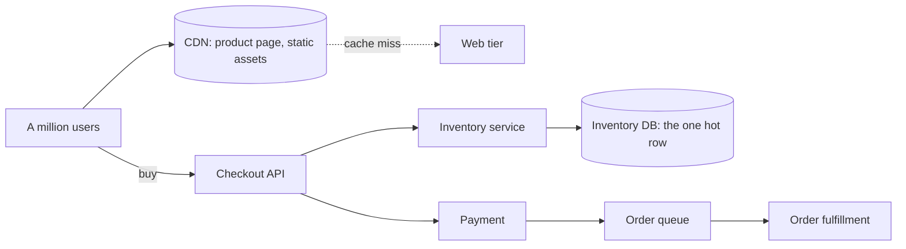

A flash sale (a drop, a launch, a lightning deal) is the most concentrated
stress test in ordinary product engineering: a product page goes from 50
views per second to a million in the minute the sale opens, and the system
must do three things at once, **serve the page fast, refuse most of the
people politely, and never sell more inventory than exists.** Each of
those is a different problem with a different tool, and the design's
quality is exactly how well it separates them.

## Requirements

**Functional**

- Product pages: browse, view, and (the hard part) a checkout that
  decrements inventory and takes payment.
- A flash sale: a fixed quantity of a hot product released at a known
  time.
- Cart, order history, and payment.

**Non-functional**

- **Absorb the spike**: the landing page is effectively static for the
  duration of the sale, and it must be served without the backend knowing
  the sale exists.
- **Inventory is the correctness core**: never oversell. It is
  *acceptable* to undersell (show "sold out" slightly early) and it is a
  catastrophe to oversell.
- **Graceful degradation**: the sale keeps taking orders in a degraded
  mode (no recommendations, no reviews) if supporting services fail.
- **Checkout latency matters but page latency matters more**: most of
  the traffic will never reach checkout.

## The architecture: three layers, three problems

**The page layer: make the spike someone else's problem.** A flash-sale
product page is the same bytes for every viewer for the duration of the
sale, which means it is a CDN object: serve it from the
[edge](/system-design/fundamentals/cdn), cache it hard, and let the origin
see essentially nothing. The genuinely per-user parts (cart badge, session)
are small, lazy-loaded endpoints, so the page is "static shell + one or
two tiny dynamic calls", and that shell is what survives the spike. The
pre-warm is deliberate: push the page to the edge *before* the sale opens,
because the first user of a cache miss at million-user scale is a
stampede.

**The checkout layer: admission control.** A million concurrent buyers
against an inventory service is a denial-of-service attack you are
running against yourself, so the design's second decision is an explicit
**admission policy**: a queue, or token issuance, or simply rate limiting
per user, so that the backend processes buyers at a rate it can survive
and everyone else waits or is told to come back. A short "virtual queue"
(waiting room, queue-it style) is the honest product answer: it converts
a thundering herd into a controlled line, and it is worth saying that
this is [rate limiting](/system-design/fundamentals/rate-limiting)
applied to a purchase, not just to API abuse.

**The inventory layer: the one hot row.** The correctness core is a
single row (product X, quantity N) that a million processes want to
decrement at once, and this is the part with actual depth. The naive
version, `SELECT quantity, then UPDATE`, oversells under concurrency
(two buyers both read 1, both buy). The standard answers:

- **Pessimistic locking**: `SELECT ... FOR UPDATE`, one buyer at a time.
  Correct, and serializes the entire sale through one lock, which at
  million-scale is a throughput disaster.
- **Optimistic decrement**: `UPDATE inventory SET quantity = quantity - 1
  WHERE product_id = X AND quantity > 0`, and the rowcount says whether
  you won. Correct, and the losers fail fast without a round trip of
  contention: this is the standard answer, and it pushes the serialization
  into the database row lock, which is what databases are built for.
- **Move the counter out of the database**: an [atomic counter](/system-design/fundamentals/caching)
  in Redis (`DECR`), or pre-generated tokens in a queue (each buyer draws
  a token; empty queue = sold out), so the database never sees the
  million-decrement storm at all. The tokens approach is the cleanest:
  the quantity becomes N entries in a
  [queue](/system-design/fundamentals/message-queues-and-pubsub), the
  database is updated once by a single consumer, and "never oversell" is
  structural rather than enforced.

Whatever holds the counter, the surrounding design must make the
decrement **reservable then confirmed**: hold the unit while payment
runs, release it if payment fails (with a TTL on the hold, so a crashed
checkout does not hold inventory forever). That hold/confirm dance, and
its TTL, is where the oversell bugs live.

**The order side: asynchronous and idempotent.** After the decrement,
the order is fulfillment work, not a checkout-blocking path: charge, then
publish "order created" to a
[queue](/system-design/fundamentals/message-queues-and-pubsub), and let
shipping, email, and analytics consume at their own pace. Every step is
[idempotent](/system-design/fundamentals/idempotency-and-exactly-once)
because retries after a payment timeout are the *normal* case here, not
the exception, and the
[outbox](/system-design/fundamentals/distributed-transactions) pattern
is what keeps "charged but no order row" from happening.

## The hard parts

**The sold-out cliff.** When inventory hits zero, the traffic does not
stop: it gets worse (refresh storms), and now the system must serve
"sold out" to a million people. That answer must be cached at the edge
too, *before* the database sees the storm, which is the design's best
trick: publish the sell-out state as a cacheable fact the moment it
happens.

**The refresh storm before the sale.** Ten million users refreshing from
09:59:00 is most of the spike, before a single sale happens, and the
answer is the page layer doing its job (edge-cached static shell with a
client-side countdown), which is why this problem is 60% CDN engineering.

**Bots.** Any scarce-drop system has professional buyers with scripts,
so the queue/admission layer needs rate limits per account and per
device, and a captcha step at the front of the queue, which is
[rate limiting](/system-design/fundamentals/rate-limiting) doing product
work again.

## Capacity sketch

The arithmetic that shapes everything: 1M concurrent users, ~100k
checkouts/second attempted, ~10k winning, inventory 10,000 units. The
page tier must handle the full million (edge: yes, origin: no); the
inventory tier must handle 100k attempts (Redis/queue: yes, database:
only behind admission control); the order tier handles 10k real orders,
which is ordinary. Three workloads, three different sizes, and the
design's job is keeping each tier from seeing the others' traffic.

## Related concepts

- [Rate Limiting](/system-design/fundamentals/rate-limiting) is the
  admission-control and anti-bot layer.
- [Caching](/system-design/fundamentals/caching) and
  [Content Delivery Networks](/system-design/fundamentals/cdn) carry the
  page and sell-out states through the spike.
- [Idempotency & Exactly-Once Delivery](/system-design/fundamentals/idempotency-and-exactly-once)
  makes checkout retries safe.
- [Message Queues & Pub/Sub](/system-design/fundamentals/message-queues-and-pubsub)
  is the post-purchase path and the token queue for inventory.
- [Design a Movie Ticket Booking](/system-design/lld/movie-ticket-booking)
  is the same hold/confirm inventory problem at code level.
